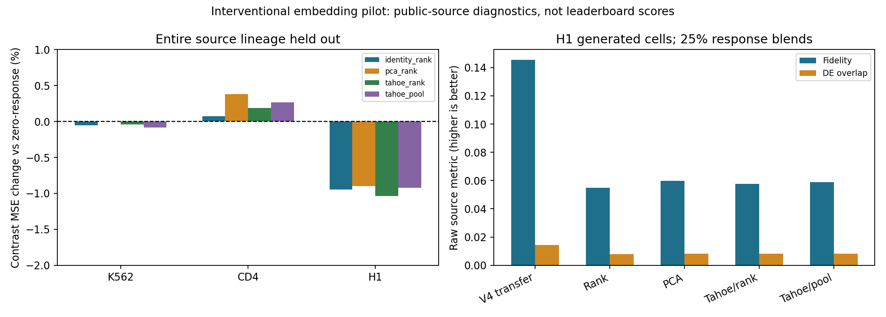

# Interventional embedding response pilot

This pilot implemented the idea recommended in `CROSS_MODAL_MODEL_REVIEW.md`: use frozen biological gene priors plus control-derived context features to predict measured CRISPRi responses. It trained small masked kernel-ridge heads, evaluated whole-lineage and whole-target holdouts, and tested the resulting priors through V4's count generator.

**Decision: retain V4.** None of the tested priors met the adoption criteria. No new upload package was generated. This conclusion concerns these small response heads and cached RNA-only embeddings; it does not rule out a properly trained cross-modal model with more interventional data.

## Inputs and source preparation

The training set contains 889 target/context contrasts spanning 284 unique panel targets:

| context | contrasts | unique_targets |
| --- | --- | --- |
| CD4_Rest | 194 | 194 |
| CD4_Stim48hr | 204 | 204 |
| CD4_Stim8hr | 206 | 206 |
| H1 | 25 | 25 |
| K562 | 260 | 260 |

- K562: the existing Replogle raw pseudobulk source; aggregate effective constructs (at least 30 cells, source knockdown at least 50%), sum duplicate symbols, estimate clipped log2 response and Poisson noise. Regression labels subtract 1.96 noise standard errors. Normal-approximation K562 calls are diagnostics, not observed cell-level DE calls.
- CD4: quality-filtered merged donor response summaries, retaining Rest/Stim8hr/Stim48hr. Use source log2 fold changes, standard errors and adjusted p-values. Fixed regression-label shrinkage is `0.04 / (0.04 + SE^2)` as in the previous model. A CD4 holdout excludes all three conditions together.
- H1: the existing 25-target raw-cell contrast cache, using full public response summaries only when H1 is a training lineage. Labels apply the previous `0.7 * sign(LFC) * max(abs(LFC)-SE, 0)` rule. All H1 response rows are removed when testing H1 transfer.

Source hashes, masks, row identities and selected group sizes are recorded. This is a selected public development panel, not an unbiased sample of the challenge distribution. The public data were previously inspected. Some merged source summaries share targets/donors; lineage-level exclusions prevent them crossing the lineage test boundary.

## Models

All four models use the same output masks, family-balanced regression loss and fixed ridge penalty **10**. There was no outcome-based penalty or blend search. Training response means are clipped to +/-3 log2 units. A separate solve for each observation-mask pattern excludes unavailable labels; a missing response is never treated as measured zero. Unavailable response/error values are masked per row. H1 output coverage is selected using non-targeting control CPM >5, without consulting test-target responses.

The kernel combines a same-intervention indicator, a weak global intercept, an optional gene-vector similarity and a control-context similarity. Gene-vector centering/scaling uses distinct training targets only. A radial-basis context kernel modulates intervention similarity; a shared context component permits conservative transfer.

| Variant | Intervention prior | Context features |
|---|---|---|
| `identity_rank` | Known target identity; no pretrained vectors | Pairwise-valid Spearman similarities to training controls |
| `pca_rank` | Cached 15-dimensional DepMap PCA gene vectors | Same rank features |
| `tahoe_rank` | Cached 512-dimensional RNA-only Tahoe gene vectors | Same rank features |
| `tahoe_pool` | Same Tahoe gene vectors | Engineered rank-weighted pooling of gene vectors from controls |

Context rank correlations remove nonfinite pairs before ranking, retain observed RNA zeros and use average ranks for ties. No pseudocount is added to the rank features. Missing gene embeddings explicitly remove that gene's embedding contribution, preserving its identity/global fallback. Engineered pooling is an exploratory feature; it is not the unavailable Trove cell encoder.

All 300 panel genes are excluded as fitted output columns. They retain the baseline response when count blends are evaluated; target identity remains an input feature. This avoids own-target leakage and focuses the pilot on downstream genes. Counts and metrics still use the complete H1 gene axis, with the own target excluded from direction/expression metrics and all panel targets excluded from discrimination.

## Validation design

Six outer splits were evaluated: three entire-lineage holdouts (K562, CD4, H1) and three target-group folds. Every target response is absent across all contexts in a target holdout. Every response from the held-out lineage is absent in a lineage holdout. Unperturbed test-context controls are allowed as query features. No query uses a measured treated expression profile.

The summary contrast evaluation uses identical gene universes for all representations in a split, source-provided standard errors and a normal/BH call approximation. It reports proxy fidelity/overlap, not official scoring. Empty-DE rows can receive overlap 1, so average proxy overlap must be read alongside the call counts. K562, CD4 and H1 have different uncertainty/calibration conventions; their diagnostics are reported separately.

The independent validator checks all 7,112 contrast records, exact hashes, source masks and fold boundaries. During verification, condition-wide missingness selection was replaced with controls-only coverage and per-row masks to protect target folds. The H1-held-lineage prediction cache remained byte-for-byte identical; `mask_boundary_verification.json` records that equality, so its completed cell evaluation was reused. Four focused tests check missing-label exclusion, observed-zero rank semantics, train/query separation and unsupported output handling.

## Whole-lineage contrast results

| family | variant | mse_ratio_to_zero | sign_accuracy_reference_DE | fidelity_proxy | jaccard_proxy |
| --- | --- | --- | --- | --- | --- |
| CD4 | identity_rank | 1.000738 | 0.583982 | 0.014939 | 0.267002 |
| CD4 | pca_rank | 1.003838 | 0.558052 | 0.029236 | 0.240564 |
| CD4 | tahoe_pool | 1.002652 | 0.551043 | 0.026750 | 0.263004 |
| CD4 | tahoe_rank | 1.001876 | 0.569358 | 0.022033 | 0.264777 |
| H1 | identity_rank | 0.990512 | 0.617606 | 0.000020 | 0.000020 |
| H1 | pca_rank | 0.991046 | 0.591946 | 0.000020 | 0.000020 |
| H1 | tahoe_pool | 0.990801 | 0.596439 | 0.000036 | 0.000049 |
| H1 | tahoe_rank | 0.989640 | 0.594312 | 0.000020 | 0.000020 |
| K562 | identity_rank | 0.999450 | 0.550231 | 0.000133 | 0.000133 |
| K562 | pca_rank | 1.000016 | 0.539267 | 0.001422 | 0.001041 |
| K562 | tahoe_pool | 0.999185 | 0.548543 | 0.000037 | 0.000037 |
| K562 | tahoe_rank | 0.999590 | 0.551281 | 0.000778 | 0.000413 |

The heads largely predict weak responses. On H1, Tahoe/rank has slightly lower MSE than the rank-only head, but worse sign agreement on the measured DE subset. Neither Tahoe representation improves error and DE diagnostics consistently across all three held-out lineages. Small error changes around the zero-response baseline therefore do not justify adoption.

## Generated-cell evaluation

Evaluated 9 H1 target groups with at least 200 actual cells in both batch partitions. Each comparison uses up to 400 distinct target/template cells, two seeds and two partitions. Non-targeting template and reference controls are disjoint by source cell ID. All five candidates use exactly the same actual cells, template rows, random seed, 90% direct knockdown and V4 zero-aware binomial/Poisson generator.

The baseline is the frozen V4 **cross-lineage transfer** formula `0.5 * CD4_specific_C + 1.0 * K562`. ALL H1 direct and shared-prior components are removed. The CD4 condition mixture is V4's C mixture; it is a fixed development comparator, not a claim that H1 is context C. These transfer coefficients were previously calibrated with H1 development data. The head holdout is strict, but the experiment as a whole is not a fresh blind benchmark. It does not reproduce or estimate the exact published A/B/C V4 artifact.

Each head supplies a fixed 25% replacement of the baseline response on supported non-panel coordinates; unsupported coordinates and panel outputs retain the baseline. Query-control CPM expression gates are applied consistently after blending. Response signs may change and previously zero coordinates may become nonzero: these are tested rather than automatically protected.

Actual generated cells are evaluated with Wilcoxon/BH rank-DE, direction fidelity, reach, DE overlap, log-FC error, panel discrimination, expression correction, detection and dispersion. These are raw, unanchored public-source metrics, not leaderboard-normalized values. The expression ratio is a source-panel capped-jackknife ratio; it has no competition anchor set.

| Candidate | Fidelity | DE overlap | Expression ratio | PDS | Profile MSE | Variance / template |
| --- | --- | --- | --- | --- | --- | --- |
| v4_transfer | 0.145431 | 0.014226 | 1.276690 | 0.590278 | 0.001740 | 0.995318 |
| identity_rank | 0.054983 | 0.007838 | 1.283253 | 0.562500 | 0.001704 | 0.996082 |
| pca_rank | 0.059872 | 0.008261 | 1.283356 | 0.562500 | 0.001705 | 0.996154 |
| tahoe_rank | 0.057594 | 0.008027 | 1.283540 | 0.562500 | 0.001706 | 0.996132 |
| tahoe_pool | 0.058971 | 0.008092 | 1.284030 | 0.562500 | 0.001708 | 0.996236 |

Paired bootstrap intervals resample the 9 target groups (2,000 draws), averaging seeds/partitions within a target. This captures target-to-target variation within this selected panel, not uncertainty across unseen contexts. The adoption gate requires consistent source-summary behavior plus supported fidelity, overlap and expression improvements, preserved discrimination and at least 90% of baseline dispersion. Detailed intervals and every failed guard are in `adoption_decision.json`.

The blends reduce uncorrected profile error but worsen the corrected expression ratio, DE fidelity, overlap and discrimination. For Tahoe/rank, fidelity falls from 0.145431 to 0.057594 and overlap from 0.014226 to 0.008027; their paired bootstrap difference intervals are entirely negative. The expression ratio rises from 1.276690 to 1.283540. Cell variance remains close to the baseline, but the expression correction factor falls from about 0.387 to 0.271 as between-target profile spread shrinks. Less noise correction offsets the small uncorrected-MSE improvement. This repeats the earlier lesson: smoothing an intervention toward a generic weak response can improve average expression error while removing correctly directed significant changes. Retaining cell-template variance alone is insufficient; response strength and sign agreement also matter.



## Reproduce

From Windows Command Prompt in the root folder:

```bat
cd /d L:\promec\Animesh\Download\Virtual
.\.competition_env\Scripts\python.exe -m unittest test_embedding_response -v
.\.competition_env\Scripts\python.exe train_embedding_response.py
.\.competition_env\Scripts\python.exe evaluate_embedding_response.py
.\.competition_env\Scripts\python.exe validate_embedding_response.py
.\.competition_env\Scripts\python.exe document_embedding_response.py
```

`train_embedding_response.py --reuse-cache` reruns fitting from the verified local cache. All code is in the root. Small CSV/JSON evaluation/provenance files and the figure are tracked; numerical `.npz` caches are ignored and regenerable. No protein checkpoint or training dataset was downloaded, and no competition API submission was made.

The next useful change should address response transfer rather than only reconstruction error: additional context-matched measured perturbations, a response model with stronger interventional conditioning, or a released cross-modal encoder tested with the same controlled generator. This fixed-ridge pilot is a limited model family; lower penalties or other heads remain possible research experiments, not established improvements.
