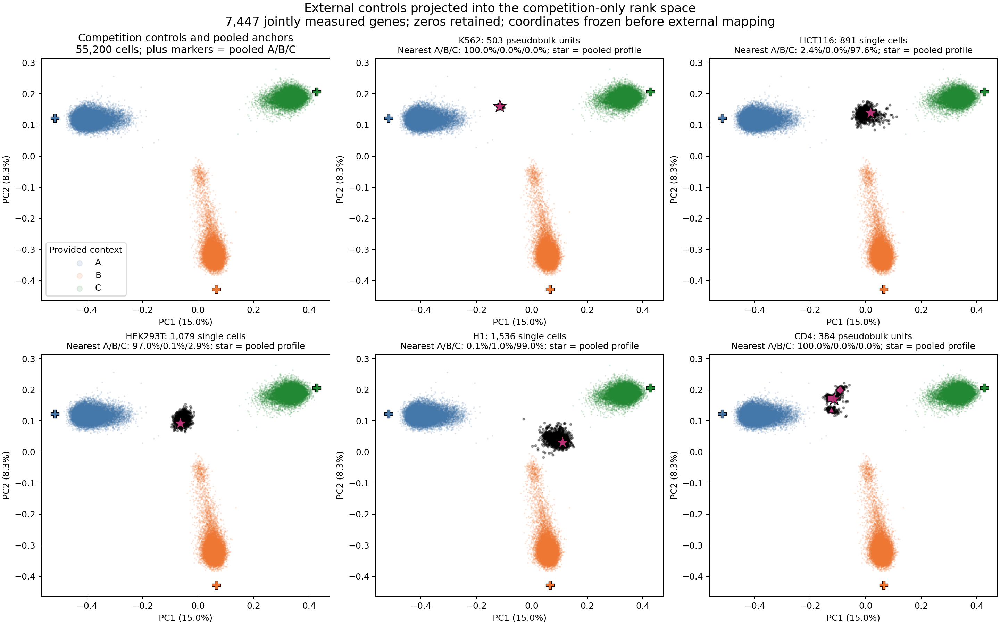
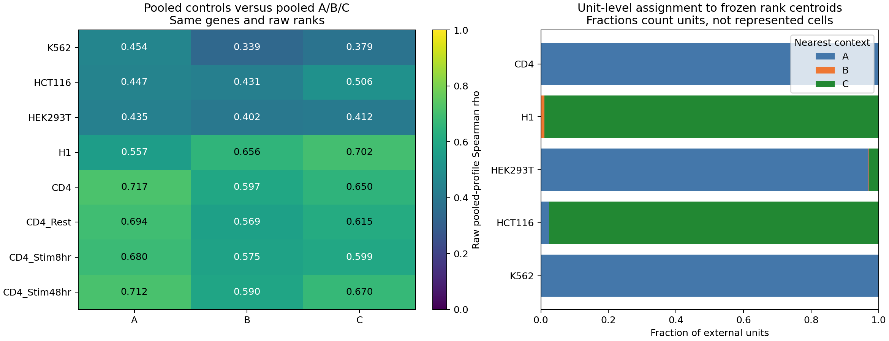

# External controls in the A/B/C rank space

A joint, comparable space uses the **7,447 genes measured by all five references and A/B/C**. No missing genes were zero-filled. The original 18,533-gene coordinates cannot be projected exactly when external genes are unmeasured. All 55,200 competition cells were reranked on the common axis, then the cluster centroids and eight-component PCA were frozen before external mapping.

The competition-only shared-axis clustering has context ARI **1.000000**, and independent-seed repeat ARI **1.000000**. The external references do not influence the fit.

## Where external control units map

| reference | units | unit_kind | fraction_A | fraction_B | fraction_C | median_similarity_margin | outside_all_pc8_fraction |
| --- | --- | --- | --- | --- | --- | --- | --- |
| K562 | 503 | pseudobulk_reconstructed_sum | 1.0000 | 0.0000 | 0.0000 | 0.0782 | 1.0000 |
| HCT116 | 891 | single_cell | 0.0236 | 0.0000 | 0.9764 | 0.0268 | 1.0000 |
| HEK293T | 1079 | single_cell | 0.9703 | 0.0009 | 0.0287 | 0.0236 | 1.0000 |
| H1 | 1536 | single_cell | 0.0007 | 0.0098 | 0.9896 | 0.0278 | 1.0000 |
| CD4 | 384 | pseudobulk_sum | 1.0000 | 0.0000 | 0.0000 | 0.0828 | 1.0000 |

Fractions count external observations. HCT116, HEK293T and H1 observations are single cells. K562 observations are reconstructed pseudobulk groups; CD4 observations are raw pseudobulk sums. Their 75,094 and 34,620 represented cells are not available as separate cell rows in these releases. Assignments mean closest among A/B/C; they are not known cell identities or calibrated probabilities.

## Pooled-reference comparison

| profile_name | nearest_context | nearest_pooled_context | pooled_profile_spearman_A | pooled_profile_spearman_B | pooled_profile_spearman_C |
| --- | --- | --- | --- | --- | --- |
| K562 | A | A | 0.4543 | 0.3389 | 0.3794 |
| HCT116 | C | C | 0.4474 | 0.4313 | 0.5061 |
| HEK293T | A | A | 0.4345 | 0.4016 | 0.4125 |
| H1 | C | C | 0.5575 | 0.6558 | 0.7019 |
| CD4 | A | A | 0.7170 | 0.5971 | 0.6504 |
| CD4_Rest | A | A | 0.6939 | 0.5685 | 0.6148 |
| CD4_Stim8hr | A | A | 0.6804 | 0.5752 | 0.5995 |
| CD4_Stim48hr | A | A | 0.7120 | 0.5897 | 0.6705 |

`nearest_context` uses the frozen unit centroid on rank features. `nearest_pooled_context` independently compares raw pooled expression profiles with raw pooled A/B/C profiles using ordinary Spearman rho. Pooling and single-cell rank averaging are different operations, so they can disagree.

## CD4 condition sensitivity

| reference | stratum | units | fraction_A | fraction_B | fraction_C | median_similarity_margin | outside_all_pc8_fraction |
| --- | --- | --- | --- | --- | --- | --- | --- |
| CD4 | Rest | 128 | 1.0000 | 0.0000 | 0.0000 | 0.0912 | 1.0000 |
| CD4 | Stim48hr | 128 | 1.0000 | 0.0000 | 0.0000 | 0.0570 | 1.0000 |
| CD4 | Stim8hr | 128 | 1.0000 | 0.0000 | 0.0000 | 0.0916 | 1.0000 |

## Interpretation and distribution shift

The plot retains external positions even when they lie outside all competition clouds. Eight-PC Mahalanobis distances are compared with the empirical 95th percentile of the assigned competition context. The report also compares each external observation with all three PC clouds; `outside_all_pc8_fraction` flags those beyond every empirical 95th-percentile region. These fractions are diagnostics of displacement from supplied controls; it is not a biological identity test. Pseudobulks have much greater count depth than individual competition cells and can be displaced simply by pooling, while batch/platform/state differences add further shifts.

Row-level files include each external unit, its guide/batch/condition metadata, three rank-centroid similarities, three exact mean Spearman correlations to every competition context, margins, PCs and distribution-shift flags. All comparisons preserve measured zeros, use average tied ranks, and use no pseudocounts, logs, CPM or gene imputation.

See [EXTERNAL_RANK_MAPPING.md](EXTERNAL_RANK_MAPPING.md) for reproduction, provenance and verification.
