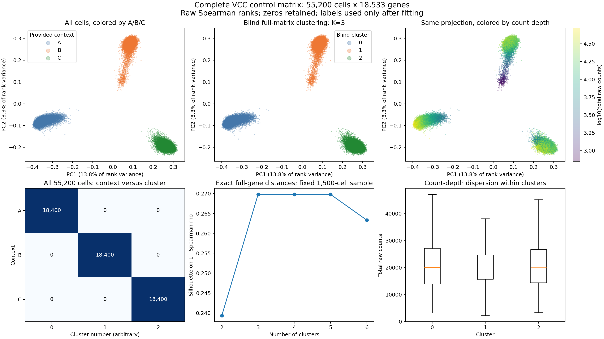

# Complete-matrix rank clustering results

All 55,200 supplied non-targeting cells and all 18,533 measured genes were clustered together. A/B/C labels were withheld from fitting. Cluster numbers are arbitrary.

## Three-cluster composition

| context | cluster | cells | within_context_fraction | within_cluster_fraction |
| --- | --- | --- | --- | --- |
| A | 0 | 18400 | 1.0000 | 1.0000 |
| A | 1 | 0 | 0.0000 | 0.0000 |
| A | 2 | 0 | 0.0000 | 0.0000 |
| B | 0 | 0 | 0.0000 | 0.0000 |
| B | 1 | 18400 | 1.0000 | 1.0000 |
| B | 2 | 0 | 0.0000 | 0.0000 |
| C | 0 | 0 | 0.0000 | 0.0000 |
| C | 1 | 0 | 0.0000 | 0.0000 |
| C | 2 | 18400 | 1.0000 | 1.0000 |

Both independent K=3 fits assign every A cell to one pure cluster, every B cell to another, and every C cell to a third: **no context mixing among any of the 55,200 cells**. ARI, NMI and purity are all 1.0.

## Number-of-clusters sensitivity

| k | repeat | sample_silhouette_spearman | context_ARI | context_purity | min_cluster_cells | singleton_clusters | sample_clusters_represented |
| --- | --- | --- | --- | --- | --- | --- | --- |
| 2 | 0 | 0.2393 | 0.5714 | 0.6667 | 18400 | 0 | 2 |
| 3 | 0 | 0.2698 | 1.0000 | 1.0000 | 18400 | 0 | 3 |
| 4 | 0 | 0.2698 | 1.0000 | 1.0000 | 1 | 1 | 3 |
| 5 | 0 | 0.2698 | 0.9999 | 1.0000 | 1 | 2 | 3 |
| 6 | 0 | 0.2633 | 0.9737 | 1.0000 | 1 | 2 | 4 |
| 3 | 1 | 0.2698 | 1.0000 | 1.0000 | 18400 | 0 | 3 |

Three-cluster repeat ARI: **1.000000**. The largest sampled silhouette among K=2..6 first occurred at K=3 (ties resolved toward smaller K). The silhouette of the supplied context labels on the same sample was 0.269772. This finite candidate range does not establish the true number of biological cell states.

Higher-K singleton counts and the number of clusters represented in the silhouette sample are shown above. Omitted singleton clusters can make different full partitions receive identical sampled silhouettes. The complete nonzero composition is below; higher-K splits and local optima need further study before biological interpretation.

| fit | context | cluster | cells |
| --- | --- | --- | --- |
| k2_repeat0 | A | 1 | 18400 |
| k2_repeat0 | B | 0 | 18400 |
| k2_repeat0 | C | 0 | 18400 |
| k3_repeat0 | A | 0 | 18400 |
| k3_repeat0 | B | 1 | 18400 |
| k3_repeat0 | C | 2 | 18400 |
| k4_repeat0 | A | 0 | 18400 |
| k4_repeat0 | B | 2 | 18400 |
| k4_repeat0 | C | 1 | 18399 |
| k4_repeat0 | C | 3 | 1 |
| k5_repeat0 | A | 1 | 1 |
| k5_repeat0 | A | 3 | 1 |
| k5_repeat0 | A | 4 | 18398 |
| k5_repeat0 | B | 2 | 18400 |
| k5_repeat0 | C | 0 | 18400 |
| k6_repeat0 | A | 3 | 18400 |
| k6_repeat0 | B | 0 | 1013 |
| k6_repeat0 | B | 4 | 17386 |
| k6_repeat0 | B | 5 | 1 |
| k6_repeat0 | C | 1 | 1 |
| k6_repeat0 | C | 2 | 18399 |
| k3_repeat1 | A | 1 | 18400 |
| k3_repeat1 | B | 2 | 18400 |
| k3_repeat1 | C | 0 | 18400 |

## Within-context dispersion

| context | feature | mean | sd | p05 | median | p95 |
| --- | --- | --- | --- | --- | --- | --- |
| A | total_counts | 21133.5358 | 9704.9852 | 6845.9000 | 20109.0000 | 38877.4500 |
| A | detected_genes | 5973.3955 | 1185.5449 | 3634.0000 | 6147.0000 | 7619.0000 |
| A | own_cluster_centroid_rho | 0.7973 | 0.0704 | 0.6515 | 0.8142 | 0.8800 |
| A | cluster_centroid_rho_margin | 0.1926 | 0.0181 | 0.1569 | 0.1957 | 0.2170 |
| B | total_counts | 19989.9399 | 7701.2546 | 5328.9000 | 19946.0000 | 32951.2000 |
| B | detected_genes | 5518.8466 | 1189.4103 | 2920.0000 | 5756.0000 | 6839.0000 |
| B | own_cluster_centroid_rho | 0.7931 | 0.0916 | 0.6240 | 0.8167 | 0.8596 |
| B | cluster_centroid_rho_margin | 0.1550 | 0.0162 | 0.1287 | 0.1584 | 0.1695 |
| C | total_counts | 21156.5363 | 9256.4414 | 7614.9000 | 20034.0000 | 38596.5500 |
| C | detected_genes | 5881.1947 | 1144.3794 | 3718.0000 | 6006.0000 | 7549.0500 |
| C | own_cluster_centroid_rho | 0.7937 | 0.0610 | 0.6697 | 0.8066 | 0.8677 |
| C | cluster_centroid_rho_margin | 0.1551 | 0.0110 | 0.1362 | 0.1558 | 0.1716 |

Count-depth distributions and cluster composition within depth quintiles and guides are recorded. When all cells have context-pure assignments, that purity necessarily persists in each stratum. The projection also shows depth gradients within contexts; neither clustering nor similar count depths removes dropout or establishes exclusively biological separation.

## Exact mean correlations to all context peers

| context | peer_context | mean_full_gene_spearman |
| --- | --- | --- |
| A | A | 0.6356 |
| B | A | 0.4796 |
| C | A | 0.4436 |
| A | B | 0.4796 |
| B | B | 0.6290 |
| C | B | 0.5065 |
| A | C | 0.4436 |
| B | C | 0.5065 |
| C | C | 0.6299 |

Every peer is included; self-pairs are excluded. This calculation uses full-gene dot products of unit rank vectors and group sums, without sampling or a dense 55,200-square matrix.

## Depth and guide diagnostics

| context | PC | feature | spearman_rho |
| --- | --- | --- | --- |
| A | 1 | total_counts | -0.8904 |
| A | 1 | detected_genes | -0.8801 |
| A | 2 | total_counts | -0.5161 |
| A | 2 | detected_genes | -0.5025 |
| B | 1 | total_counts | 0.0015 |
| B | 1 | detected_genes | -0.0336 |
| B | 2 | total_counts | 0.4645 |
| B | 2 | detected_genes | 0.4618 |
| C | 1 | total_counts | -0.0989 |
| C | 1 | detected_genes | -0.1089 |
| C | 2 | total_counts | -0.2815 |
| C | 2 | detected_genes | -0.2464 |

Within-context guide/cluster NMI: A: 0.000000, B: 0.000000, C: 0.000000. See depth-quintile and guide composition CSVs for all cells. PC axes describe only a projection, and count-depth correlations do not establish causation.

These data contain only supplied non-targeting controls. Context separation can include biological and batch differences; it cannot identify the anonymous cell types or validate CRISPRi responses.

Reproduction, methods and validation: [FULL_RANK_CLUSTERING.md](FULL_RANK_CLUSTERING.md).
