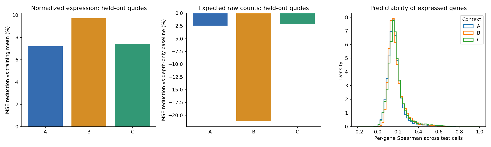
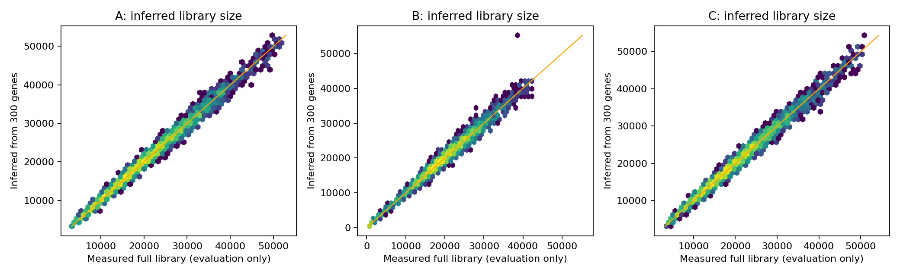

# Separate A/B/C models: first results

Three models were fitted using only the 300 measured input genes to predict the other 18,233 genes. Each evaluation uses 2,800 cells from seven guide groups withheld from model fitting and selection. The selected models were subsequently refitted on all controls for saved full-cell reconstructions.

| Context | Selected features | Alpha | Normalized MSE reduction vs mean | Raw MSE reduction vs depth baseline | Median gene rank correlation | Library median relative error |
|---|---|---:|---:|---:|---:|---:|
| A | magnitude | 1 | 7.20% | -2.46% | 0.154 | 3.40% |
| B | hybrid | 1 | 9.70% | -21.16% | 0.157 | 3.84% |
| C | magnitude | 1 | 7.40% | -2.12% | 0.160 | 3.80% |

Normalized MSE and gene rank correlations above use output genes with training mean CPM at least 5. Raw-count error includes all 18,233 outputs. Negative skill means the indicated baseline performs better. The reported raw-count conversion uses an inferred full-library total and residual smearing; the normalized expression result therefore cannot be treated as an equivalent gain in raw-count accuracy.

| Context | Expressed outputs | Raw MSE | Raw MSE reduction vs constant mean | Median cell profile correlation | Mean-profile baseline correlation | All-output normalized MSE reduction |
|---|---:|---:|---:|---:|---:|---:|
| A | 9,630 | 4.361 | 30.96% | 0.752 | 0.749 | 6.99% |
| B | 9,336 | 4.715 | 15.23% | 0.739 | 0.737 | 9.35% |
| C | 9,826 | 4.361 | 28.48% | 0.742 | 0.737 | 7.15% |

A high correlation between the genes within a cell can partly reflect the shared ordering of abundant genes. The mean-profile baseline makes this visible. Per-gene correlations across cells and baseline-relative normalized error are more informative about the cell-specific signal.

## Feature comparison on validation cells

| Context | Family | Best alpha | Validation normalized MSE reduction vs mean |
|---|---|---:|---:|
| A | hybrid | 1 | 7.07% |
| A | magnitude | 1 | 7.28% |
| A | rank | 1 | 6.99% |
| B | hybrid | 1 | 9.58% |
| B | magnitude | 1 | 9.52% |
| B | rank | 1 | 9.30% |
| C | hybrid | 1 | 7.24% |
| C | magnitude | 1 | 7.42% |
| C | rank | 1 | 6.95% |

These comparisons chose the model settings before the test evaluation. The full 36-candidate table is `analysis/gene300_models/candidate_scores.csv`.

## Most predictable measured outputs

The following genes have the highest held-out normalized-expression skill among outputs with training mean CPM at least 5 and mean raw counts at least 0.25. This is a descriptive test result, not a feature-selection step.

- **A:** PLK1 (43.7%), TYMS (41.6%), KIF20A (40.5%), ENO1 (40.2%), PIF1 (40.1%), AURKB (39.8%), HIST1H1B (38.7%), HJURP (38.6%), PCNA (38.2%), DLGAP5 (37.6%).
- **B:** HACD3 (46.3%), PSMB2 (44.2%), VMA21 (44.1%), KIF20A (42.6%), FAM111B (42.4%), BRIX1 (41.9%), EMC7 (41.8%), NME1 (41.7%), RRM1 (41.4%), FBXO7 (40.5%).
- **C:** ASF1B (40.9%), B4GALT5 (39.0%), CCNA2 (37.9%), KIFC1 (37.4%), TACC3 (37.2%), ZWINT (37.1%), NCAPG (37.1%), SPC25 (37.0%), CDK1 (36.3%), NUF2 (36.2%).

The complete output-gene metrics and a 20-gene-per-context export are provided in `per_gene_test_metrics.csv` and `most_predictable_genes.csv`.

## Where raw-count conversion loses accuracy

The largest additional raw-count errors against the depth-only baseline occur in the following output genes. Many still show positive normalized-expression skill; optimizing log-CPM therefore does not ensure that their back-transformed expected counts minimize raw-count error.

| Context | Largest excess raw-count error genes |
|---|---|
| A | TMSB4X, ARHGDIB, PFN1, TRBC1, OAZ1 |
| B | S100A6, EEF2, TMSB4X, ANXA2, B2M |
| C | ACTB, B2M, EEF2, EEF1G, SCD |

Exact per-gene error differences are saved in `raw_count_conversion_diagnostics.csv`.

## What this first model establishes

There is measurable predictive association between the 300-gene panel and other genes in held-out control cells. Much of single-cell variation remains unpredictable from this small panel. Library estimation and normalized-expression prediction are evaluated separately because depth alone can account for substantial raw-count variation.

For any context with negative raw-count skill, the depth-only baseline is the stronger raw-count predictor on this test. The next modeling comparison should train a raw-count objective directly and test whether nonlinear features capture additional cell-state structure. Any future comparison needs its own prespecified evaluation rather than choosing settings from the current test table.

These data contain controls, not observed responses to the 300 CRISPRi interventions. This experiment does not create a new leaderboard submission or establish causal knockdown responses.

## Verification and reproduction

Seven focused tests passed. Independent validation checked all source and artifact hashes, all split assignments, all saved cell and gene identities, feature statistics, 24 output genes per model using an independent normal-equation solve, and all depth coefficients. Every held-out prediction was replayed and every output-gene raw/log-CPM MSE was recomputed. All full reconstruction values were scanned for finite nonnegative values and count conservation, with 24 full-fit rows per context replayed across every output gene. See `analysis/gene300_models/validation.json` for the exact coverage.

Models and H5AD files are saved locally; source code, documentation and small result tables are versioned. See [GENE300_MODELS.md](GENE300_MODELS.md) for every method step, artifact schema and training/inference commands.
