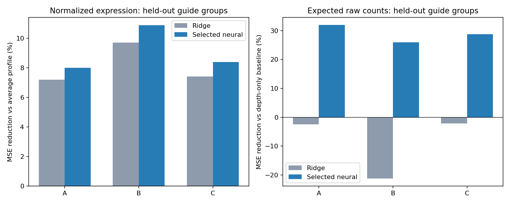
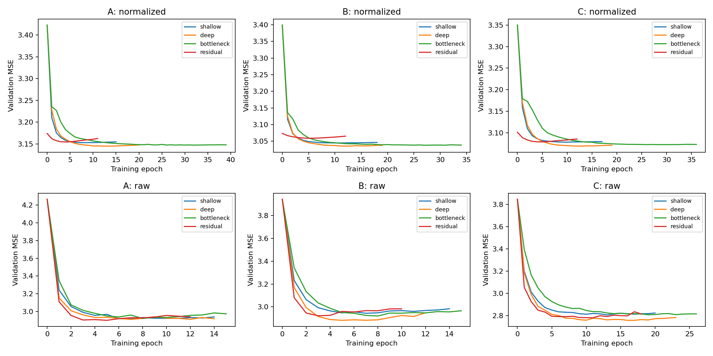

# Neural architecture comparison: measured results

Trained 24 candidate neural networks: four configurations, two output objectives and three cell types. Architecture and stopping epoch were selected on seven held-out validation guide groups. The following scores use the same seven test-guide groups per context as the earlier ridge study.

| Context | Best normalized network | Epoch | Normalized error reduction vs mean | Best raw network | Epoch | Raw error reduction vs depth baseline |
|---|---|---:|---:|---|---:|---:|
| A | deep | 13 | 7.99% | residual | 5 | 31.94% |
| B | deep | 12 | 10.87% | deep | 5 | 25.97% |
| C | deep | 12 | 8.38% | deep | 16 | 28.79% |

Normalized scores use genes with training mean CPM at least 5; raw-count scores use all 18,233 output genes. Positive skill means lower MSE than the stated baseline. Input genes are excluded from both output axes and all errors.

| Context | Ridge normalized reduction vs mean | Neural normalized MSE reduction vs ridge | Ridge raw reduction vs depth baseline | Neural raw MSE reduction vs ridge |
|---|---:|---:|---:|---:|
| A | 7.20% | 0.85% | -2.46% | 33.57% |
| B | 9.70% | 1.30% | -21.16% | 38.90% |
| C | 7.40% | 1.06% | -2.12% | 30.27% |

The raw neural objective compares predicted counts directly with original observed counts. The earlier ridge raw output was obtained by converting a log-CPM model back to counts. The improvement therefore reflects both a neural predictor and a better-matched training objective; it does not isolate a pure architecture effect.

## Every frozen configuration

| Context | Objective | Configuration | Selected epoch | Validation MSE | Test MSE | Test skill vs stated baseline | Chosen on validation |
|---|---|---|---:|---:|---:|---:|---|
| A | normalized | shallow | 8 | 3.1528 | 3.1467 | 7.77% | no |
| A | normalized | deep | 13 | 3.1448 | 3.1393 | 7.99% | yes |
| A | normalized | bottleneck | 32 | 3.1471 | 3.1409 | 7.94% | no |
| A | normalized | residual | 4 | 3.1544 | 3.1484 | 7.72% | no |
| A | raw | shallow | 7 | 2.9164 | 2.9376 | 30.99% | no |
| A | raw | deep | 7 | 2.9106 | 2.9091 | 31.66% | no |
| A | raw | bottleneck | 8 | 2.9214 | 2.9490 | 30.72% | no |
| A | raw | residual | 5 | 2.9008 | 2.8971 | 31.94% | yes |
| B | normalized | shallow | 11 | 3.0445 | 3.0436 | 10.59% | no |
| B | normalized | deep | 12 | 3.0351 | 3.0341 | 10.87% | yes |
| B | normalized | bottleneck | 27 | 3.0378 | 3.0368 | 10.79% | no |
| B | normalized | residual | 5 | 3.0587 | 3.0585 | 10.16% | no |
| B | raw | shallow | 7 | 2.9438 | 2.9685 | 23.72% | no |
| B | raw | deep | 5 | 2.8820 | 2.8808 | 25.97% | yes |
| B | raw | bottleneck | 8 | 2.9200 | 2.9402 | 24.45% | no |
| B | raw | residual | 3 | 2.9219 | 2.9259 | 24.81% | no |
| C | normalized | shallow | 10 | 3.0782 | 3.0533 | 8.11% | no |
| C | normalized | deep | 12 | 3.0690 | 3.0442 | 8.38% | yes |
| C | normalized | bottleneck | 29 | 3.0725 | 3.0483 | 8.26% | no |
| C | normalized | residual | 5 | 3.0789 | 3.0538 | 8.10% | no |
| C | raw | shallow | 13 | 2.8057 | 3.1012 | 27.39% | no |
| C | raw | deep | 16 | 2.7572 | 3.0414 | 28.79% | yes |
| C | raw | bottleneck | 19 | 2.8071 | 3.0995 | 27.43% | no |
| C | raw | residual | 11 | 2.7801 | 3.0688 | 28.15% | no |

The configuration marked chosen minimizes validation MSE. A different configuration can happen to score better on test; that does not change the saved choice. Full epoch histories are in `analysis/gene300_neural/training_history.csv`.

## Predictable output genes

The following output genes have the strongest normalized rank correlation across test cells among genes with training mean CPM at least 5. They were not used to choose models.

- **A:** TOP2A (0.770), PCNA (0.764), MCM6 (0.759), TPX2 (0.759), TYMS (0.755), DLGAP5 (0.749), AURKB (0.744), MCM4 (0.740), HIST1H1B (0.737), PLK1 (0.733).
- **B:** MKI67 (0.698), BIRC5 (0.688), WDR76 (0.682), FAM111B (0.682), KIFC1 (0.681), TOP2A (0.679), TPX2 (0.674), CENPF (0.673), TYMS (0.672), KIF20A (0.670).
- **C:** TUBA1B (0.759), ANLN (0.744), CDK1 (0.739), MCM4 (0.734), UBE2T (0.730), IFIT3 (0.729), MAD2L1 (0.725), PLAAT4 (0.725), MCM7 (0.722), MCM2 (0.717).

Rank correlations retain zeros and average ties; undefined constant-vector correlations remain missing. The full selected-model gene/cell error tables include every output gene and test cell.

## Saved and verified work

Saved all candidate checkpoints, six selected evaluation models, six selected all-control models, normalized/raw held-out prediction files, and expected raw-count reconstructions for all 55,200 controls. Full-data reconstructions are in-sample and are not the source of the reported test results.

Five focused tests passed, including independent NumPy prediction checks for every structure/objective. The artifact audit verified all selected source/output hashes, feature statistics, validation-based settings, baseline profiles and source identities; recomputed every selected-model gene/cell MSE and baseline error; scanned every saved output value; and independently replayed 32 rows per evaluation/production model and output file using explicit NumPy network mathematics. Exact coverage is in `analysis/gene300_neural/validation.json`.

All six standalone inference CLI checks also passed using real measured counts and reversed gene-column order. Original cell IDs and output axes were preserved; see `inference_smoke.json`.

The test set was previously reported for ridge, and only one training seed was used per configuration. Small architecture differences need repeated-seed checks. The data contain controls, so these results do not validate causal CRISPRi response predictions or establish a new leaderboard score.

See [GENE300_NEURAL_MODELS.md](GENE300_NEURAL_MODELS.md) for architectures, losses, file units, the verified Windows runtime cache and complete training/inference commands.
