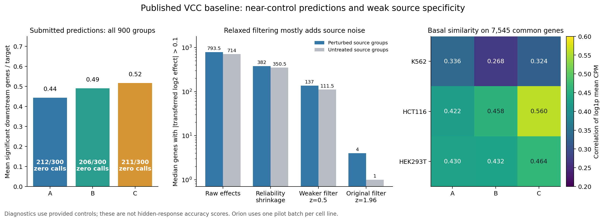

# Step-by-step model audit and improvement work

The published baseline is weak principally because it predicts almost no statistically detectable downstream response. This is consistent with raw leaderboard metrics and a complete audit of the generated cells. The audit has improved the experiment framework and added a candidate simulator, but no better leaderboard score has been established and no second model has been submitted.

The original `prediction.h5ad`, `prediction.vcc`, source cache and first submission record are preserved. The generator used for that submission is retained in Git commit `7ee51fc`; its original code hash remains in `analysis/run_parameters.json`. New code exposes optional experiments while retaining the original defaults.

## 1. Read the actual metric values

The published entry was confirmed using read-only `vcc status --json`. At that query its rank was 1141, compared with 1140 at publication; scores are unchanged. `analysis/model_audit/published_api_status.json` records the response.

| Component | Raw API value | Interpretation |
|---|---:|---|
| Perturbation discrimination | 0.50991453 | Close to the raw no-information value of 0.5 |
| Expression error | 1.02301751 | About the control-pasting error; the scaled score is clamped to zero |
| Fold-change error | 0.99134285 | Only slightly below the raw zero-effect error of 1 |
| Direction-fidelity yield | 0.01757235 | Very few correctly directed significant calls relative to the response budget |
| Direction reach | 0.10902127 | Some directional ranking signal remains |
| Significant-gene Jaccard | 0.00773299 | Very little significant-set agreement |

The zero-score anchor is the mean **perturbed response**, assigned identically to every perturbation. It is not the untreated context mean. Direction fidelity counts correct significant directions divided by the larger of the predicted call count and the real response count. It penalizes silence. Its raw value is not simply the percentage of predicted signs that are correct.

Source: [official scoring definitions](https://github.com/ArcInstitute/cell-eval2/blob/main/docs/vcc2026_metrics/vcc2026-metrics.md). The API does not expose the withheld gene-level response labels or enough detail to count wrong signs separately from missed calls.

## 2. Check the generated cells, not just model coefficients

`audit_prediction.py` normalizes each cell to 1 million counts, applies the control-mean >5 CPM gene filter, runs a two-sided asymptotic Mann-Whitney/Wilcoxon test with tie and continuity correction, and adjusts p-values within each perturbation by Benjamini-Hochberg. The target gene is excluded from reported downstream calls. Its cached rank-test implementation agrees with SciPy on tied, sparse and all-zero synthetic columns.

All 900 submitted target/context groups were inspected against the full provided controls. Overlapping results from the independent C pass agreed exactly with the first pass.

| Context | Targets audited | Mean downstream DE calls | Median | Maximum | Targets with zero calls |
|---|---:|---:|---:|---:|---:|
| A | 300 | 0.4433 | 0 | 5 | 212 |
| B | 300 | 0.4900 | 0 | 7 | 206 |
| C | 300 | 0.5167 | 0 | 6 | 211 |

**629 of 900 groups (69.9%) call nothing downstream.** The other groups still call very few genes. This provides direct evidence of underprediction, rather than attributing the negative fidelity score solely to reversed effects.

These are provided-control diagnostics, not hidden-ground-truth scores. The provided controls can differ from held-out scoring controls, and sampled input cells are included in the diagnostic control pool. This test cannot measure true recall, direction accuracy or the leaderboard's full metrics.

Records: `full_panel_de.csv` and `full_panel_summary.json` under `analysis/model_audit/`.

## 3. Verify source alignment and distinguish signal from noise

An independent calculation of source on-target expression ratios correlated 0.9957 with the author's reported knockdown ratios after log1p transformation. Thus a gross source gene-mapping or target-label error is unlikely.

However, the source has a median of only 176 cells per covered perturbation. Strongly suppressing noise leaves very little downstream signal, while simply relaxing suppression retains large apparent effects in untreated source controls too.

`audit_source_stages.py` reconstructs the original source coefficients (matching the cached coefficients to within 1e-6), and compares 260 covered perturbations with 40 independent groups of non-targeting guide pseudobulks. Null groups have approximately matched cell counts and are compared with the remaining control guides.

Median genes with an absolute transferred log2 effect above 0.1, at transfer strength 0.3:

| Source treatment | Perturbed groups | Untreated/null groups |
|---|---:|---:|
| Raw ratios | 793.5 | 714 |
| Reliability shrinkage only | 382 | 350.5 |
| Weaker soft threshold, z=0.5 | 137 | 111.5 |
| Original soft threshold, z=1.96 | 4 | 1 |

The original mean is about 7.2 such genes per covered target. A smaller threshold produces many more calls but little separation from the null. It is therefore not justified as a biological improvement by this experiment.

Limitations: whole guide profiles, rather than individual cells, are pooled; guides can share technical effects; the null cell counts are approximate matches. This measures source specificity, not transfer performance. Different source promoter constructs remain distinct interventions and are not treated as technical replicates.

Records: `source_stage_and_nulls.csv`, `source_stage_and_nulls_summary.csv` and `source_stage_checks.json`.

## 4. Audit context adaptation and source coverage

The submitted model uses identical fractional gene-effect multipliers in A, B and C; only their basal counts and sampled cell distributions differ. Source basal correlations do not change the multipliers because there is one source and the weighting temperature is zero. Raising that temperature with one source would not fix this.

K562 covers 260/300 targets and 7,681/18,533 genes. Genes absent from the source receive no modeled downstream effect. The first model has no learned interaction between perturbation identity and the destination context's state.

A bounded [X-Atlas/Orion](https://huggingface.co/datasets/Xaira-Therapeutics/X-Atlas-Orion) pilot downloads one HCT116 batch, one HEK293T batch and gene metadata: 698,765,186 bytes, pinned to revision `53a5bc98d49247bcf967500292575c3d3602de31` and checked against publisher SHA-256 identifiers. The guide library includes all 300 targets and gene metadata directly matches 18,106 challenge symbols (97.7%).

| Pilot | Cells | Controls | Targets with any cells | Targets with >=30 cells |
|---|---:|---:|---:|---:|
| HCT116 batch 1 | 18,549 | 891 | 168 | 0 |
| HEK293T batch 1 | 22,731 | 1,079 | 160 | 0 |

Pilot controls sum exactly to the published library totals and contain raw whole counts. No response model is fitted to these undersampled targets.

To avoid comparing different gene axes, source basal correlations were recomputed over the same 7,545 symbols:

| Source | A | B | C |
|---|---:|---:|---:|
| K562 | 0.336 | 0.268 | 0.324 |
| HCT116 pilot | 0.422 | 0.458 | 0.560 |
| HEK293T pilot | 0.430 | 0.432 | 0.464 |

The broader-axis pilot correlations around 0.75-0.81 are not directly comparable with the original K562 values. The common-axis advantage is smaller, though still present. Basal similarity does not demonstrate accurate response transfer or identify the anonymous competition cell lines.

The full Orion release is roughly 126 GB on Hugging Face; raw Figshare H5ADs total roughly 560 GB. A representative Parquet shard has one row group and places nearly all bytes in gene-token/expression list columns. Selecting target labels alone is inexpensive, but extracting expression cannot generally skip most of that shard. This informs the cost of a larger aggregation pilot.

The pinned Pisces repository currently lists only documentation/license files. Its advertised expression data and X-Cell inference interface are not treated as available inputs.

## 5. Improve the simulator as a separately testable component

The original increase model adds counts only at already nonzero entries. It therefore cannot turn a gene's zero count into a positive count in an individual cell, even when an upward response is requested.

`simulate_counts_zero_aware` is an optional alternative. It retains downward binomial thinning and adds upward Poisson counts using the context gene mean and each input cell's library-size factor. This supports expression increases from zero while preserving the requested mean in expectation over a representative population.

The new tests verify mean behavior, zero activation, unchanged input matrices, integer counts and an all-zero-gene fallback. This is a distribution assumption, not proof that the synthetic cells match biological responses.

Paired ablations across six source-strength/coverage targets in all three contexts compared unchanged sampled controls, target-only thinning, the actual submission, full-strength source transfer and the zero-aware simulator. With the original source settings, zero-aware simulation changes DCP2 calls from 5/7/6 to 8/7/8 in A/B/C and has little effect elsewhere. Full-strength transfer yields 43/54/56 calls for DCP2, but the source null test warns against interpreting more calls as more correct biology.

Conclusion: zero-locking is worth fixing as an optional component, but it is not the principal bottleneck demonstrated here. The original mode remains the default until there is a sound basis for choosing the alternative.

## 6. Improve experiment isolation and validation

The pipeline now exposes:

- `--output-dir`: isolates prediction and analysis files under a separate experiment directory; relative paths are resolved under `--root`.
- `--transfer-shrinkage`: separates effect transfer strength from source-noise filtering (default 0.3).
- `--noise-z`: exposes the source soft threshold (default 1.96).
- `--upward-mode proportional|zero-aware`: makes the simulator choice explicit (default proportional).

Ten focused tests pass. New checks cover the cached rank kernel, zero-aware simulation, independent source settings and separate output paths. A synthetic analysis-only CLI run confirms that experiment outputs do not overwrite input-root analysis or predictions. The original official synthetic packaging test also passes. Changed model settings require a separate output directory, even with `--force`, so they cannot overwrite the first submission in the input root.

No first-submission generation records are rewritten by the audits. The numeric original source cache is needed to reproduce the audit; it is ignored by Git and can be rebuilt with the original generator defaults. Current audit data, metadata and figures are separate.

## 7. Prioritize a reference with independently testable responses

A second candidate is the [Zhu/Dann et al. primary CD4 T-cell Perturb-seq resource](https://doi.org/10.1016/j.cell.2026.08.002), with author-released processed data and several donors/conditions. Its checksum-verified 7.3 MB perturbation-level summary contains 291 of the 300 competition targets. Current summary columns include guide and donor agreement measures, which can help distinguish reproducible biology from source noise.

Only the summary table and object metadata were inspected. The complete merged pseudobulk file is 44.6 GB; expression/effect matrices have not been downloaded. The retained summary is not a substitute for gene-level fold changes. Counts, downstream response sizes and quality flags by competition target/condition are recorded in `cd4_competition_target_quality.csv` and `cd4_target_quality_summary.csv`.

Next data work should compare sources with adequate cells per target, align historical gene names carefully, distinguish active/inactive conditions, and measure transfer on independent donor or cell-line splits. Source specificity and effect direction should be validated before selecting shrinkage or a simulator. A context-only comparison is useful, but should not be mistaken for the competition's mean-response anchor.

Then generate an isolated second prediction, run the existing full format/count validator and official packager, and evaluate one preregistered candidate. More DE calls or greater basal correlation alone will not establish an improved leaderboard model.

## Reproduce the completed audit (Command Prompt)

```cmd
.\.competition_env\Scripts\python.exe test_submission.py
.\.competition_env\Scripts\python.exe audit_prediction.py --skip-api
.\.competition_env\Scripts\python.exe audit_prediction.py --full-panel --skip-api
.\.competition_env\Scripts\python.exe audit_source_stages.py
.\.competition_env\Scripts\python.exe pilot_orion.py
.\.competition_env\Scripts\python.exe plot_model_audit.py
```

The full-panel audit may take tens of minutes. Selected contexts can be audited independently with `--contexts A`, `--contexts B` or `--contexts C`. The rank test is a diagnostic approximation of the documented test, not a full reproduction of the hosted scorer and its hidden controls/anchors.

A future component experiment can use `--output-dir experiments/<name>` with the generator. No new full-matrix artifact or leaderboard submission was made during this audit.


