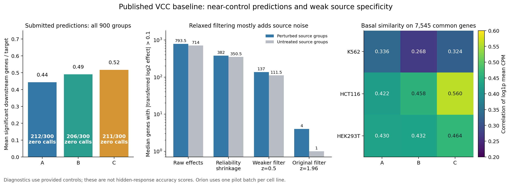

# Virtual Cell Challenge 2026

This project analyses the validation bundle for the [Virtual Cell Challenge](https://virtualcellchallenge.org/), generates raw single-cell CRISPRi response predictions, and packages them using the official VCC CLI. The first submission has been uploaded, scored, and published. It is a working statistical baseline with weak predictive performance.

## Completed work

- Reviewed and hashed all 146 original project files, including the manifest, gene/target lists, three control matrices, saved competition pages and their assets.
- Extracted the saved HTML and all 61 PDF pages. The PDF concerns bacteriophage genome generation and was excluded from the model.
- Checked every stored control count, gene order, context label and guide count. Analysed per-gene expression, detection, library sizes, guide balance and differences between contexts.
- Rejected a public essential-gene reference because it had zero target overlap with this panel.
- Downloaded and checksum-verified the original Replogle et al. genome-wide K562 pseudobulk reference. Retained usable responses for 260/300 targets and 7,681/18,533 challenge genes.
- Implemented the root-level prediction pipeline, source downloader and five focused tests. Fixed a quantile-bin sampling overlap discovered during the initial full run.
- Generated and independently checked the complete prediction, passed official `vcc prep`, and created the upload package.
- Uploaded `prediction.vcc` as **Public CRISPR transfer**. The competition published entry **QQnFEBGlOk2pFFwkgtJL**.

The detailed review, modeling assumptions and limitations are in [COMPETITION_ANALYSIS.md](COMPETITION_ANALYSIS.md). No challenge perturbation ground truth was available locally.

## Competition requirements

This is the **validation** partition, panel `vcc2026-val-1`, with contexts **A/B/C**. Each context supplies 18,400 non-targeting controls from 46 guides.

| Requirement | Value |
|---|---|
| Targets | Exactly the 300 symbols in `pert_counts.csv`, in each context |
| Cells per target/context | 400 |
| Prediction shape | 360,000 cells x 18,533 genes |
| Gene order | Exact order in `gene_names.csv` (header: `gene_name`) |
| Cell annotations | `obs.target_gene` and `obs.context`, retaining A/B/C labels |
| Expression | Finite nonnegative whole raw counts in sparse CSR form |
| Controls in submission | None |
| Maximum counts per cell | 1,000,000 |
| Maximum stored entries | 4,750,000,000 |
| Upload file | One `prediction.vcc` covering all three contexts |

The target gene itself is excluded from all six scored metrics; the discrimination metric excludes all 300 panel target genes. Predicting only the direct knockdown therefore cannot solve the evaluated task.

The final round is separate: the supplied documentation schedules new contexts D/E/F and a new target panel for October 22, 2026, with submissions due November 5, 2026. This A/B/C artifact is a validation-round submission.

## Model

`build_submission.py` pools effective K562 source constructs (at least 30 cells and at least 50% source knockdown), aligns gene symbols and sums duplicate source symbols. It computes source log2 response ratios with a 1-CPM pseudocount, soft-thresholds sampling noise, clips effects, and shrinks estimates with limited source cells.

The pipeline transfers **30% of the estimated log2 effect** onto each context's own controls. This fixed shrinkage is an assumption, not a validated cross-context fit. The other 40 targets and genes outside the source axis retain control-derived downstream expression. A separate 90% on-target reduction is also an assumption; the target is excluded from scoring.

For each target/context, the pipeline samples 400 distinct control cells, balanced across guides and stratified by library size. It applies binomial thinning for decreases and Poisson increments for increases, then streams integer CSR blocks to H5AD with 64-bit global pointers. The default random seed is **20261003**.

Different promoter/transcript constructs were compared only as an exploratory source agreement diagnostic. The legacy filename `reference_cross_validation.csv` does **not** establish cross-context validation and was not used to tune the transfer setting.

## Validation and generated artifacts

| Artifact/check | Completed result |
|---|---|
| `prediction.h5ad` | 2,473,492,232 bytes |
| `prediction.vcc` | 3,306,905,600 bytes (3.31 GB) |
| Groups | 900; exactly 400 cells each |
| Context sizes | 120,000 cells each in A, B and C |
| Stored entries | 2,083,470,063 |
| Maximum predicted cell total | 52,457 counts |
| Gene order and labels | Exact matches |
| Stored values | Positive integers; explicit zeros removed |
| Official packaging | Passed with `vcc-cli==0.2.2` |
| Tests | All 5 passed, including 200 sampling seeds and official synthetic packaging |

Package SHA-256:

```text
d236c64869488827f54012a0e10de68aad05c6d97142674a561969483618371e
```

Generation and validation took approximately 11.5 minutes on the original workstation. Packaging may require roughly 40-60 GB of memory and tens of GB of temporary disk space. Large local artifacts are excluded from Git and can be rebuilt.

## Published leaderboard result

The user supplied the successful CLI output on October 3, 2026. Upload took 13 minutes 10 seconds; scoring finished with status **published**. The scores were subsequently confirmed through the CLI API; rank was 1141 at that query. The table preserves rank 1140 at publication, and rank can change as other teams submit.

| Metric | Published score |
|---|---:|
| Rank at publication | 1140 |
| Overall | **-0.276289857599391** |
| Perturbation discrimination (`pds`) | 0.019643814695154346 |
| Expression accuracy (`mse`) | 0 |
| DE log-FC accuracy (`nmae`) | 0.016005525603025445 |
| DE direction fidelity (`fid`) | **-1.6653311841128977** |
| DE direction reach (`reach`) | 0.03387419826161333 |
| DE significance overlap (`jac`) | -0.06193150004324146 |

Partition: `val`. Panel: `vcc2026-val-1`. Anchor set: `vcc2026-valA-r4+vcc2026-valB-r4+vcc2026-valC-r4`.

Scores are scaled against a competition baseline (0) and a split-half experimental replicate (1); the overall score is the unweighted mean of the six components. Expression accuracy is clamped to [0, 1], so its reported zero is a score floor, not zero prediction error. Direction fidelity penalizes incorrect signs and insufficient numbers of predicted responding genes. See the [official metric definitions](https://github.com/ArcInstitute/cell-eval2/blob/main/docs/vcc2026_metrics/vcc2026-metrics.md).

The model performed below baseline overall, principally because of direction fidelity. Poor transfer from K562 to the anonymous contexts is a plausible explanation, but the aggregate scores cannot distinguish wrong directions, insufficient DE calls or other modeling problems. The subsequent audit inspected all 900 groups and added separate experiments and a candidate zero-aware simulator. No second model has been selected or submitted; see [MODEL_IMPROVEMENT.md](MODEL_IMPROVEMENT.md).

## Project files

| File/directory | Purpose |
|---|---|
| `build_submission.py` | Control analysis, reference transfer, integer count simulation, full validation and official packaging |
| `download_reference.py` | Resumable public reference download with pinned file ID and MD5 verification |
| `test_submission.py` | Sampling, simulation, mapping, streaming and official packaging checks |
| `requirements-competition.txt` | Versions used by the project environment |
| `manifest.json`, `gene_names.csv`, `pert_counts.csv` | Small official panel specifications needed for reproduction |
| `analysis/` | Inventory, statistics, diagnostic figure, model/validation records, tests and published score record |
| `reference/provenance.json` | Original-author reference location, checksum and CC BY 4.0 attribution |
| `reference/rejected_essential_reference.json` | Evidence that the earlier essential-gene source was not used |
| `reference/SOURCE.md` | Explanation of the retained source and excluded exploratory downloads |

Tracked analysis records include the per-gene and per-target CSVs, group statistics, source coverage and agreement diagnostics, `run_parameters.json`, official prep output, `prediction_validation.json`, `submission_ready.json` and `leaderboard_result.json`. The inventory records hashes from the original review; the README and ignore file have since changed.

The Git ignore rules exclude control/reference matrices, submission packages, local environments, extracted third-party page/paper text, downloaded website assets, and abandoned reference caches. Files remain available locally. API credentials belong in the CLI's OS keychain, not in this repository.

## Reproduce (Windows Command Prompt)

The examples below use **Command Prompt (`cmd.exe`)**, matching the successful upload session. In PowerShell, prefix executable invocations with `&` if needed and use `Set-Location` to change directory.

```cmd
cd /d L:\promec\Animesh\Download\Virtual
```

The existing `.competition_env` is already installed on the original workstation. On another machine, use Python 3.14 to create the environment and install the recorded versions:

```cmd
python -m venv .competition_env
.\.competition_env\Scripts\python.exe -m pip install -r requirements-competition.txt
```

Obtain the official validation controls from the [competition download page](https://virtualcellchallenge.org/downloads) or the [official CLI guide](https://vcc-cli-wiki.virtualcellchallenge.org/), and place `context_A.h5ad`, `context_B.h5ad` and `context_C.h5ad` in the project root alongside the tracked panel specifications. Keep all labels and gene order intact. The saved browser pages and unrelated PDF are local review inputs; they are not needed to generate predictions from the controls.

```cmd
.\.competition_env\Scripts\python.exe test_submission.py
.\.competition_env\Scripts\python.exe download_reference.py
.\.competition_env\Scripts\python.exe build_submission.py
```

The downloader retrieves only the compact 374,587,922-byte `K562_gwps_raw_bulk_01.h5ad`, pinned to Figshare file 35774443 and MD5 `4570b53c9d62ff6df281e622f0350060`.

Additional modes:

```cmd
.\.competition_env\Scripts\python.exe build_submission.py --analysis-only
.\.competition_env\Scripts\python.exe build_submission.py --force
.\.competition_env\Scripts\python.exe build_submission.py --package-only --force
```

`--analysis-only` analyses controls without generating predictions. `--force` intentionally rebuilds/replaces existing outputs. `--package-only --force` validates and repackages the existing H5AD. The script does not upload. A rebuild rewrites generated analysis records, including the readiness record; the separate `leaderboard_result.json` preserves the first submission's historical scores.

## Submit (Windows Command Prompt)

**The first package is already submitted.** These commands document the completed workflow and future submissions. Obtain an API token from the [credentials page](https://virtualcellchallenge.org/app/credentials); paste it into the interactive login prompt.

```cmd
.\.competition_env\Scripts\python.exe -m vcc login
.\.competition_env\Scripts\python.exe -m vcc whoami
.\.competition_env\Scripts\python.exe -m vcc submit .\prediction.vcc -m "Public CRISPR transfer" --wait
```

Keep the terminal open through upload and scoring. If an upload is interrupted, resume it with:

```cmd
.\.competition_env\Scripts\python.exe -m vcc submit .\prediction.vcc --resume --wait
```

The documented allowance is two daily submissions, with one in flight. Avoid resubmitting the unchanged package merely to reproduce this result.

## Sources and limitations

- [Official competition](https://virtualcellchallenge.org/) and [CLI reference](https://vcc-cli-wiki.virtualcellchallenge.org/cli-reference).
- [Official scoring implementation and metric definitions](https://github.com/ArcInstitute/cell-eval2).
- [Original Replogle et al. processed Perturb-seq release](https://plus.figshare.com/articles/dataset/20029387), licensed [CC BY 4.0](https://creativecommons.org/licenses/by/4.0/); pinned metadata and provenance are tracked.

Coverage is partial, tissue/assay differences can invalidate transferred effects, and the simulator cannot create counts for a gene absent in a sampled input cell. Its Poisson noise approximation does not capture all biological or technical variation. File validation and passing tests establish pipeline correctness, not predictive accuracy; the published leaderboard result is the available performance evidence.

## Subsequent model audit

[MODEL_IMPROVEMENT.md](MODEL_IMPROVEMENT.md) records the step-by-step audit, measured failure mechanisms, component changes and next reference-data work. Of 900 groups, 629 call no significant downstream genes against provided controls; all contexts average below one call per target. Relaxing source suppression mostly adds changes also seen in untreated source groups. Ten focused tests now pass.

New scripts: `audit_prediction.py`, `audit_source_stages.py`, `pilot_orion.py` and `plot_model_audit.py`. The generator supports isolated `--output-dir` experiments, configurable `--transfer-shrinkage` and `--noise-z`, and optional `--upward-mode zero-aware`. Original settings remain the defaults.

A 699 MB Orion pilot was SHA-256 verified and compared on a common gene axis. Its guide library covers all targets, but the pilot has inadequate cells per target for fitting responses. A separate public CD4 T-cell summary covers 291 targets and includes independent donor/guide agreement. These are candidates for the next data step, not evidence of an improved leaderboard score.



Changed model parameters require a separate output directory, even with `--force`, to protect the first-submission files.
