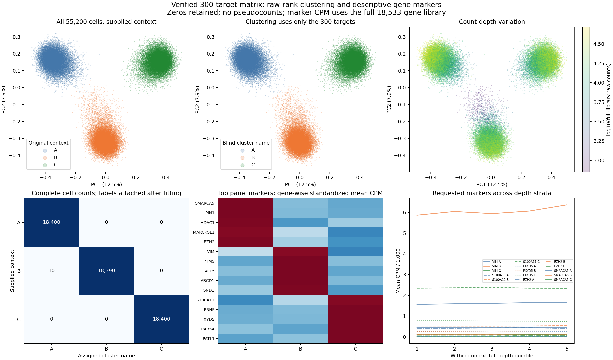
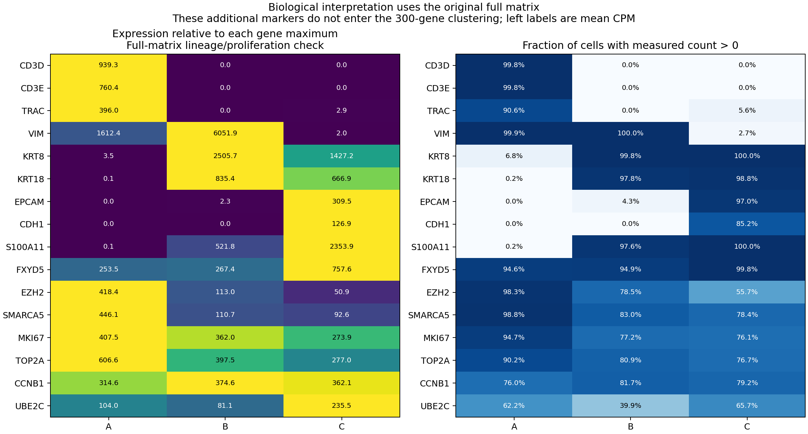

# Verified 300-target archive: clustering and markers

The ZIP contains every one of the 300 requested target genes, all 55,200 controls, and **16,560,000 original raw count values with zero mismatches**. Float CSV notation such as `2.0` preserves the integer count 2. There are no cell IDs in the archive; original IDs were attached using the verified row order within each context.

## Target-only rank clustering

| context | assigned_context | cells |
| --- | --- | --- |
| A | A | 18400 |
| A | B | 0 |
| A | C | 0 |
| B | A | 10 |
| B | B | 18390 |
| B | C | 0 |
| C | A | 0 |
| C | B | 0 |
| C | C | 18400 |

Correctly grouped cells: **55,190/55,200 (99.9819%)**. Context ARI: 0.999457; independent-seed repeat ARI: 1.000000. Cluster names are attached after fitting; neither context labels nor other genes enter the clustering. All assignments and disagreements are saved.

## Strong panel-enriched markers

| group | gene_name | mean_raw_count | detection_fraction | mean_cpm | fold_over_highest_other_group | minimum_pairwise_auc |
| --- | --- | --- | --- | --- | --- | --- |
| A | SMARCA5 | 9.3808 | 0.9878 | 446.0769 | 4.0345 | 0.9531 |
| A | PIN1 | 4.6219 | 0.9387 | 215.9824 | 9.4195 | 0.9412 |
| A | HDAC1 | 12.1250 | 0.9940 | 563.9603 | 2.7734 | 0.9323 |
| A | MARCKSL1 | 11.8148 | 0.9880 | 556.6931 | 3.3696 | 0.9249 |
| A | EZH2 | 8.8213 | 0.9828 | 418.2164 | 3.7025 | 0.9236 |
| A | ZNF22 | 8.5929 | 0.9891 | 414.6935 | 3.0441 | 0.9158 |
| A | PTOV1 | 7.7809 | 0.9802 | 365.0595 | 2.8875 | 0.8973 |
| A | TAF15 | 3.8133 | 0.9097 | 175.7562 | 5.2366 | 0.8910 |
| A | KIF2A | 4.1056 | 0.9340 | 193.5200 | 4.1359 | 0.8879 |
| A | CYTH2 | 3.6641 | 0.8982 | 170.4613 | 5.4532 | 0.8810 |
| B | VIM | 122.6469 | 0.9997 | 6053.1190 | 3.7512 | 0.9927 |
| B | PTMS | 18.4662 | 0.9913 | 940.3652 | 5.3767 | 0.9803 |
| B | ACLY | 9.3608 | 0.9740 | 461.6799 | 2.1677 | 0.8589 |
| B | ABCD1 | 2.4028 | 0.8352 | 122.0001 | 5.6076 | 0.8398 |
| B | SND1 | 7.0769 | 0.9671 | 353.6886 | 2.1155 | 0.8339 |
| C | S100A11 | 49.7873 | 1.0000 | 2353.9215 | 4.5087 | 0.9956 |
| C | PRNP | 9.9573 | 0.9832 | 449.3482 | 6.9490 | 0.9626 |
| C | FXYD5 | 15.8936 | 0.9983 | 757.5825 | 2.8324 | 0.9428 |
| C | RAB5A | 4.2791 | 0.9501 | 206.9873 | 8.4337 | 0.9413 |
| C | PATL1 | 6.3670 | 0.9709 | 298.9622 | 3.1642 | 0.8771 |
| C | PRDX3 | 2.7956 | 0.8763 | 132.5375 | 5.9855 | 0.8728 |
| C | RSRC1 | 4.5106 | 0.9477 | 214.2808 | 3.0603 | 0.8579 |
| C | NT5DC1 | 3.8590 | 0.9247 | 182.7907 | 3.5269 | 0.8529 |
| C | RNF141 | 5.4820 | 0.9691 | 267.9042 | 2.5812 | 0.8434 |
| C | COQ10B | 2.4822 | 0.8443 | 117.8741 | 5.0550 | 0.8396 |

Markers are enriched relative to the other supplied clusters under explicit descriptive thresholds, not proven tissue-specific genes. Full 900-row tables include every gene/group, pairwise AUCs, CPM fold ratios without pseudocounts and detection-restriction flags. The 300 CRISPRi targets form a selected panel rather than an unbiased collection of lineage markers.

## The proposed diagnostic genes

| context | gene_name | mean_raw_count | median_raw_count | detection_fraction | mean_cpm | median_cpm |
| --- | --- | --- | --- | --- | --- | --- |
| A | E2F1 | 4.7436 | 4.0000 | 0.8454 | 245.6753 | 195.4031 |
| A | EZH2 | 8.8261 | 8.0000 | 0.9833 | 418.3842 | 398.7017 |
| A | FXYD5 | 5.3465 | 5.0000 | 0.9464 | 253.5304 | 234.5161 |
| A | S100A11 | 0.0026 | 0.0000 | 0.0023 | 0.1067 | 0.0000 |
| A | SMARCA5 | 9.3858 | 9.0000 | 0.9882 | 446.1415 | 430.2278 |
| A | VIM | 34.3613 | 30.0000 | 0.9995 | 1612.4025 | 1523.7542 |
| B | E2F1 | 4.9370 | 4.0000 | 0.8608 | 250.2140 | 216.9609 |
| B | EZH2 | 2.2832 | 2.0000 | 0.7849 | 112.9545 | 92.8678 |
| B | FXYD5 | 5.3786 | 5.0000 | 0.9494 | 267.3670 | 249.6515 |
| B | S100A11 | 10.5005 | 10.0000 | 0.9755 | 521.8056 | 490.5718 |
| B | SMARCA5 | 2.1999 | 2.0000 | 0.8302 | 110.6845 | 97.8354 |
| B | VIM | 122.5823 | 114.0000 | 0.9996 | 6051.9360 | 5795.8321 |
| C | E2F1 | 1.6352 | 1.0000 | 0.5241 | 75.5396 | 30.9186 |
| C | EZH2 | 1.1629 | 1.0000 | 0.5570 | 50.9494 | 36.8331 |
| C | FXYD5 | 15.8936 | 14.0000 | 0.9983 | 757.5825 | 716.7778 |
| C | S100A11 | 49.7873 | 45.0000 | 1.0000 | 2353.9215 | 2264.3951 |
| C | SMARCA5 | 1.9660 | 2.0000 | 0.7843 | 92.5724 | 80.1523 |
| C | VIM | 0.0428 | 0.0000 | 0.0267 | 1.9986 | 0.0000 |

## Broader identity and proliferation check

| context | gene_name | mean_raw_count | detection_fraction | mean_cpm | in_300_targets |
| --- | --- | --- | --- | --- | --- |
| A | CD3D | 19.9382 | 0.9983 | 939.2937 | False |
| A | CD3E | 16.0320 | 0.9978 | 760.3559 | False |
| A | TRAC | 8.2653 | 0.9060 | 395.9766 | False |
| A | EPCAM | 0.0000 | 0.0000 | 0.0000 | False |
| A | CDH1 | 0.0001 | 0.0001 | 0.0037 | False |
| A | KRT8 | 0.0722 | 0.0679 | 3.5023 | False |
| A | KRT18 | 0.0022 | 0.0020 | 0.1138 | False |
| A | MKI67 | 9.1114 | 0.9467 | 407.5097 | False |
| A | TOP2A | 14.7498 | 0.9018 | 606.6493 | False |
| A | CCNB1 | 7.5477 | 0.7603 | 314.6373 | False |
| A | UBE2C | 2.5715 | 0.6218 | 103.9718 | False |
| B | CD3D | 0.0000 | 0.0000 | 0.0000 | False |
| B | CD3E | 0.0000 | 0.0000 | 0.0000 | False |
| B | TRAC | 0.0006 | 0.0005 | 0.0348 | False |
| B | EPCAM | 0.0489 | 0.0431 | 2.2761 | False |
| B | CDH1 | 0.0001 | 0.0001 | 0.0044 | False |
| B | KRT8 | 50.6271 | 0.9977 | 2505.6563 | False |
| B | KRT18 | 16.9594 | 0.9778 | 835.3997 | False |
| B | MKI67 | 8.1251 | 0.7716 | 361.9962 | False |
| B | TOP2A | 9.3246 | 0.8091 | 397.4511 | False |
| B | CCNB1 | 7.9290 | 0.8173 | 374.5878 | False |
| B | UBE2C | 1.8821 | 0.3993 | 81.1142 | False |
| C | CD3D | 0.0000 | 0.0000 | 0.0000 | False |
| C | CD3E | 0.0005 | 0.0005 | 0.0225 | False |
| C | TRAC | 0.0608 | 0.0557 | 2.8682 | False |
| C | EPCAM | 6.6061 | 0.9702 | 309.4943 | False |
| C | CDH1 | 2.7140 | 0.8524 | 126.8867 | False |
| C | KRT8 | 29.6388 | 0.9998 | 1427.2124 | False |
| C | KRT18 | 14.2099 | 0.9880 | 666.8978 | False |
| C | MKI67 | 6.7915 | 0.7611 | 273.8518 | False |
| C | TOP2A | 7.0842 | 0.7667 | 277.0462 | False |
| C | CCNB1 | 8.6754 | 0.7923 | 362.1050 | False |
| C | UBE2C | 6.1635 | 0.6572 | 235.5250 | False |

The full-matrix CD3D/CD3E/TRAC program supports a T-cell-like interpretation for A. B expresses both VIM and epithelial keratins, supporting a mixed expression program rather than proof of mesenchymal origin or an observed EMT transition. C expresses EPCAM/CDH1 and keratins, providing stronger epithelial evidence than S100A11/FXYD5 alone. Chromatin/proliferation expression is a cell-state signal and does not identify tissue of origin. These are marker-based inferences, not established anonymous identities. Literature and limitations are documented in [TARGET_LINEAGE_INTERPRETATION.md](TARGET_LINEAGE_INTERPRETATION.md).

Reproduction and audit details: [TARGET_ARCHIVE_AUDIT.md](TARGET_ARCHIVE_AUDIT.md).

## Interpretation of enrichment and discordant cells

The explicit enrichment thresholds identify 37 distinct targets: 20 in A, 5 in B and 12 in C. The other 263 targets do not pass this stringent rule; this does not imply identical distributions. KIF21B in A is the only target meeting detection restriction (74.1% A, 0.4% B, 3.8% C). No B or C target meets that stricter rule.

The ten B cells assigned to A have only 737–1,298 total full-library counts and 8–27 detected targets, versus a B median of 19,946 total counts. All ten belong to B in the earlier full-18,533-gene clustering. This supports low information content as a plausible source of target-panel ambiguity, without proving its cause. The requested marker maxima persist in every one of the five within-context depth strata.

All three focused tests passed. Independent validation passed for all 16,560,000 source count values, all 55,200 cell identities/depths, all 1,800 cluster/context marker rows, all 150 broader marker summaries, 70 independently reranked model cells and saved script/output checksums. See `analysis/target_archive_audit/validation.json`.
