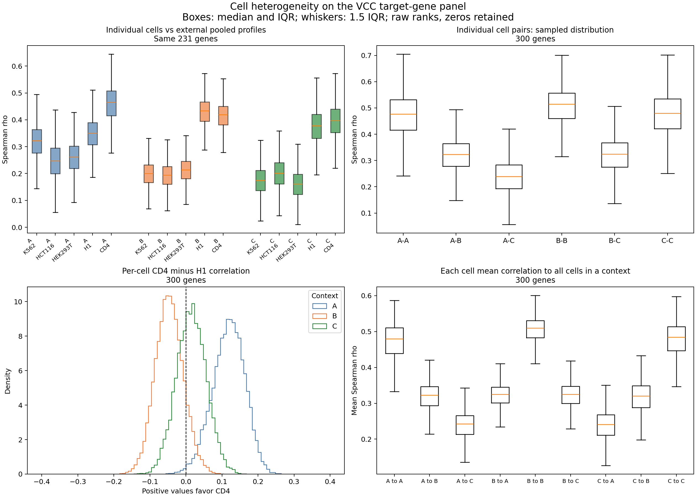

# Target-gene cell dispersion results

All 55,200 cells; exactly the 300 competition target genes. No added constant or transformations.

## Per-cell external-profile correlation spread

| context | comparison | mean | sd | p05 | median | p95 | iqr |
| --- | --- | --- | --- | --- | --- | --- | --- |
| A | K562 | 0.3176 | 0.0653 | 0.2030 | 0.3229 | 0.4153 | 0.0879 |
| A | HCT116 | 0.3198 | 0.0664 | 0.2012 | 0.3249 | 0.4192 | 0.0901 |
| A | HEK293T | 0.3290 | 0.0602 | 0.2213 | 0.3338 | 0.4192 | 0.0803 |
| A | H1 | 0.3851 | 0.0582 | 0.2792 | 0.3913 | 0.4701 | 0.0753 |
| A | CD4 | 0.5032 | 0.0732 | 0.3653 | 0.5129 | 0.6052 | 0.0962 |
| B | K562 | 0.1983 | 0.0503 | 0.1133 | 0.2004 | 0.2772 | 0.0656 |
| B | HCT116 | 0.2736 | 0.0587 | 0.1722 | 0.2801 | 0.3543 | 0.0661 |
| B | HEK293T | 0.3010 | 0.0545 | 0.2049 | 0.3065 | 0.3779 | 0.0622 |
| B | H1 | 0.4504 | 0.0719 | 0.3168 | 0.4625 | 0.5352 | 0.0679 |
| B | CD4 | 0.4041 | 0.0656 | 0.2891 | 0.4141 | 0.4836 | 0.0649 |
| C | K562 | 0.1732 | 0.0557 | 0.0785 | 0.1746 | 0.2619 | 0.0753 |
| C | HCT116 | 0.2817 | 0.0588 | 0.1812 | 0.2835 | 0.3757 | 0.0789 |
| C | HEK293T | 0.2576 | 0.0567 | 0.1590 | 0.2602 | 0.3472 | 0.0758 |
| C | H1 | 0.3965 | 0.0671 | 0.2765 | 0.4023 | 0.4960 | 0.0902 |
| C | CD4 | 0.4116 | 0.0636 | 0.3003 | 0.4159 | 0.5084 | 0.0853 |

## Highest correlation on the same 231 genes

| context | K562 | HCT116 | HEK293T | H1 | CD4 |
| --- | --- | --- | --- | --- | --- |
| A | 0.0069 | 0.0001 | 0.0004 | 0.0132 | 0.9794 |
| B | 0.0024 | 0.0000 | 0.0027 | 0.6252 | 0.3698 |
| C | 0.0003 | 0.0000 | 0.0001 | 0.3187 | 0.6809 |

These fractions compare basal expression associations, not cell-type assignments.

## Individual cell-pair similarity

| pair_group | all_unique_valid_cell_pairs | all_pairs_mean | all_pairs_population_sd | sample_p05 | sample_median | sample_p95 |
| --- | --- | --- | --- | --- | --- | --- |
| A-A | 169270800 | 0.4698 | 0.0863 | 0.3191 | 0.4766 | 0.6001 |
| A-B | 338560000 | 0.3168 | 0.0696 | 0.1881 | 0.3239 | 0.4159 |
| A-C | 338560000 | 0.2378 | 0.0663 | 0.1245 | 0.2396 | 0.3410 |
| B-B | 169270800 | 0.4949 | 0.0969 | 0.2720 | 0.5146 | 0.6095 |
| B-C | 338560000 | 0.3160 | 0.0756 | 0.1850 | 0.3242 | 0.4237 |
| C-C | 169270800 | 0.4761 | 0.0828 | 0.3273 | 0.4802 | 0.6026 |

Means and population SDs use ALL valid cell pairs exactly; p05/median/p95 use the reproducible uniform sample of 20000 pairs per group. Same-cell comparisons are excluded.

## Cell-to-own-context profile

| context | mean | sd | p05 | median | p95 |
| --- | --- | --- | --- | --- | --- |
| A | 0.6698 | 0.0869 | 0.5011 | 0.6842 | 0.7861 |
| B | 0.6790 | 0.0978 | 0.4861 | 0.7009 | 0.7769 |
| C | 0.6735 | 0.0828 | 0.5161 | 0.6854 | 0.7877 |

Each pooled profile excludes the cell being compared. Correlation to a pool and correlation to another individual cell have different noise levels.

## Count-depth associations

| context | correlation_metric | covariate | cells | spearman |
| --- | --- | --- | --- | --- |
| A | spearman_H1 | total_counts | 18400 | 0.6634 |
| A | spearman_H1 | nonzero_target_genes | 18400 | 0.6353 |
| A | spearman_CD4 | total_counts | 18400 | 0.8105 |
| A | spearman_CD4 | nonzero_target_genes | 18400 | 0.7741 |
| A | delta_CD4_minus_H1_300 | total_counts | 18400 | 0.4299 |
| A | delta_CD4_minus_H1_300 | nonzero_target_genes | 18400 | 0.4118 |
| A | spearman_own_context_leave_one_out_300 | total_counts | 18400 | 0.9085 |
| A | spearman_own_context_leave_one_out_300 | nonzero_target_genes | 18400 | 0.8799 |
| B | spearman_H1 | total_counts | 18400 | 0.6187 |
| B | spearman_H1 | nonzero_target_genes | 18400 | 0.6171 |
| B | spearman_CD4 | total_counts | 18400 | 0.5604 |
| B | spearman_CD4 | nonzero_target_genes | 18400 | 0.5411 |
| B | delta_CD4_minus_H1_300 | total_counts | 18400 | -0.1651 |
| B | delta_CD4_minus_H1_300 | nonzero_target_genes | 18400 | -0.1867 |
| B | spearman_own_context_leave_one_out_300 | total_counts | 18400 | 0.8357 |
| B | spearman_own_context_leave_one_out_300 | nonzero_target_genes | 18400 | 0.8122 |
| C | spearman_H1 | total_counts | 18400 | 0.7092 |
| C | spearman_H1 | nonzero_target_genes | 18400 | 0.7059 |
| C | spearman_CD4 | total_counts | 18400 | 0.7278 |
| C | spearman_CD4 | nonzero_target_genes | 18400 | 0.7049 |
| C | delta_CD4_minus_H1_300 | total_counts | 18400 | -0.0343 |
| C | delta_CD4_minus_H1_300 | nonzero_target_genes | 18400 | -0.0619 |
| C | spearman_own_context_leave_one_out_300 | total_counts | 18400 | 0.8881 |
| C | spearman_own_context_leave_one_out_300 | nonzero_target_genes | 18400 | 0.8677 |

These associations show sensitivity to count depth and detected targets; they do not separate technical and biological variation. Guide-level summaries are also supplied.

See [TARGET_CELL_DISPERSION.md](TARGET_CELL_DISPERSION.md) for method, schemas and reproduction commands. Every cell has a row in `per_cell_dispersion.csv`; individual sampled pairs retain both cell IDs.
