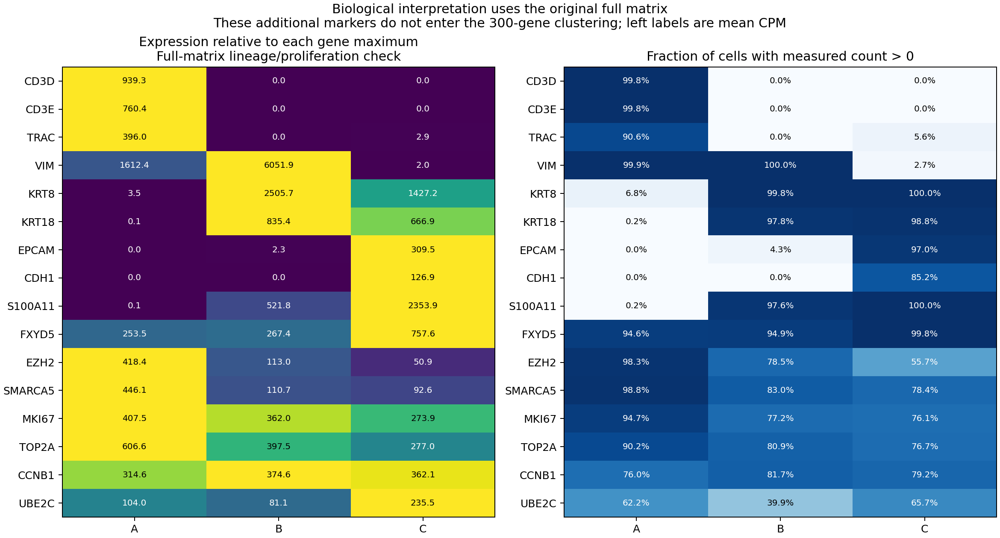

# What do the cluster markers imply about cell identity?

Your observations are supported as expression differences, but they need a more cautious lineage interpretation. VIM, S100A11 and FXYD5 are strong discriminators of these particular control datasets; none establishes an exact tissue of origin by itself. Looking beyond the selected CRISPRi panel provides much stronger evidence for A and C.

The input ZIP is an exact extraction of the original 300 targets: all 16,560,000 counts match. Blind three-cluster rank analysis groups 55,190 of 55,200 cells according to A/B/C (99.9819%), with ten low-depth B cells joining A. A second seed gives the identical partition. Additional lineage genes below are checked in the original full matrix and are not used to fit these clusters.

## Which target-panel genes distinguish the clusters?

Strong enrichment requires a CPM mean fold of at least two against the higher of the other-group means, minimum pairwise rank AUC at least 0.8, and detection in at least 25% of the group. CPM uses each cell's full 18,533-gene library. There is no pseudocount. These thresholds identify 20 A, 5 B and 12 C markers: 37 unique targets. The other 263 targets do not meet this stringent rule; that does not mean their distributions are identical.

| group | gene_name | fold_over_highest_other_group | minimum_pairwise_auc | detection_fraction |
| --- | --- | --- | --- | --- |
| A | SMARCA5 | 4.0345 | 0.9531 | 0.9878 |
| A | PIN1 | 9.4195 | 0.9412 | 0.9387 |
| A | HDAC1 | 2.7734 | 0.9323 | 0.9940 |
| A | MARCKSL1 | 3.3696 | 0.9249 | 0.9880 |
| A | EZH2 | 3.7025 | 0.9236 | 0.9828 |
| B | VIM | 3.7512 | 0.9927 | 0.9997 |
| B | PTMS | 5.3767 | 0.9803 | 0.9913 |
| B | ACLY | 2.1677 | 0.8589 | 0.9740 |
| B | ABCD1 | 5.6076 | 0.8398 | 0.8352 |
| B | SND1 | 2.1155 | 0.8339 | 0.9671 |
| C | S100A11 | 4.5087 | 0.9956 | 1.0000 |
| C | PRNP | 6.9490 | 0.9626 | 0.9832 |
| C | FXYD5 | 2.8324 | 0.9428 | 0.9983 |
| C | RAB5A | 8.4337 | 0.9413 | 0.9501 |
| C | PATL1 | 3.1642 | 0.8771 | 0.9709 |

Only **KIF21B in A** meets the stricter detection-restriction rule (at least 50% detection in-group and at most 5% in either other group): 74.1% in the A-named cluster, 0.4% in B and 3.8% in C. No B or C target meets that rule. This is dataset-relative detection restriction, not a claim of universal tissue specificity.

## B: high VIM is real, but does not establish mesenchymal origin

Mean VIM raw count is 122.58 in B, 34.36 in A and 0.043 in C. B's VIM CPM is about 3.75 times A's; minimum rank AUC against both other clusters is 0.993. The B maximum persists in all five within-context depth strata. However, VIM is detected in 99.9% of A as well as effectively all B cells, so it is not exclusive to B.

Vimentin expression is not limited to mesenchymal cells. Direct experiments reported vimentin RNA expression in normal human lymphocytes, which provides a clear counterexample to identifying mesenchymal origin from VIM alone. [Lilienbaum et al., EMBO Journal, 1986](https://pubmed.ncbi.nlm.nih.gov/3792301/).

The original B matrix also shows KRT8 in 99.8% and KRT18 in 97.8% of cells, while EPCAM is detected in only 4.3% and CDH1 in approximately 0.01%. The combination supports an expression program with both epithelial and mesenchymal-associated features. An epithelial/mesenchymal intermediate-state hypothesis is reasonable to investigate; the snapshot does not establish a transition, exact cell-line identity or original tissue. Group means also should not substitute for a dedicated within-cell coexpression analysis.

## C: epithelial interpretation has stronger supporting evidence

Mean raw counts are 49.79 for S100A11 and 15.89 for FXYD5 in C, versus 10.50/5.38 in B and 0.0026/5.35 in A. Their minimum pairwise rank AUCs are 0.996 and 0.943. The C maxima remain across all five depth strata.

These two genes are C-enriched, not C-exclusive. S100A11 is detected in 97.6% of B as well as effectively all C cells, and FXYD5 is detected in about 95% of A and B as well as 99.8% of C. The Human Protein Atlas associates S100A11 with squamous epithelial expression but also detects enrichment in neutrophils; FXYD5 has expression across immune and other cell types. Therefore neither gene alone reliably diagnoses an epithelial lineage. [HPA S100A11](https://www.proteinatlas.org/ENSG00000163191-S100A11/single%2Bcell), [HPA FXYD5](https://www.proteinatlas.org/ENSG00000089327-FXYD5/single%2Bcell), accessed 2026-10-04.

The broader matrix provides the more diagnostic combination: **EPCAM in 97.0%, CDH1 in 85.2%, KRT8 in effectively 100% and KRT18 in 98.8%** of C cells, together with VIM in only 2.7%. This supports an epithelial expression program. EPCAM's atlas expression includes multiple epithelial groups, so this does not identify a particular organ or cell line. [HPA EPCAM](https://www.proteinatlas.org/ENSG00000119888-EPCAM/single%2Bcell), [HPA CDH1](https://www.proteinatlas.org/ENSG00000039068-CDH1/single%2Bcell), accessed 2026-10-04.

## A: the 300-gene chromatin signal is insufficient, but the full matrix is informative

A's strongest target-panel markers include SMARCA5, PIN1, HDAC1, MARCKSL1 and EZH2. SMARCA5 and EZH2 are approximately fourfold and 3.7-fold higher in mean CPM than the higher other-group mean. Their chromatin-associated functions do not by themselves identify the tissue. [HPA SMARCA5](https://www.proteinatlas.org/ENSG00000153147-SMARCA5), [HPA EZH2](https://www.proteinatlas.org/ENSG00000106462-EZH2).

The full matrix shows **CD3D in 99.8%, CD3E in 99.8% and TRAC in 90.6% of A cells**, with essentially no CD3D/CD3E signal in B/C. This coordinated T-cell-receptor program supports a **T-cell-like lineage interpretation**. The atlas classifies CD3D as T-cell enriched and places CD3E/TRAC among its closest expression neighbors. [HPA CD3D](https://www.proteinatlas.org/ENSG00000167286-CD3D/single%2Bcell), accessed 2026-10-04.

CD4 is detected in 52.8% of A versus CD8A in 2.2% and CD8B in about 0.01%. That is compatible with a CD4-like program and our earlier external basal-profile match, but does not establish a precise CD4 subset or anonymous cell-line identity.

The proliferation signal is shared across contexts. A has higher MKI67/TOP2A CPM, but CCNB1 CPM is higher in B and UBE2C CPM is higher in C. Calling mitosis an exclusively A-specific signature would oversimplify the observed profiles.

## Quantitative full-matrix evidence

CPM is computed per cell before taking group means. Detection fractions describe measured counts above zero. All 50 prespecified markers were present in the original gene axis. The complete table is `analysis/target_archive_audit/broader_lineage_expression_summary.csv`.

| context | gene_name | mean_raw_count | detection_fraction | mean_cpm |
| --- | --- | --- | --- | --- |
| A | CD3D | 19.9382 | 0.9983 | 939.2937 |
| A | CD3E | 16.0320 | 0.9978 | 760.3559 |
| A | TRAC | 8.2653 | 0.9060 | 395.9766 |
| A | EPCAM | 0.0000 | 0.0000 | 0.0000 |
| A | CDH1 | 0.0001 | 0.0001 | 0.0037 |
| A | KRT8 | 0.0722 | 0.0679 | 3.5023 |
| A | KRT18 | 0.0022 | 0.0020 | 0.1138 |
| A | VIM | 34.3613 | 0.9995 | 1612.4025 |
| A | MKI67 | 9.1114 | 0.9467 | 407.5097 |
| A | TOP2A | 14.7498 | 0.9018 | 606.6493 |
| A | CCNB1 | 7.5477 | 0.7603 | 314.6373 |
| A | UBE2C | 2.5715 | 0.6218 | 103.9718 |
| A | EZH2 | 8.8261 | 0.9833 | 418.3842 |
| A | SMARCA5 | 9.3858 | 0.9882 | 446.1415 |
| A | S100A11 | 0.0026 | 0.0023 | 0.1067 |
| A | FXYD5 | 5.3465 | 0.9464 | 253.5304 |
| B | CD3D | 0.0000 | 0.0000 | 0.0000 |
| B | CD3E | 0.0000 | 0.0000 | 0.0000 |
| B | TRAC | 0.0006 | 0.0005 | 0.0348 |
| B | EPCAM | 0.0489 | 0.0431 | 2.2761 |
| B | CDH1 | 0.0001 | 0.0001 | 0.0044 |
| B | KRT8 | 50.6271 | 0.9977 | 2505.6563 |
| B | KRT18 | 16.9594 | 0.9778 | 835.3997 |
| B | VIM | 122.5823 | 0.9996 | 6051.9360 |
| B | MKI67 | 8.1251 | 0.7716 | 361.9962 |
| B | TOP2A | 9.3246 | 0.8091 | 397.4511 |
| B | CCNB1 | 7.9290 | 0.8173 | 374.5878 |
| B | UBE2C | 1.8821 | 0.3993 | 81.1142 |
| B | EZH2 | 2.2832 | 0.7849 | 112.9545 |
| B | SMARCA5 | 2.1999 | 0.8302 | 110.6845 |
| B | S100A11 | 10.5005 | 0.9755 | 521.8056 |
| B | FXYD5 | 5.3786 | 0.9494 | 267.3670 |
| C | CD3D | 0.0000 | 0.0000 | 0.0000 |
| C | CD3E | 0.0005 | 0.0005 | 0.0225 |
| C | TRAC | 0.0608 | 0.0557 | 2.8682 |
| C | EPCAM | 6.6061 | 0.9702 | 309.4943 |
| C | CDH1 | 2.7140 | 0.8524 | 126.8867 |
| C | KRT8 | 29.6388 | 0.9998 | 1427.2124 |
| C | KRT18 | 14.2099 | 0.9880 | 666.8978 |
| C | VIM | 0.0428 | 0.0267 | 1.9986 |
| C | MKI67 | 6.7915 | 0.7611 | 273.8518 |
| C | TOP2A | 7.0842 | 0.7667 | 277.0462 |
| C | CCNB1 | 8.6754 | 0.7923 | 362.1050 |
| C | UBE2C | 6.1635 | 0.6572 | 235.5250 |
| C | EZH2 | 1.1629 | 0.5570 | 50.9494 |
| C | SMARCA5 | 1.9660 | 0.7843 | 92.5724 |
| C | S100A11 | 49.7873 | 1.0000 | 2353.9215 |
| C | FXYD5 | 15.8936 | 0.9983 | 757.5825 |

## Discordant cells and limitations

The ten discordant cells contain only 737–1,298 counts across the entire gene matrix and only 8–27 nonzero target genes, versus a B median of 19,946 total counts. All were correctly grouped with B using all 18,533 genes. Low information content is a plausible reason for their target-only ambiguity; the analysis does not prove a cause. Their IDs and guide labels are saved in `cells_disagreeing_with_context.csv`.

The 300 genes were chosen as CRISPRi targets, not as a diagnostic lineage panel. Basal expression differences do not reveal knockdown-response accuracy, and context/batch effects cannot be separated from these controls alone. The appropriate interpretation is **A: T-cell-like; B: a mixed epithelial/mesenchymal-associated program; C: epithelial-like**, with exact anonymous identities unresolved.

For reproducible code, explicit marker thresholds, all counts and validation, see [TARGET_ARCHIVE_AUDIT.md](TARGET_ARCHIVE_AUDIT.md) and [TARGET_ARCHIVE_RESULTS.md](TARGET_ARCHIVE_RESULTS.md).
