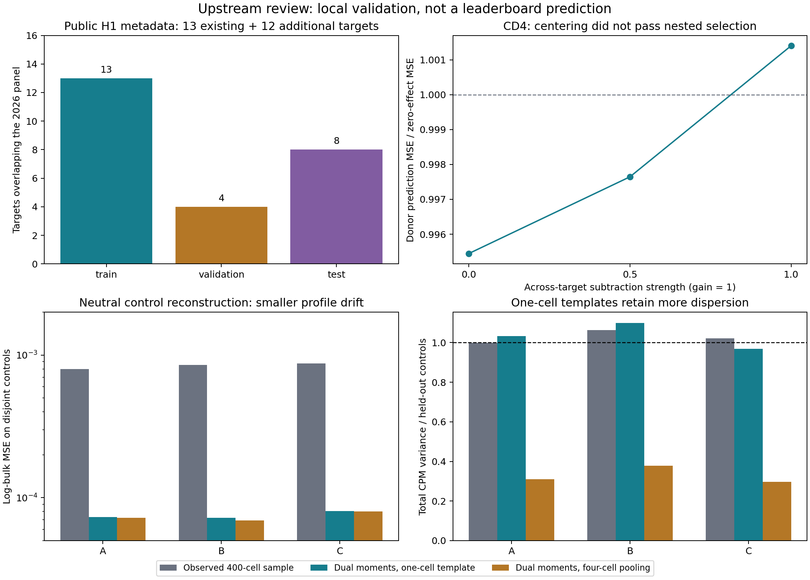

# Review of AtlasShift and Arc Virtual Cell Atlas

Review date: 2026-10-05. This report combines the requests to examine both user-cloned repositories and learn from their commits. Code, historical methods, configuration and tutorial cells were read before running the small numerical experiments below. Neither repository was modified. The five original competition input hashes match AtlasShift's historical input manifest; that does not establish identical hidden evaluation references or anchors.

## Conclusion and next submission strategy

The strongest additions to test are **12 more directly observed public H1 targets** and **separate calibration of mean CPM and pooled-count profiles while retaining one-cell templates**. Promoter-neighbor effects warrant an independently calibrated prior. The held-target donor experiment did not support adding across-target subtraction to our CD4 estimator. None of these local diagnostics proves a higher hidden leaderboard score, and this review does not create or upload a new submission.

V4 remains the current published candidate: entry `w5criCkgkCWj1QOgP08E`, overall **-0.05067391016092112**. Its raw expression error rose from 1.014294 for V2 to 1.247733 even though the scaled expression component stayed at zero. Better profile calibration addresses a measured weakness alongside response coverage. Existing V4 source code and effect arrays are unchanged; the effect-cache hash was checked afresh, and package size was checked against its readiness record. The 3.1 GiB package was not rehashed in this review.

## Commit history and implementation lessons

| Repository | Pinned HEAD | Main commits | All reachable commits |
| --- | --- | --- | --- |
| Virtual-Cell-Challenge-2026 | d24ce4fdae0cd7cba3ba29546cd8737094eae98a | 14 | 14 |
| arc-virtual-cell-atlas | 4f7bb170c61d2fafce70f67db6e52c7d9af1be4b | 59 | 62 |

The origin main hashes were also checked with read-only `git ls-remote`. Complete reachable commit metadata, paths and executable-Python classifications are in `analysis/upstream_review/*_commits.csv`. AST comparison ignores docstrings; notebook code and documentation were reviewed separately, so a count of Python-file changes does not describe every notebook update.

### AtlasShift

Source: [Virtual-Cell-Challenge-2026](https://github.com/kaipengm2/Virtual-Cell-Challenge-2026).

Only two of its 14 commits change executable Python. Initial commit `8257ada256112e1e7374241fcc1f744a575089ad` contains the methods, reproducibility guide, configuration, tests and input hashes. Commit `490dcaac2c824b92a7997b7e8d2970b1690c3570` reorganizes the implementation into five scripts and removes much of that documentation. The remaining changes adjust documentation and names/docstrings. The historical methods were recovered using `git show`; this history does not provide 38 successive trained model experiments.

The author reports historical v38 score **0.1545618019323822**, rank 82 of 839 on September 10. These are author-reported historical results, not a current rank or an independently reproduced score. A documented v39 result is slightly lower. Matching original input hashes makes the method relevant, but unspecified hidden anchor versions prevent a strict score comparison with our current V4.

Useful mechanisms in the reviewed implementation:

- Source coverage spans K562, HCT116, HEK293T, the complete released H1 target panel, and CD4 conditions. Default source-family weights are 2, 1, 1, 2 and 0.5 respectively. CD4 conditions form one averaged family. Its full K562 source has broader gene coverage than our 7,681-gene pseudobulk overlap. Our small HCT116/HEK293T pilot batches do not provide comparable response training support.
- The full source-target panel is built before source centering and output selection. Across-target source means exclude the target's own-gene coordinate. Subtracting a shared effect can prevent repeatedly transferring generic responses; it can also remove real biology shared by targets. Our empirical test below evaluates that tradeoff for CD4 donor transfer.
- Mean cell-normalized CPM and library-weighted pooled counts are modeled separately. The published defaults use response amplitudes 0.6 and 0.3, with clipping. The count generator iteratively reconciles both requested profiles, projects incompatible moments, rounds to integer counts and preserves each cell's requested library size. Defaults are hypotheses to calibrate for our estimator, not established optimum values for A/B/C.
- Its default template averages four controls with nearby library sizes. Our paired experiment shows that this can greatly reduce cell variance. A one-cell template is a more promising adaptation for the next experiment.
- GENCODE gene-boundary TSS pairs within 5 kb produce neighboring-gene suppression caps, with remaining expression 0.15 at the shortest distances and a distance-dependent relaxation. These are heuristic caps; renormalizing profiles after applying them means they are not strict final expression ceilings.
- `compact.py` changes sparse layout/cell order while checking count equality. This could reduce upload size without improving numerical predictions. `pack.py` uses a private adapter requiring VCC 0.2.0, while our working environment has 0.2.2. Retain our official preparation path.

We imported the pinned, reviewed numerical `model.py` for focused tests; no upstream source was copied. Its MIT license is retained in the original clone. The large preparation pipeline was not run: full-source downloads/scans are substantial, and the existing environment was not upgraded to its dependency versions.

### Arc Virtual Cell Atlas

Source: [arc-virtual-cell-atlas](https://github.com/ArcInstitute/arc-virtual-cell-atlas).

The checked main branch has 59 commits; all reachable refs contain 62. Its current files provide data descriptions, access examples and five Python/R notebooks, with no trained perturbation predictor. The two historical executable-Python changes concern a subsequently removed TileDB-SOMA access helper. The useful recent changes concern release pinning, metadata, access methods and tutorials.

The challenge data here are the released **2025 H1** dataset: 150 training, 50 validation and 100 test target labels. The old three-metric description is not the six-component 2026 scoring contract. Tahoe-100M is a drug-treatment resource, and scBaseCount is observational expression data: neither supplies interchangeable CRISPRi response labels. They can support lineage/control characterization if sample provenance and treatment status are checked. Study-level disease annotations can include healthy samples. Unique-UMI `X`, EM counts and Velocyto layers require distinct treatment rather than being combined indiscriminately.

Remote branch `origin/docs/fix-egress-guidance`, commit `8fc7a9e368f0fa7098858019ba41a492c8062c69`, corrects older access/billing guidance, but was **not merged into the checked main**. Our bounded H1 HTTPS metadata reads worked anonymously without a billing project. This verifies those URLs only; it is not a claim about all atlas access or billing arrangements. We did not execute example whole-species reads or download complete atlases.

## 1. Public H1 response coverage: 13 to 25 potential targets

Only observation labels, cell identifiers and gene axes were read through bounded HTTP ranges: the H1 expression matrix was not accessed. Each split has 18,080 gene names, with 18,077 shared with the 2026 axis. Coverage counts indicate available cells before response QC.

| Public H1 split | 2026 targets | Available cells | Control cells |
| --- | --- | --- | --- |
| train | 13 | 221273 | 38176 |
| validation | 4 | 98927 | 38176 |
| test | 8 | 170846 | 38176 |

The three public splits offer **25 distinct 2026 targets**, including these **12 beyond the training-only source used in V4**:

| Target | Public 2025 split | Available target cells |
| --- | --- | --- |
| ACLY | validation | 1026 |
| ADNP | test | 291 |
| ANKZF1 | test | 1063 |
| BRPF1 | test | 366 |
| HDAC8 | validation | 1204 |
| MED15 | test | 3637 |
| MED25 | test | 2028 |
| NFE2L1 | validation | 926 |
| PLAGL2 | test | 3642 |
| SLIRP | validation | 2000 |
| ZFP62 | test | 204 |
| ZNF32 | test | 699 |

All 38,176 control-cell identifiers in training also appear in validation and test. Count equality was not checked. Future source validation must partition controls globally by identifier and avoid treating the public splits as independent control replicates.

These are publicly released 2025 labels, not hidden 2026 evaluation data. Before estimating effects, extract the relevant sparse expression rows, map measured symbols, check guide/batch metadata, verify on-target knockdown and minimum usable cell counts, and use matched source controls. A shared gene axis does not justify filling unmeasured genes with zero. URLs, object generations, sizes, ETags and observed coverage are recorded in `h1_coverage_probe.json` and the 900-row/300-row coverage tables.

## 2. Across-target centering: not supported for our CD4 donor estimator

The existing disjoint CD4 donor contrasts supply **72 targets, 138 target-condition contrasts and 10,273 genes**. We tested gain {0.5, 0.75, 1} and centering {0, 0.5, 1}. For each condition, the source center is the unweighted average of valid other training-target effects. Target conditions stay together; the target's own-gene coordinate and invalid values are excluded. The response remains softly shrunk by `0.04 / (0.04 + SE²)` and clipped to +/-3.

Five outer target folds and three inner folds prevent a held target from contributing to its centering fit or setting selection. Selection maximizes the existing direction/overlap/error proxy among candidates whose inner prediction error does not exceed the fixed V4 baseline. Adoption additionally requires no outer loss increase and a better composite proxy. All five folds select **gain 1, centering 0**.

At gain 1, the independently aggregated outer diagnostics are:

| Centering | Relative MSE | Selection proxy | Fidelity proxy | Jaccard proxy |
| --- | --- | --- | --- | --- |
| 0 | 0.995447 | 0.287590 | 0.176374 | 0.109563 |
| 0.5 | 0.997645 | 0.286227 | 0.177148 | 0.108534 |
| 1 | 1.001400 | 0.286714 | 0.181329 | 0.106751 |

These are donor/normal-approximation 400-cell proxies, not published FID/Jaccard scores or the official hidden-reference expression metric. Full subtraction slightly increases direction yield but worsens overlap and squared error. Keep the present CD4 centering policy. This does not rule out centering for a different cross-lineage estimator or a broader source panel.

## 3. Paired count-generation experiment: separate moments, preserve dispersion

For each context, split the 18,400 original controls into **9,200 training and 9,200 distinct held-out controls**, with a recorded seed. Estimate both the equal-cell mean CPM probability and the library-weighted pooled probability using training controls. Generate 400 neutral cells. The baseline and one-cell dual-moment reconstruction use the **same guide/depth-stratified 400 donors**; the four-cell version averages 1,600 depth-sorted controls.

All generated groups contain nonnegative integer counts and preserve their requested cell depths. The control log-bulk diagnostic is the mean squared difference between `log1p(50000 * pooled_probability)` profiles of generated and held-out controls; it is not the leaderboard metric. Variance is the sum of per-gene cell-normalized variances relative to held-out controls.

| Context | Generator | Pooled-profile L1 | Held-out control log-bulk MSE | Variance / held-out controls |
| --- | --- | --- | --- | --- |
| A | Observed sample | 0.029288 | 0.00080050 | 1.000 |
| A | Dual moments, pool 1 | 0.000463 | 0.00007298 | 1.032 |
| A | Dual moments, pool 4 | 0.000442 | 0.00007229 | 0.311 |
| B | Observed sample | 0.029718 | 0.00085134 | 1.063 |
| B | Dual moments, pool 1 | 0.000492 | 0.00007240 | 1.098 |
| B | Dual moments, pool 4 | 0.000475 | 0.00006946 | 0.379 |
| C | Observed sample | 0.030635 | 0.00087592 | 1.022 |
| C | Dual moments, pool 1 | 0.000468 | 0.00008045 | 0.969 |
| C | Dual moments, pool 4 | 0.000447 | 0.00008015 | 0.298 |

One-cell dual moments reduce pooled-profile L1 drift from about 0.03 to below 0.0005, with variance ratios approximately 0.97-1.10. Four-cell pooling retains only approximately 0.30-0.38 of held-out variance and increases gene detection. This is a neutral control reconstruction test: there are no perturbation responses or own-target knockdown, so response performance and DE-call calibration remain untested. Both CPM-moment residuals and detection/depth diagnostics are retained in the CSV.



## 4. Promoter neighbors: relevant evidence, no universal knockdown rule

The 58,953,903-byte GENCODE v47 annotation is size/SHA-256 checked. Independently parsing its unambiguous gene-boundary TSS positions reproduces **75 measured neighbor pairs across 74 targets** within 5 kb. The reconstructed upstream CSV also matches its historical SHA-256 exactly.

Cached CD4 data yield **129 qualifying target-condition observations**, with **70 significant negative and 1 significant positive neighboring-gene responses** at q < 0.05. Repeated conditions are not independent genes. The descriptive filter requires at least 100 target cells, significant on-target knockdown, multiple-guide estimates, and no distal-off-target/low-target-expression flags; it deliberately retains the publisher's neighboring-gene-KD flag so collateral behavior can be examined. This does not alter the stricter V4 training filter.

Gene-boundary TSS is not the experimentally targeted guide position or the context's active promoter. The evidence supports testing a distance-, expression- and source-confidence-dependent neighboring-gene prior on held-out targets; it does not justify forcing every neighbor to 15% expression. Complete target/neighbor/condition/distance/q-value records are saved.

## Proposed sequence for the next candidate

1. Extract the 12 added public H1 targets and their matched controls with a recorded download budget. Check source counts and knockdown, then extend V4's direct-H1 coverage only for usable targets. Keep global control-ID splits.
2. Estimate mean-CPM and pooled-profile perturbation effects separately. Tune amplitudes on held-out source targets. Test one-cell dual-moment generation against the existing generator with identical effect arrays and donor IDs; assess expression error, response direction/overlap, detection and per-gene variance. Expand beyond neutral tests before generating a complete package.
3. Test promoter-neighbor corrections separately under target-held-out validation. Keep CD4 across-target subtraction at zero unless a different source experiment supports it. Obtain substantial HCT116/HEK293T perturbation data before assigning them response weights.
4. Generate and validate a candidate through the existing VCC 0.2.2 official preparation path only after these ablations support it. Record all changes and input hashes. A future hidden score remains unknown until a submitted candidate is scored.

## Reproduction and evidence

Run from the project root in **Command Prompt**. Existing V4 inputs/caches must be present: the three original H5ADs, `gene_names.csv`, `pert_counts.csv`, donor inputs referenced by `fit_lineage_submission.donor_inputs`, `reference/cd4_probe/merged.csv` / `.npz`, and the V4 reference model/package. The original clones must be present at the pinned commits above; the moment test imports `Virtual-Cell-Challenge-2026/model.py` after checking its hash. No additional dependency installation was needed in the existing `.competition_env`.

```cmd
.\.competition_env\Scripts\python.exe review_upstream_repositories.py
.\.competition_env\Scripts\python.exe probe_atlas_sources.py
.\.competition_env\Scripts\python.exe evaluate_atlas_transfer.py
.\.competition_env\Scripts\python.exe -m unittest test_upstream_review -v > analysis\upstream_review\test_results.txt 2>&1
.\.competition_env\Scripts\python.exe validate_upstream_review.py
.\.competition_env\Scripts\python.exe document_upstream_review.py
```

The probe budgets 128 MiB of H1 ranges per split, reads metadata only and downloads the pinned approximately 59 MB annotation if absent. HTTP caches reside in ignored `reference/upstream_review/`, with the existing H1 training cache reused. Cached reruns reduce network use. `--metadata-only` skips annotation/neighbor analysis; `--centering-only` and `--moments-only` isolate the numerical experiments. Full validation/documentation requires all outputs.

Four focused tests passed: held-target centering exclusion, missing/own-gene handling, deterministic integer moment matching with exact depths, and infeasible moment rejection. The independent validator checks clone cleanliness/pins, reviewed file and root-script hashes, target-fold disjointness, all 900 coverage records, source identities, original GTF reconstruction, historical input hashes, all nine moment groups and V4 model preservation. It checks stored numerical summaries and focused replay, not hidden scores or every source-expression value. `validation.json` records its scope and hashes; `documentation_manifest.json` records this report/figure/code provenance.

The root scripts and compact evidence under `analysis/upstream_review/` are version-controlled. User clones, HTTP caches and original large inputs remain local research inputs. Do not push full atlases or prediction packages into Git.
