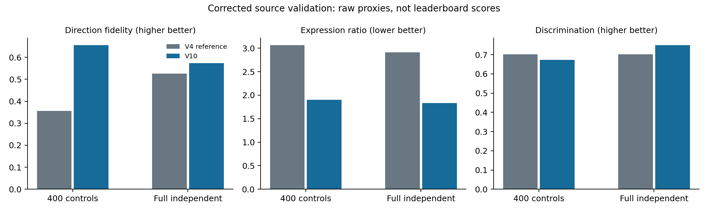

# V10 verified submission

Selected **dose_compact**; response `dose`, emission `compact`. This is an unsubmitted experimental prediction. V4 remains the best published submission until another official result beats it.

See [V10_STRATEGY.md](V10_STRATEGY.md) for the diagnosis, public approaches, new response pooling, population transport and explicit neutral-control bias.

## Corrected validation of the frozen candidate

The original compact validation adapter indexed depths from the beginning of the control population rather than the recorded 400-cell template. Production indexes the full control matrix correctly. The separate root audit corrects the adapter, verifies every generated validation depth against its actual template, tests both seeds with 400 and full independent reference controls, and preserves the original snapshots. No model parameter or selection was changed. These are revisited public development targets, not new blind confirmation.

| reference_mode | candidate | pds | fidelity | reach | jaccard | nmae | common_expression_ratio |
| --- | --- | --- | --- | --- | --- | --- | --- |
| full_independent | dose_compact | 0.750000 | 0.574049 | 0.385929 | 0.043311 | 0.881051 | 1.833134 |
| full_independent | v4_legacy | 0.701389 | 0.525383 | 0.611467 | 0.045696 | 0.869425 | 2.913312 |
| sampled400 | dose_compact | 0.673611 | 0.655697 | 0.417091 | 0.037320 | 0.819506 | 1.899539 |
| sampled400 | v4_legacy | 0.701389 | 0.355850 | 0.657455 | 0.149028 | 0.812531 | 3.065696 |

Reference `sampled400`: original-style fidelity/PDS/expression guards passed **True**; paired six-metric utility difference **0.099887**.

Reference `full_independent`: original-style fidelity/PDS/expression guards passed **True**; paired six-metric utility difference **0.122538**.

## Original public calibration snapshot (before depth-adapter repair)

| candidate | pds | fidelity | reach | jaccard | nmae | common_expression_ratio | utility |
| --- | --- | --- | --- | --- | --- | --- | --- |
| control_null | 0.500000 | 0.000000 | 0.564574 | 0.312500 | 0.817496 | 4.708920 | -0.114156 |
| dose_compact | 0.520833 | 0.689284 | 0.604743 | 0.034348 | 0.733158 | 2.503636 | 0.141381 |
| dose_selective | 0.527778 | 0.486154 | 0.655710 | 0.069373 | 0.731699 | 2.509934 | 0.121933 |
| invariant_compact | 0.513889 | 0.688050 | 0.586205 | 0.033548 | 0.736804 | 2.506069 | 0.134902 |
| pooled_compact | 0.513889 | 0.686718 | 0.569402 | 0.032430 | 0.764227 | 2.519003 | 0.126371 |
| v4_compact | 0.534722 | 0.672902 | 0.588073 | 0.038369 | 0.795732 | 2.786945 | 0.103560 |
| v4_legacy | 0.520833 | 0.468032 | 0.661195 | 0.155254 | 0.765164 | 4.929231 | -0.024173 |

## Original public confirmation snapshot (before depth-adapter repair)

| candidate | pds | fidelity | reach | jaccard | nmae | common_expression_ratio | utility |
| --- | --- | --- | --- | --- | --- | --- | --- |
| control_null | 0.500000 | 0.000000 | 0.468460 | 0.312500 | 0.871667 | 3.044569 | -0.121355 |
| dose_compact | 0.673611 | 0.655966 | 0.454452 | 0.037004 | 0.818586 | 1.898389 | 0.129611 |
| dose_selective | 0.673611 | 0.425990 | 0.516742 | 0.106953 | 0.811886 | 1.887885 | 0.116189 |
| invariant_compact | 0.576389 | 0.656537 | 0.397684 | 0.036795 | 0.819496 | 1.911277 | 0.085503 |
| pooled_compact | 0.527778 | 0.655949 | 0.464189 | 0.036561 | 0.791611 | 1.931552 | 0.081515 |
| v4_compact | 0.715278 | 0.652669 | 0.426988 | 0.040394 | 0.819614 | 2.026724 | 0.117378 |
| v4_legacy | 0.701389 | 0.355850 | 0.657455 | 0.149028 | 0.812531 | 3.065696 | 0.023160 |

The original historical confirmation snapshot passed guards: **True**; positive paired six-metric proxy improvement: **True**; paired utility difference **0.106451**. No candidate was selected or retuned using confirmation. H1 is reused development; HCT/HEK count targets are new, with public summaries previously available. These figures are not predictions of the hidden anchored score.

Original snapshot full target-mean fidelity: **0.370983 -> 0.655966**. On identical finite cases: **0.370983 -> 0.657817**. The paired proxy uses 10 common complete panels; unresolved panels are not silently filled.



## Fidelity by source family (corrected adapter)

| reference_mode | family | unique_targets | baseline_fidelity | candidate_fidelity | difference |
| --- | --- | --- | --- | --- | --- |
| full_independent | H1 | 2 | 0.447434 | 0.599574 | 0.152140 |
| full_independent | HCT116 | 5 | 0.664027 | 0.587194 | -0.076833 |
| full_independent | HEK293T | 6 | 0.472062 | 0.535381 | 0.063319 |
| sampled400 | H1 | 2 | 0.170667 | 0.639340 | 0.468673 |
| sampled400 | HCT116 | 5 | 0.456430 | 0.669102 | 0.212672 |
| sampled400 | HEK293T | 6 | 0.485854 | 0.658649 | 0.172795 |

The full-reference gain is uneven: H1 and HEK293T improve, while HCT116 declines. Reference size materially changes the apparent benefit. These public targets cannot establish transfer to the three hidden contexts.

## Neutral-control diagnostic

| generator | max_false_de_calls | max_false_call_fraction | mean_variance_ratio | neutral_guard |
| --- | --- | --- | --- | --- |
| compact | 3265 | 0.329532 | 0.172297 | False |
| legacy | 0 | 0.000000 | 1.039426 | True |
| selective | 0 | 0.000000 | 1.017197 | True |

Compact emission has substantial control-to-control DE bias and fails the former neutral-control preservation gate. The package is an experimental population model. Do not interpret synthetic dispersion as predicted biological variance.

## Verified upload artifact

- File: `experiments/v10_population_transport/prediction.vcc`
- Bytes: 4,167,249,920
- Shape: 360,000 cells x 18,533 genes; 900 target/context groups x 400 cells.
- Stored values: 2,459,676,692.
- Official prep, independent full-payload comparison and all 360,000 production-depth checks: passed.
- Exactly replayed groups: 12; replayed gene counts: 88,958,400.
- SHA-256: `0aea2ed2900a404de5b99963a9e00887a1b1fff1c14165e631869d556374da44`
- Uploaded: false. Hidden leaderboard performance: unknown.

## Submit from Windows Command Prompt

```bat
cd /d L:\promec\Animesh\Download\Virtual
.\.competition_env\Scripts\python.exe -m vcc submit .\experiments\v10_population_transport\prediction.vcc -m "Pooled intervention population transport v10" --wait
```

If Ctrl+C interrupts waiting after upload, use `vcc status <entry-id> --wait` to follow the existing scoring job instead of creating a duplicate.
