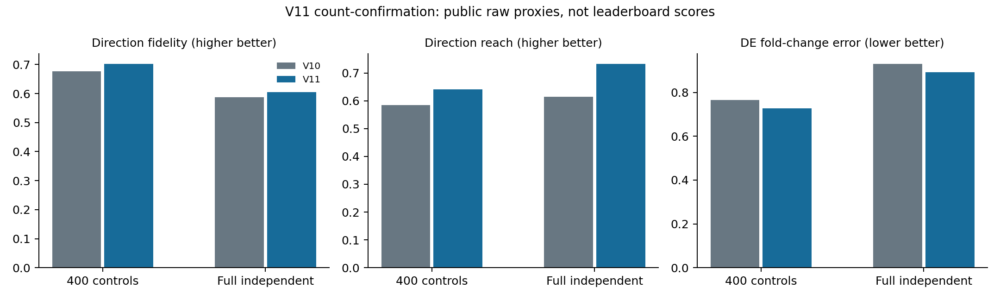

# V11 verified submission

Selected **consensus20_noise65**, setting `{"amplitude": 1.0, "bulk_amplitude": 1.0, "eligible": true, "noise": 0.65, "response": "consensus20"}`. V10 remains the best published project submission at 0.116754121 until another official result beats it. V11 has not been uploaded.

See [V11_STRATEGY.md](V11_STRATEGY.md) for the hypothesis, source review, code, frozen candidate grid and reproduction.

Compared with V10 using full independent controls, public fidelity improves 0.587892 to 0.604638, reach improves 0.614913 to 0.732797, and DE fold-change error falls 0.930693 to 0.893199. The common-control expression-error ratio worsens 5.12% (6.709610 to 7.053307; lower is better). These are public proxy measures, with the 400-cell SLIRP reach tradeoff and neutral-control bias detailed below.

## Public development results

| reference_mode | candidate | pds | fidelity | reach | jaccard | nmae | common_expression_ratio |
| --- | --- | --- | --- | --- | --- | --- | --- |
| full_independent | bulk085 | 0.534722 | 0.595123 | 0.554759 | 0.039383 | 0.785753 | 2.539135 |
| full_independent | consensus20 | 0.625000 | 0.593817 | 0.582949 | 0.039875 | 0.782356 | 2.536886 |
| full_independent | consensus20_noise65 | 0.625000 | 0.621441 | 0.555172 | 0.038559 | 0.769759 | 2.534328 |
| full_independent | consensus40 | 0.631944 | 0.589597 | 0.612837 | 0.040544 | 0.741712 | 2.618474 |
| full_independent | dose125 | 0.534722 | 0.596210 | 0.513645 | 0.040163 | 0.800764 | 2.533399 |
| full_independent | noise35 | 0.534722 | 0.582496 | 0.487270 | 0.040324 | 0.819177 | 2.537223 |
| full_independent | noise65 | 0.534722 | 0.627571 | 0.490805 | 0.036621 | 0.792758 | 2.533224 |
| full_independent | v10 | 0.534722 | 0.596947 | 0.489829 | 0.039200 | 0.814127 | 2.535135 |
| full_independent | v4_compact | 0.513889 | 0.586597 | 0.522701 | 0.043239 | 0.855594 | 2.811495 |
| sampled400 | bulk085 | 0.520833 | 0.686005 | 0.666287 | 0.035152 | 0.784872 | 2.468110 |
| sampled400 | consensus20 | 0.555556 | 0.679496 | 0.701548 | 0.036136 | 0.774206 | 2.467022 |
| sampled400 | consensus20_noise65 | 0.555556 | 0.722440 | 0.702383 | 0.034435 | 0.754057 | 2.464457 |
| sampled400 | consensus40 | 0.562500 | 0.670198 | 0.702772 | 0.036902 | 0.747313 | 2.549909 |
| sampled400 | dose125 | 0.534722 | 0.684932 | 0.501428 | 0.035912 | 0.793764 | 2.463048 |
| sampled400 | noise35 | 0.520833 | 0.651540 | 0.657240 | 0.036388 | 0.782534 | 2.466349 |
| sampled400 | noise65 | 0.520833 | 0.719728 | 0.643156 | 0.032479 | 0.777912 | 2.462375 |
| sampled400 | v10 | 0.520833 | 0.683281 | 0.611589 | 0.035549 | 0.793433 | 2.464292 |
| sampled400 | v4_compact | 0.513889 | 0.670217 | 0.585555 | 0.038706 | 0.842829 | 2.753556 |

## Public confirmation results

| reference_mode | candidate | pds | fidelity | reach | jaccard | nmae | common_expression_ratio |
| --- | --- | --- | --- | --- | --- | --- | --- |
| full_independent | consensus20_noise65 | 0.527778 | 0.604638 | 0.732797 | 0.010277 | 0.893199 | 7.053307 |
| full_independent | v10 | 0.500000 | 0.587892 | 0.614913 | 0.008946 | 0.930693 | 6.709610 |
| sampled400 | consensus20_noise65 | 0.541667 | 0.702463 | 0.640395 | 0.010395 | 0.728144 | 6.572716 |
| sampled400 | v10 | 0.541667 | 0.677080 | 0.584249 | 0.008670 | 0.765485 | 6.229079 |

Frozen candidate confirmation guard passed: **True**. Weighted paired six-metric proxy change versus V10: **+0.015148**. Public proxies are not hidden anchored scores. HCT/HEK count-confirmation targets were previously untested; H1 and public source summaries remain development evidence. No candidate was selected or retuned using confirmation.

## Fidelity by held-out family

| reference_mode | family | v10_fidelity | v11_fidelity | change |
| --- | --- | --- | --- | --- |
| full_independent | H1 | 0.608148 | 0.614135 | 0.005986 |
| full_independent | HCT116 | 0.589203 | 0.611393 | 0.022191 |
| full_independent | HEK293T | 0.566326 | 0.588387 | 0.022060 |
| sampled400 | H1 | 0.661250 | 0.665751 | 0.004501 |
| sampled400 | HCT116 | 0.668866 | 0.699832 | 0.030966 |
| sampled400 | HEK293T | 0.701125 | 0.741807 | 0.040682 |

## 400-distinct-treated-cell H1 power check

| reference_mode | candidate | fidelity | reach | jaccard | nmae | predicted_calls | reference_calls |
| --- | --- | --- | --- | --- | --- | --- | --- |
| full_independent | consensus20_noise65 | 0.633194 | 0.112309 | 0.044743 | 0.860125 | 2958.500000 | 399.000000 |
| full_independent | v10 | 0.632786 | 0.307660 | 0.037475 | 0.873241 | 3982.500000 | 399.000000 |
| sampled400 | consensus20_noise65 | 0.703771 | 0.480864 | 0.035741 | 0.871524 | 2441.000000 | 261.000000 |
| sampled400 | v10 | 0.709987 | 0.455870 | 0.030603 | 0.888661 | 3118.500000 | 261.000000 |

The power guard passed without duplicating cells. On SLIRP with full independent controls, fidelity changed +0.000408, NMAE changed -0.013116, but reach fell from 0.307660 to 0.112309. The predefined power guard protects fidelity and NMAE, not reach. This target-specific tradeoff remains. Only H1 has enough observed treated cells here; this is reused public biology and does not remove the HCT/HEK or hidden-context power gap.

## Neutral population bias

| candidate | reference_mode | max_false_de_calls | max_false_call_fraction | mean_variance_ratio |
| --- | --- | --- | --- | --- |
| noise35 | sampled2000 | 7526 | 0.757295 | 0.131624 |
| noise35 | sampled400 | 4441 | 0.447907 | 0.131624 |
| noise65 | sampled2000 | 2474 | 0.249345 | 0.234196 |
| noise65 | sampled400 | 1102 | 0.111145 | 0.234196 |
| v10 | sampled2000 | 5956 | 0.600282 | 0.175485 |
| v10 | sampled400 | 2747 | 0.277055 | 0.175485 |

Compact synthetic cells remain biased neutral populations. Reduced false calls do not mean faithful biological cell variance, and neither public guard passage nor this audit guarantees a leaderboard gain.

## Production response changes

| context | nonzero_effects | mean_absolute_effect | changed_effects_from_v10 | mean_absolute_change_from_v10 |
| --- | --- | --- | --- | --- |
| A | 3905884 | 0.014915 | 1995704 | 0.007279 |
| B | 3919848 | 0.014286 | 2010891 | 0.006976 |
| C | 3934857 | 0.015486 | 2008980 | 0.007429 |

## Production population constraints

| context | groups | nonzero_counts | max_mean_probability_L1 | max_bulk_probability_L1 |
| --- | --- | --- | --- | --- |
| A | 300 | 820584543 | 0.008020 | 0.000442 |
| B | 300 | 751584357 | 0.017749 | 0.000561 |
| C | 300 | 803681760 | 0.007309 | 0.000458 |

L1 distances compare requested versus realized mean cell proportions and pooled proportions. All 900 groups meet the predefined limits; these constraints do not establish realistic cell variance.

## Scientific and integrity checks

Four focused scientific tests passed. The model audit verified 64 target/seed splits and recomputed sampling for 4 power-check groups with 400 distinct treated cells. All production response arrays were independently recomputed exactly.



## Upload artifact

- File: `experiments/v11_consensus_coverage/prediction.vcc`
- Bytes: 4,080,977,920
- Shape: 360,000 cells x 18,533 genes; 900 groups x 400 cells.
- Official prep, every packaged count/index/pointer/axis, all control provenance and depths: passed.
- Exact replay: 12 groups, 88,958,400 gene counts.
- SHA-256: `7841429ef987c43abcfb01a5be8f09864c5f8955e1bd7aae68fb4a03240be31d`
- Uploaded: false. Leaderboard performance unknown.

## Submit from Windows Command Prompt

```bat
cd /d L:\promec\Animesh\Download\Virtual
.\.competition_env\Scripts\python.exe -m vcc submit .\experiments\v11_consensus_coverage\prediction.vcc -m "Consensus-supported coverage and dispersion v11" --wait
```

If waiting is interrupted after upload, follow the existing entry with `vcc status <entry-id> --wait` instead of creating a duplicate.
