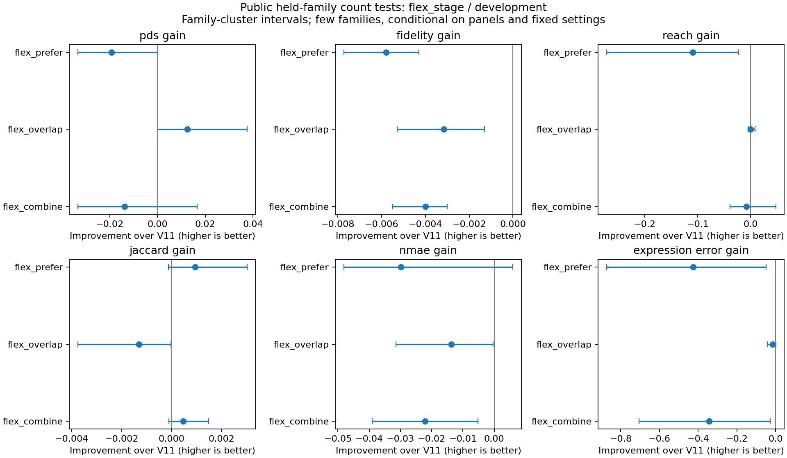
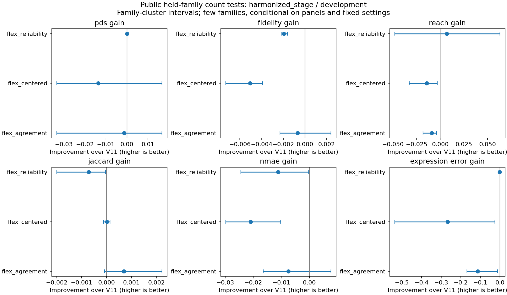

# V12 rigorous validation and matched-Flex source experiments

This experiment preserves V11 (published overall 0.137003974) and its package. A new candidate must pass the fixed development and independent-count confirmation checks before production generation. Public-source comparisons are not predictions of the hidden leaderboard score.

## What changed in validation

The official scorer is pinned to `ArcInstitute/cell-eval2` commit `0ce25cf4c495e76e60dfca4ddc8f822507aa0e18`, version 0.18.0. An isolated Python 3.13 environment reproduces its CPU Scanpy path. Six metric edge fixtures and an independent tied-count fixture pass; the latter agrees on 125 eligible genes with maximum p-value error 5.55e-16, adjusted-p error 9.44e-16, and identical log-fold changes. Exact division by `depth / 1e6` followed by `log1p` matters for floating-point rank ties. The first distribution stage used mathematically equivalent CPM ranks; subsequent count stages use the verified CPU arithmetic.

Each count experiment holds out an entire source family before pooling responses. It uses genuine perturbed cells, distinct control identities for templates and references, two fixed seeds, 400 generated cells, and both sampled-400 and full independent reference controls. Small observed treatment groups are never expanded by duplicating cells. Confirmation target names are disjoint from development. Existing biological summaries were already examined in earlier project versions, so these are independent count tests, not wholly blind biological discovery.

The original plan and amendments are immutable evidence under `experiments/v12_distribution_calibrated/analysis/`. Added power cases were selected from existing summaries and metadata before their new count outcomes: RNF10 in the second HEK development stratum, and TAF4/PAPOLA in both HCT confirmation strata. The original reserved cases remain. Complete metric panels are mandatory; missing NMAE is not silently converted to zero.

Fixed guards in each reference mode: aggregate fidelity and reach may drop at most 0.01, each family's fidelity and reach at most 0.03, NMAE may worsen at most 0.01, and PDS may fall at most 0.02. Expression error must improve in development and confirmation. No retuning after confirmation failure.

## Completed rejected ideas

These are full-independent-reference development averages, balanced over families and control strata. Lower expression ratio and NMAE are better; higher fidelity and reach are better.

| Count emitter | Fidelity | Reach | Expression ratio | Decision |
|---|---:|---:|---:|---|
| V11 compact | 0.5868 | 0.3569 | 1.4050 | Comparator |
| Full empirical variation | 0.3068 | 0.4601 | 1.4021 | Reject: fidelity loss |
| Full gamma variation | 0.3993 | 0.4422 | 1.4007 | Reject: fidelity loss |
| 25% gamma variation | 0.5946 | 0.3640 | 1.4065 | Reject: expression worsens |
| Intervention-linked variance | 0.4464 | 0.4162 | 1.4018 | Reject: fidelity loss |
| Thinning and immigration | 0.3519 | 0.4672 | 1.4020 | Reject: fidelity loss |

Neutral control tests explain the tradeoff: full empirical counts retain about 1.01 times real control variance and almost eliminate false DE calls; V11 retains about 0.23 times variance and creates many null calls. Distribution realism alone did not improve the intervention metrics sufficiently. No rejected emitter was promoted to confirmation.

Whole-family source-summary screens also tested stronger heterogeneity shrinkage, nested amplitude calibration, and Reactome neighbor imputation. The pathway result did not beat the shuffled-annotation control; amplitude shrinkage improved squared error but lost direction yield. These screens use normal-q proxies and do not substitute for official count metrics.

## New matched-Flex source

[VIPerturb-seq public data](https://doi.org/10.5281/zenodo.18460279), CC-BY-4.0, supplies three genome-wide K562 Flex RDS bins. All three files are checked against publisher MD5 and recorded SHA-256 digests. The full RNA assay has 19,068 genes, including 18,111 competition genes. Full-assay library totals are computed before projection. Exact repeated non-targeting cells across bins are deduplicated after checking their identities, metadata, and every projected count.

The [authors' guide library](https://satijalab.org/viperturb-seq/computational-tools/guest_list_protospacer_reference.csv) identifies 496 `NO-TARGET` guides. An initial inspection incorrectly classified the human gene `CTRL` as a control label. This was caught before fitting any Flex response. The incorrect extract is quarantined, the corrected extraction checks guide identities, and `flex_control_identity_correction.json` explicitly supersedes the early 69-control inspection and its obsolete control-limit text. Correct extracts have 7,949 true control cells per bin before deduplication. No response model was trained with the incorrect control labels.

The [paper](https://www.biorxiv.org/content/10.64898/2026.02.12.705613v1.full) describes one K562 culture divided into indexed aliquots and two Flex lanes. Lane-matched controls are used; aliquot labels remain in the audit. Minimum source QC was fixed before response fitting: 30 actual treatment cells, target control expression above 5 CPM, and at least 25% measured knockdown. Failed estimates are unavailable, with legacy fallback, rather than measured zero effects.

Flex is part of the existing K562 family, not a sixth independent lineage. Three source-only variants retain V11 count emission: equal-platform blend, prefer-Flex with fallback, and blend restricted to legacy measured genes. The blend retains marginal platform uncertainty plus disagreement; it does not divide the uncertainty by two. Whole-K562 exclusion must erase every Flex contribution exactly. A shuffled-target Flex negative control is screened separately. The old K562 file is pseudobulk, so a genuine cell-count-matched old-source downsample cannot be reconstructed and is not claimed.

## Reproduce

Run from the project root in Command Prompt. Large public inputs, environments, counts, and packages are ignored by Git; small plans, scores, tests, and hashes are tracked. Source downloads and extraction require adequate disk space and RAM. R is installed project-locally, not system-wide.

```cmd
.\.competition_env\Scripts\python.exe collect_v12_resources.py
.\.competition_env\Scripts\python.exe setup_v12_environment.py --python313 "C:\Users\animeshs\AppData\Local\Programs\Python\Python313\python.exe" --with-r
.\.competition_env\Scripts\python.exe test_v12_metrics.py
.\.v12_eval_env\Scripts\python.exe verify_v12_official_cpu.py
.\.competition_env\Scripts\python.exe benchmark_v12_distributions.py
.\.competition_env\Scripts\python.exe evaluate_v12_submission.py --stage development --workers 8
.\.competition_env\Scripts\python.exe evaluate_v12_interventions.py --stage development --workers 8
.\.competition_env\Scripts\python.exe screen_v12_responses.py
.\.competition_env\Scripts\python.exe download_v12_ranges.py
.\.competition_env\Scripts\python.exe audit_v12_control_labels.py
.\.competition_env\Scripts\python.exe extract_v12_flex.py --bin genome_wide_binA.RDS
.\.competition_env\Scripts\python.exe extract_v12_flex.py --bin genome_wide_binB.RDS
.\.competition_env\Scripts\python.exe extract_v12_flex.py --bin genome_wide_binC.RDS
.\.competition_env\Scripts\python.exe extract_v12_flex.py --combine
.\.competition_env\Scripts\python.exe test_v12_flex.py
.\.competition_env\Scripts\python.exe evaluate_v12_flex.py --stage development --workers 8
.\.competition_env\Scripts\python.exe assess_v12_stage.py --folder flex_stage
.\.competition_env\Scripts\python.exe compare_v12_source_anchors.py
```

Plan-creation commands intentionally refuse to overwrite frozen plans. Check their recorded script and input digests before reusing generated caches. Official anchor generation requires the isolated evaluator environment and the prepared real panels. Source anchor comparisons use the first seed and full independent controls with exactly the same truth panels; PDS excludes the targets in each public panel to match its anchor. Small panels give noisy anchor denominators. Private competition anchors remain unavailable.

The target coverage table records the knockdown/expression flag as `target_qc_pass`; the separate minimum-cell rule is enforced in `valid`. The number with actual usable outputs, after all rules, is 214.

The final decision and measured outcomes are recorded below. No V12 production package was generated.

## Follow-up platform-calibration hypotheses

The complete first Flex summary screen showed that the full-axis blend's objective (0.0624) was close to target-shuffled Flex (0.0605), both below V11 (0.1298). This does not demonstrate useful target-specific transfer. A second bounded development stage was therefore frozen before its own outcomes: (1) leave-target-out per-gene platform offset correction, with at least 20 other paired targets and a 20-pair regularizer; unpaired genes remove their leave-target-out generic Flex response; (2) accept shared-gene updates only on cross-platform sign agreement and added genes only when another training family agrees; (3) retain legacy effects and inflate their uncertainty where Flex disagrees. Marginal uncertainty is retained. Whole-family exclusion and a centered target-permutation control are checked again.

This is development reuse after a failed hypothesis, not a fresh blind development set. All thresholds and variants were frozen before this follow-up's outcomes. Confirmation remains separate and may be used only once for the final frozen choice. The same genuine cells, technical strata, seeds, count emitter, metrics, and public anchors are used, isolating source calibration. Root scripts: `v12_harmonized_methods.py`, `screen_v12_harmonized.py`, `evaluate_v12_harmonized.py`, `compare_v12_harmonized_anchors.py`, and `select_v12_harmonized.py`.

## Bounded higher-Poisson experiment and early rejection

A final emitter-only stage kept V11 responses fixed and tested noise 0.85 and 1.0 against 0.65. Neutral false DE decreased substantially, but the completed H1 family (six targets, both seeds, both reference modes) lost 0.287-0.407 full-reference fidelity and 0.297-0.401 sampled-reference fidelity. Each loss exceeds the fixed worst-family limit of 0.03. Both candidates were therefore rejected early; other families cannot repair that guard failure. Later-family partial caches are preserved, but there is no completed overall development score or promotion claim. ABC neutral diagnostics continue to completion to characterize the tradeoff. `reject_v12_poisson_futility.py` records the terminal rejection and exact evidence hashes.

The sampled-400 HEK stratum1 panel at the first seed still has no NMAE-eligible perturbation even after adding RNF10. Its NMAE remains missing; the complete-panel guard is not relaxed. Full-reference panels are complete. Every first-stage Flex candidate also fails substantive expression/NMAE/reach guards, independently of this power deficiency. This limitation must inform future validation design rather than become a zero score or a claim that every public panel was fully powered.

## Final decision: retain V11

**No new candidate passes the fixed development guards. No V12 prediction package was generated, and no submission was uploaded. Confirmation count outcomes remain unopened.** The final development decision is pinned in `experiments/v12_distribution_calibrated/analysis/final_development_choice.json`.

The six source/calibration alternatives have these full-independent-reference results, balanced equally over families and then technical strata:

| Candidate | Fidelity | Reach | NMAE (lower better) | Expression ratio (lower better) |
|---|---:|---:|---:|---:|
| flex_combine | 0.5795 | 0.3358 | 0.8994 | 1.7793 |
| flex_overlap | 0.5803 | 0.3432 | 0.8909 | 1.4514 |
| flex_prefer | 0.5777 | 0.2347 | 0.9071 | 1.8628 |
| v11 | 0.5835 | 0.3439 | 0.8772 | 1.4358 |
| flex_agreement | 0.5828 | 0.3349 | 0.8848 | 1.5486 |
| flex_centered | 0.5784 | 0.3295 | 0.8982 | 1.7030 |
| flex_reliability | 0.5815 | 0.3508 | 0.8884 | 1.4376 |

All six worsen expression error. The closest reliability-only update still worsens NMAE by 0.0111 (limit 0.01), increases expression error by 0.00183, and fails a family reach guard. Platform agreement protects fidelity reasonably well but increases expression error by about 0.113. None is rejected solely because of the remaining sampled-reference NMAE power deficiency.

Some public-source anchored composites increase, especially the overlap-only blend (0.09857 versus V11 0.05458). The improvement is driven by PDS, whose replicate/baseline denominator is only 0.05 in one small source panel. This is not reliable evidence of a better private leaderboard score and does not override the fixed expression, fold-change, or worst-family guards. The centered-response summary objective (0.06983) remains close to its shuffled-target control (0.06858), below V11 (0.12984).

Across the five count stages, **952 complete generated 400-cell populations** are retained as cached profiles/metrics (including 22 cases in the deliberately stopped Poisson stage). This is not 952 independent biological experiments: many populations share actual treatments, templates, references, or settings. There were 13 count/source alternatives plus four response-summary alternatives and negative controls. Three cell families have actual-count validation; all five existing source families have summary screens. Exact baseline profiles and jackknife corrections match across all 60 shared source/calibration cases, 58 intervention cases, and 22 partial Poisson cases.

Neutral Poisson noise 0.85 and 1.0 reduce worst-context full-reference false DE from 2,293 to 544 and 385, respectively, while total variance rises from 0.232 to 0.335 and 0.428 times real-control variance. Their severe H1 fidelity losses make them unsuitable despite these null improvements. Full empirical variance is even more realistic under the null but also loses too much intervention fidelity.

Family-cluster intervals and metric-gain figures are saved for both complete source stages. They resample family means after averaging technical strata and seeds. With only three development families, these are descriptive, conditional intervals; they do not capture model selection, anchor, or private-domain uncertainty.

The strongest supported upload artifact remains the already published `experiments/v11_consensus_coverage/prediction.vcc`, SHA-256 `7841429ef987c43abcfb01a5be8f09864c5f8955e1bd7aae68fb4a03240be31d`. Re-uploading the unchanged package is unnecessary. Its published overall score is 0.137003974. Original V11 code, generation snapshots, and package are preserved.

The useful next work is a genuinely stronger causal transfer model or additional independently matched intervention contexts. Further tuning of these tested variance and platform-blending dials is not supported by the present evidence. Future count tests also need genuinely powered treatments in every sampled-reference stratum, selected without candidate predictions; missing official metrics must remain missing.





Final audit/decision commands (the decision command refuses to overwrite its frozen record):

```cmd
.\.competition_env\Scripts\python.exe audit_v12_splits.py --folder flex_stage
.\.competition_env\Scripts\python.exe audit_v12_splits.py --folder harmonized_stage
.\.competition_env\Scripts\python.exe audit_v12_splits.py --folder poisson_stage
.\.competition_env\Scripts\python.exe summarize_v12_evidence.py --folder flex_stage
.\.competition_env\Scripts\python.exe summarize_v12_evidence.py --folder harmonized_stage
.\.competition_env\Scripts\python.exe audit_v12_baseline_replay.py
.\.competition_env\Scripts\python.exe freeze_v12_choice.py
.\.competition_env\Scripts\python.exe finalize_v12_research.py
```
