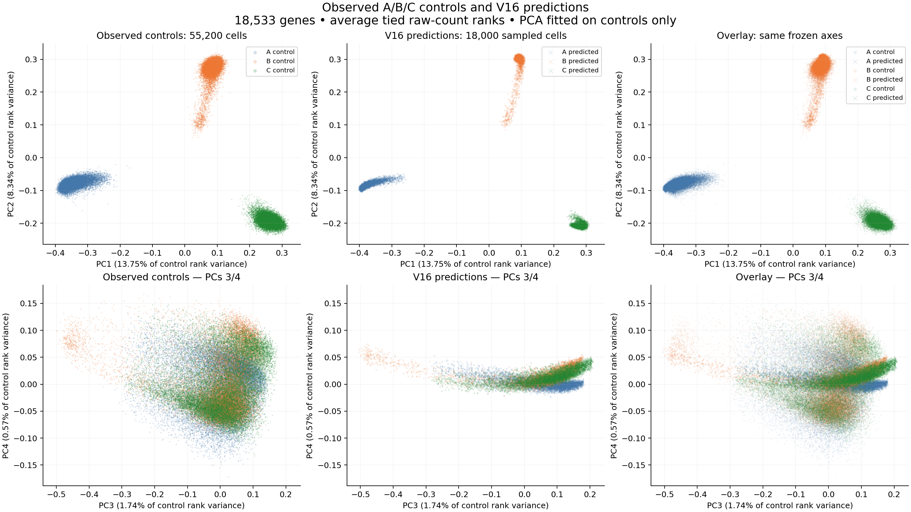

# Observed controls and V16 predicted cells

Plots use all **55,200 observed non-targeting controls** and **18,000 V16 predicted cells**: a seeded simple random sample of 20/400 cells from every one of the 900 target/context groups. Every target is represented in A, B and C. Source counts stay unchanged.



The top row shows PC1/PC2; the bottom shows PC3/PC4. Columns show observed controls, predicted cells, and the overlay, with identical axes across each row. Blue=A, orange=B, green=C; circles=controls, crosses=predictions. The frozen axes explain 13.75%, 8.34%, 1.74%, and 0.57% of the observed-control rank variance.

## Method and checks

Reuse the original full-matrix rank PCA fitted only on controls. Each cell is ranked across the same 18,533 raw-count genes with average ties and zeros retained, then centered and unit-normalized. Predictions are transformed with the original control mean/components; there is no refit, pseudocount, gene imputation, or separate alignment. This retains our earlier rank-correlation strategy. All 900 groups, gene axes, unique prediction IDs, sampled nonnegative integer counts, and coverage are checked. Eight cached observed coordinates per context are independently replayed against the original counts; predicted projection is checked for batching invariance.

The standalone interactive HTML supports all 300 targets, source/context legend toggles, hover, zoom, and switching PC1/PC2 to PC3/PC4. Observed circles remain unperturbed controls even when a target is selected. There are no measured A/B/C treated responses here. Separation/overlap is descriptive and is not an accuracy score. The prediction pool includes different interventions, so its spread is not directly equivalent to within-treatment biological variance. `projection_summary.csv` reports descriptive eight-PC spread and count summaries, not full-gene variance.

## Reproduce

Run from the root in Windows Command Prompt after restoring the original controls, V16 prediction H5AD and the existing full-rank clustering cache:

```cmd
.\.competition_env\Scripts\python.exe plot_v16_cell_projection.py
```

Outputs: `analysis/v16_cell_projection/cells_observed_vs_v16.png`, `.pdf`, `.html`, `cell_coordinates.csv`, `projection_summary.csv`, and `analysis_report.json`. Large regenerable HTML/coordinate files remain local. Inputs and outputs are recorded with checksums; the prediction file's prior full-audit hash is inherited and explicitly not rehashed by this plotting script. No model or prediction is changed.
