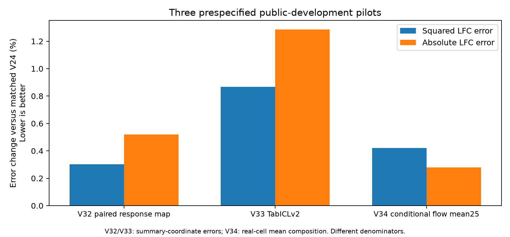

# Three new model tests: V32–V34

V24 remains the published comparator (overall 0.14299785521745675). All three hypotheses were implemented and tested in sequence. These are public development results, not leaderboard forecasts. The latest donor reserve was not opened.

| Primary model | Squared LFC error change vs V24 | Absolute LFC error change vs V24 | Mean gate |
|---|---:|---:|---|
| V32 paired response map | +0.302% | +0.520% | FAIL |
| V33 TabICLv2 | +0.866% | +1.287% | FAIL |
| V34 conditional flow mean25 | +0.421% | +0.280% | FAIL |

Negative error changes are improvements. V32/V33 use masked public summary-coordinate LFC errors; V34 uses approximate normalized mean-composition errors against real cells. Their percentages have different evaluation denominators and must not be ranked as interchangeable scores. Each compares against its matched held-family V24 baseline.

## V32: paired source-response transfer

Corrected paired MSE ratio 1.003019024; identity-shuffled 1.002976541; direct-copy 1.002816721.

The first implementation reapplied expression gating to V24 fallback. The separate correction preserves unsupported coordinates exactly and replays saved models with the same nested selection grid. Original results are retained for traceability. The corrected result, rather than the initial run, determines the conclusion.

All twelve ridge fits passed independently recomputed masked-gradient checks. All nine outer comparisons were replayed with independent float64 error accumulation; fitting/validation target separation and whole-family exclusions were checked.

## V33: tabular foundation model

| Matched algorithm, fixed alpha0.5 | Squared LFC error change | Absolute LFC error change |
|---|---:|---:|
| tabicl | +0.866% | +1.287% |
| catboost | +0.874% | +1.300% |
| ridge | +1.127% | +1.685% |
| identity_shuffled_tabicl | +0.899% | +1.338% |

The pilot uses eight response programs, 512 route-balanced public in-context examples and two TabICL ensemble members. Ridge/CatBoost use identical inputs/labels. Their results are comparisons, not post-hoc alternative release selections. Checkpoint bytes, family/target boundaries, finite outputs and score aggregation were audited; every GPU forward was not independently reimplemented.

## V34: conditional flow

Primary learned-mean CPM error ratio: 1.003812995.

Three independent outer-family flow models were trained for eight epochs each. Epoch selection used generated held-target source means, not outer scores or observed treated means supplied to the decoder. The architecture predicts 1,024 measured genes and retains V24 elsewhere. It does not receive the measured source-response tokens available to V24, so this comparison combines architecture and intervention-information differences. Missing STRING embeddings use a zero descriptor. Mean-only and flow-shape count diagnostics were run regardless of earlier model failures. The shape arm preserves the mean25 reference gene totals exactly, cell libraries exactly, and CPM mean L1 <=0.0005. After the initial integer projection failed in D1 (0.0007056), a uniform16-depth-bin allocation repaired the numerical contract; it also constrains learned gene-depth associations. Initial partial null results and failure evidence are retained.

| Count diagnostic | PDS change | FID change | REACH change | JAC change | NMAE change | Relative expression error change |
|---|---:|---:|---:|---:|---:|---:|
| flow_mean25 | -0.013889 | -0.005114 | +0.058183 | -0.000275 | -0.001856 | +0.018639 |
| flow_shape25 | -0.013889 | -0.005894 | +0.058183 | +0.000298 | -0.001932 | +0.017834 |

### Control-null calibration

| Context | Real NTC comparison DE calls | V24 emitter DE calls | Flow shape DE calls |
|---|---:|---:|---:|
| CD4_Rest_D1 | 1 | 516 | 479 |
| CD4_Stim48_D2 | 0 | 753 | 719 |
| H1 | 0 | 1415 | 1392 |
| HCT116 | 1 | 780 | 732 |
| HEK293T | 0 | 355 | 343 |

The actual NTC-vs-NTC comparisons have0–1 DE calls. Both synthetic emitters retain hundreds to thousands: the flow reduces this artifact only slightly. Null FID is not a treatment-recovery result. V29 previously showed that eliminating null calls alone also does not guarantee better treatment prediction.

PDS/FID/REACH/JAC increases are favorable; NMAE/expression-error decreases are favorable. Undefined quantities remain null and fail resolution guards. The count subset consists of the first four cases in each of five contexts; D1 cases have 200 cells and are explicitly lower-power diagnostics. It does not estimate performance on the complete 300-target competition panel.

## Limits and decision

This tests three specific, reproducible configurations. A negative pilot does not rule out its entire model class. There are few independent training lineages, most target/context examples come from reused public sources, and matched source/query assays differ. In particular, source-observed response transfer still must extrapolate to a recipient with only controls; recipient-anchored paper results do not remove that difficulty.

No primary mean candidate passed. No new submission package was generated, and V24 remains the preferred upload. Further tuning on these same outer outcomes would be exploratory and would require new confirmation evidence.

See [V32_V34_STRATEGY.md](V32_V34_STRATEGY.md) for inputs, exact commands, corrections and literature. Plans, score records, checkpoints receipts and independent audit results are retained under their respective experiment analysis directories.

