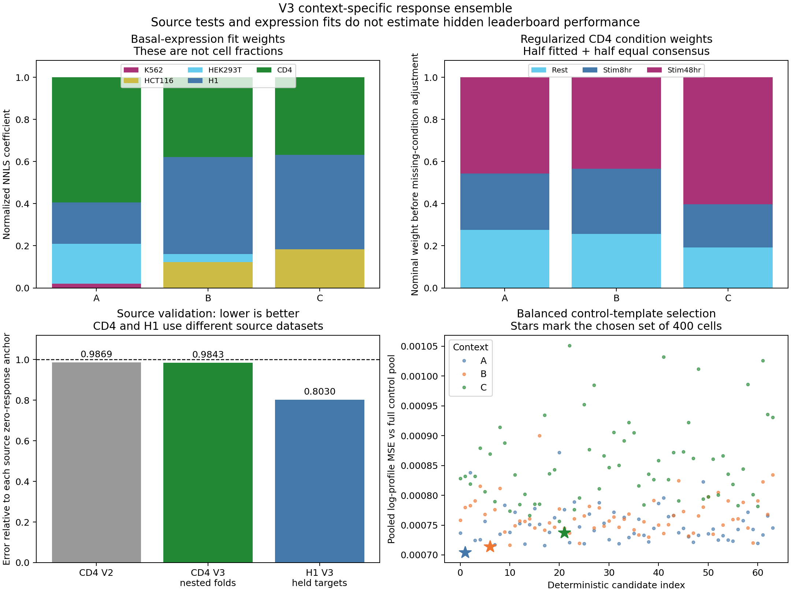

# V3: context-specific response ensemble

## Completed upload-ready package

The new candidate is generated, officially packaged and independently validated. It has not been uploaded or scored.

| Check | Result |
|---|---|
| Package | `experiments/v3_context_ensemble/prediction.vcc` |
| Package bytes | 3,305,861,120 (3.31 GB; about 3.08 GiB) |
| H5AD bytes | 2,471,345,097 |
| Shape | 360,000 cells x 18,533 genes |
| Groups | 900, exactly 400 cells each |
| Stored entries | 2,082,589,661 |
| Maximum cell total | 51,227 |
| Official packaging | Passed, CLI 0.2.2, counts preserved |
| Independent checks | Package hash, source/axis checks, target-fold separation, all control templates, 333,594 gene-count expectations across 18 selected groups |
| Regression tests | 19 passed |
| Generation/packaging time | 24.5 minutes, excluding source preparation |
| Leaderboard score | Not yet available |

Package SHA-256:

```text
93ba49eabf7b2b730080a5f2a52745b31d7df90719fc5488bf75e69f7cc2f454
```

The response audit compares six deliberately selected targets in each context. For example, AKT2 downstream calls changed from 2/6/8 (V2 A/B/C) to 4/21/31 (V3), while SMARCA5 changed from 558/549/506 to 408/612/612. Both increases and decreases occur. These diagnostics do not establish correct gene identities, signs or a higher competition score. The original two prediction packages remain untouched.

## Strategy

V2 used one CD4/K562 effect vector for all three anonymous contexts. The new candidate uses a separate response blend for A/B/C, uncertainty-calibrated CD4 estimates, direct public H1 responses for 13 targets, and a common balanced control template within each context. Predictions remain 400 raw-count cells per target/context, on the exact 18,533-gene axis.

The prior correlations describe unperturbed expression, and their dispersion strongly tracks count depth. They do not identify cell types or biological mixture fractions. V3 therefore uses a **regularized expression-fit ensemble**, rather than assigning each cell a hard external cell-type label. Reference-associated variability is not evidence that A/B/C actually contain mixtures of those named cell lines.

## 1. Select the CD4 response estimator using independent donors

Reuse the pinned author-provided DE estimates and standard errors from `reference/cd4_probe/`. The same quality filters as V2 require >=100 cells, significant on-target reduction, two guides, and no reported low-target-expression or neighboring/distal off-target flags.

Compare 19 candidate estimators: a zero response, six FDR-filtered/shrunk estimates (q 0.05/0.2, alpha 0.3/0.7/1), and 12 uncertainty-based Gaussian-prior estimates (prior variance 0.0025/0.01/0.04, alpha 0.5/1, with/without a condition-specific shared-response prior). All donor log2FC values are clipped to +/-3 and each perturbed gene is excluded from its own loss.

Use the two disjoint donor groups from V2. Five outer folds group all conditions for a target together; three inner target folds choose settings. Fit any shared-response prior exclusively using training targets. The loss equally weights the 138 eligible target-condition contrasts across 72 targets and 10,273 genes, bidirectionally predicting one donor group from the other. This is source-domain validation, not a competition score.

Every outer fold selected zero-centered uncertainty shrinkage with prior variance 0.04 and alpha 0.5:

`predicted_log2FC = 0.5 * observed_log2FC * 0.04 / (0.04 + standard_error^2)`

Nested held-out relative error is **0.984254**, compared with V2's **0.986857**, on the zero-response scale. This is a small improvement (~0.26% relative to V2's error). The shared-response prior was not selected. Final settings use all outer-fold results; the selected minimum itself is optimistic, while the nested result measures the selection procedure. Donor subsets are enriched for larger responses.

Fit separate Rest, Stim8hr and Stim48hr responses from eligible merged rows. CD4 supplies 223 targets and 10,113 challenge genes.

## 2. Add direct H1 perturbation measurements

`extract_h1_responses.py` uses ONLY the public 2025 H1 training release, with pinned GCS generation `1765904883947296`. Exactly 13 of the current 300 targets are present. Keep 32 non-targeting controls per source batch and adapt the target-cell sampling plan until the sparse-storage range plan fits a two-GiB cap. The completed plan used two target cells per target/batch: 1,236 perturbed cells plus 1,536 controls, across 48 batches. All source range requests enforce source identity and checksums through the existing range reader.

Total ranges used: 1,635,264,949 bytes; newly downloaded: 741,867,520 bytes. No full 15.5-GB H1 matrix or hidden 2026 perturbation measurements are downloaded. Extracted counts, cell IDs, gene axis, source metadata and hashes are stored in the ignored `reference/h1_response/` cache; derived validation records are tracked.

Estimate each response using mean CPM and a batch-matched control mean. Calculate log2 ratios with a one-CPM continuity value and sampling standard errors, clip effects to +/-3, and exclude genes with control expression <=5 CPM. This continuity value is part of the response model; the earlier requested raw Spearman correlations remain unchanged and have no added constant.

Split source batches into disjoint alternating sets. Use leave-one-target-out parameter selection over shrinkage 0/0.3/0.5/0.7/1 and SE soft thresholds 0/1/1.96. The selected shrinkage is 0.7, with one-SE soft thresholding. Held-target selection error relative to zero response is **0.802987** (~19.7% lower). This validates within-source batch prediction, not cross-cell-type transfer. All 13 targets have >=40 sampled cells and >=30% measured source knockdown and are accepted.

## 3. Fit basal expression ensembles and regularize condition weights

Read the verified K562/HCT116/HEK293T/H1/CD4 control profiles and the actual A/B/C raw-control means. Exclude all 300 panel target genes from fitting. Use a common measured gene axis; normalize each profile to a common total on that axis. Only genes expressed above five CPM in the mean source basis inform mixture coefficients. Genes absent from every source cannot inform a mixture coefficient and are excluded.

Fit nonnegative least squares after weighting genes by the inverse square root of their mean basis expression. Normalize fitted coefficients to weights. Evaluate expression reconstruction on five held-out gene folds and record 100 gene-resampling stability fits per context/basis. These are expression-fit weights and stability diagnostics, not cell-type percentages or biological confidence intervals.

The five-profile blend reduces held-out weighted expression error by about 11% (A), 13% (B), and 16% (C), compared with the best single profile. This does not validate perturbation-transfer weights. A separate three-condition CD4 fit has smaller gains (~1–3%). To avoid a strong condition assignment from weak basal evidence, use **half the fitted condition weights plus half an equal-condition consensus**, then renormalize over conditions with a valid estimate for each target. This is a fixed conservative modeling assumption.

Approximate five-profile expression-fit coefficients:

| Context | K562 | HCT116 | HEK293T | H1 | CD4 |
|---|---:|---:|---:|---:|---:|
| A | 0.020 | 0.000 | 0.189 | 0.196 | 0.594 |
| B | 0.000 | 0.122 | 0.039 | 0.460 | 0.379 |
| C | 0.000 | 0.183 | 0.000 | 0.448 | 0.369 |

Only CD4, K562 and H1 currently provide measured response estimates. Renormalize their response weights **per target and measured gene**, preserving fallback estimates instead of treating an unmeasured gene as a measured zero. HCT116/HEK293T basal coefficients cannot supply perturbation responses. If a source's basal weight is zero but it is the only measured fallback, retain its estimate. Unsupported downstream genes retain the control-derived baseline.

K562 retains source quality checks and SE soft thresholding, with a conservative fixed 0.3 transfer coefficient. This coefficient is an assumption, not an independently validated cross-context optimum. The ensemble uses log2 response effects; its basal-fit coefficients are not transferred raw expression amounts.

## 4. Reduce baseline sampling noise while retaining real cells

For each context, draw 64 candidate sets of 400 distinct controls. Each is balanced across all 46 guides (8–9 cells per guide) and stratified across library size. Select the set whose pooled 50,000-total log1p profile best matches the complete control pool on non-panel genes. Every target in a context starts from the SAME selected set. This reduces unrelated baseline differences among target predictions.

This selection uses supplied unperturbed controls only. It is not perturbation-response validation. Count-depth spread, guide counts and cell identities are independently checked. Downward changes use binomial thinning; increases use the existing zero-aware, depth-scaled Poisson additions. Keep the original assumed 90% direct knockdown. No source cell-type label is assigned to any submitted cell.

## Reproduce in Windows Command Prompt

Use the pinned environment in `requirements-competition.txt`. Restore the original controls and the public external caches using [CELL_REFERENCE_CORRELATIONS.md](CELL_REFERENCE_CORRELATIONS.md) and [V2_SUBMISSION.md](V2_SUBMISSION.md) if needed. Source preparation scripts verify pinned checksums. All new code is in the root folder.

```cmd
cd /d L:\promec\Animesh\Download\Virtual
.\.competition_env\Scripts\python.exe extract_h1_responses.py
.\.competition_env\Scripts\python.exe fit_context_ensemble.py
.\.competition_env\Scripts\python.exe -m unittest test_submission test_cd4_model test_context_ensemble -v
.\.competition_env\Scripts\python.exe validate_v3.py --model-only
.\.competition_env\Scripts\python.exe build_submission.py --output-dir experiments/v3_context_ensemble --reference-kind context-ensemble --upward-mode zero-aware --seed 20261005
.\.competition_env\Scripts\python.exe validate_v3.py --audit
.\.competition_env\Scripts\python.exe audit_v3_effects.py
.\.competition_env\Scripts\python.exe plot_v3_strategy.py
```

An already completed prediction requires intentional `--force` to regenerate. To recompute CD4 model selection explicitly, call `validate_cd4` from the fitter before its main preparation; otherwise preparation reuses the recorded grid choice. Source files, effect arrays and prediction packages are ignored by Git; small model-selection CSV/JSON records and documentation are tracked.

## Submit

The generator packages and validates locally. It does not upload. Reuse the existing OS-keychain login:

```cmd
cd /d L:\promec\Animesh\Download\Virtual
.\.competition_env\Scripts\python.exe -m vcc submit .\experiments\v3_context_ensemble\prediction.vcc -m "Context-specific uncertainty ensemble v3" --wait
```

## Validation and interpretation

`validate_v3.py` checks source/model checksums, target-grouped fold separation, matched axes, context-specific effects, source-weight support and all three control templates. Once generation finishes, the existing pipeline checks every stored count, every cell total, all 900 groups and exact labels/gene order, then runs official `vcc prep` and validates the package. Independent checks verify the package hash and compare selected generated groups against binomial/Poisson count expectations, with exact checks on unchanged gene sums.

The optional audit compares selected V2/V3 downstream DE calls against the provided controls. More predicted DE calls do not establish accuracy; this is a response diagnostic, not a competition score. The numerical validation, nested donor tests and source batch tests cannot guarantee an improved hidden leaderboard result. The new uploaded score will be the direct competition evidence.

## Modeled effects and stability

All three contexts have downstream estimates for 284 targets; the other 16 retain control-based downstream expression. There are 27,681/31,769/35,697 gene-target effects above absolute log2FC 0.1 in A/B/C, versus 18,977 for the shared V2 model. These are modeled effects, not measured DE accuracy.

Across 100 gene-resampling fits, the central 95% H1 weight ranges are approximately 0.145–0.229 (A), 0.377–0.560 (B), and 0.385–0.507 (C). These are resampling stability ranges, not biological mixture confidence intervals. Detailed quantiles and V2/V3 target-level effect comparisons are generated by `audit_v3_effects.py`.



## Main output records

All candidate outputs are isolated under `experiments/v3_context_ensemble/`. Important tracked records in its `analysis/` directory include:

- CD4 nested selection JSON and candidate outer-fold scores.
- H1 source extraction provenance, coverage, batch grid and held-target validation.
- Basal mixture weights, held-out gene errors and gene-resampling fits.
- Per-context/target nominal source weights (actual gene weights also account for measured support).
- Control-template row/guide/count records and all 64 candidate-fit errors per context.
- Model validation, run parameters, group statistics, complete prediction validation, official packaging output and submission readiness.
- Independent generated-count checks and selected V2/V3 response diagnostics.

## Primary sources

- [Official competition announcement](https://arcinstitute.org/news/virtual-cell-challenge-2026).
- [Official 2026 metric definitions](https://github.com/ArcInstitute/cell-eval2/blob/main/docs/vcc2026_metrics/vcc2026-metrics.md).
- [Official CLI reference](https://vcc-cli-wiki.virtualcellchallenge.org/cli-reference).
- Public 2025 H1 source identity is pinned in `h1_model_selection.json`; CD4 and K562 provenance remain in the preceding source documents.
