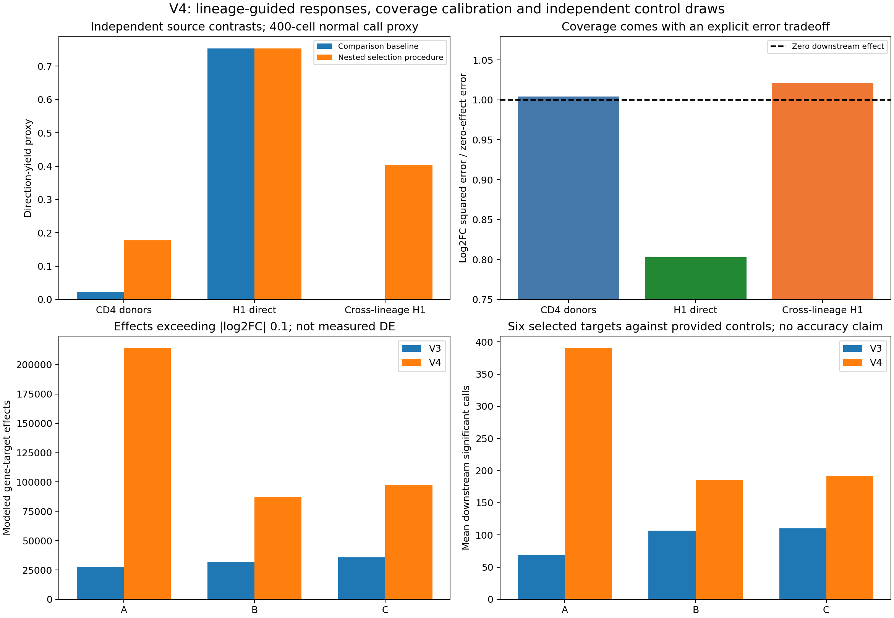

# V4: upload-ready lineage-guided response submission

The new candidate is generated, officially packaged and independently validated. It has not been uploaded or scored. The package is isolated in `experiments/v4_lineage_response/`; the earlier submission files retain their original locations.

| Check | Completed result |
|---|---|
| Package | `experiments/v4_lineage_response/prediction.vcc` |
| Package bytes | 3,309,240,320 (3.08 GiB) |
| H5AD bytes | 2,475,123,088 |
| Shape | 360,000 cells x 18,533 genes |
| Groups | 900, exactly 400 cells each |
| Stored count entries | 2,085,901,209 |
| Maximum cell total | 52,673 |
| Official CLI preparation | Passed; CLI 0.2.2 |
| Regression tests | 23 passed |
| Original source control rows | All 360,000 verified; 400 unique rows per group; 46 balanced guides |
| Independent count expectation checks | 389,193 across 21 groups, with complete deterministic count replay |
| All final model effects | 16,679,700 independently assembled |
| Generation and packaging time | 28.3 minutes |
| Leaderboard result | Not yet available |

Package SHA-256:

```text
b2cd9da4388d43937a016581b91a84f2c005b2f713fb5f0eae4d5fe1737f015b
```

## Strategy

A uses supported CD4 responses with a donor-calibrated target-specific gain of 1 instead of V3's 0.5. K562 fills unsupported coordinates. B/C use measured H1 responses for 13 targets; other targets use 0.5 CD4 target-specific effect + the existing 0.3-shrunk K562 effect + 0.5 shared H1 response. These are response-estimator coefficients, not cell-type fractions. Gene/target expression compatibility moderates weakly expressed coordinates. Every group starts from a separately seeded, guide/depth-stratified draw of 400 original controls.

Nested CD4 selection increases the direction-yield proxy from 0.02324 to 0.17701, with predicted response calls increasing from 2.81 to 31.86 per source contrast. Relative squared error changes from 0.98425 to 1.00436. Public H1 direct validation retains the V3 estimator (relative squared error 0.80299). The cross-lineage selection procedure has direction-yield proxy 0.40430 and relative squared error 1.02142; the final fixed candidate has 1.01191. These are source-domain tradeoffs using a stated 400-cell normal call proxy, not competition scores or proof of improved B/C predictions.

All 284 previously covered targets retain modeled downstream effects in A. B/C have response estimates for all 300 through the shared prior, including targets with no direct source measurements. The H1 prior is based on only 13 selected interventions and may not represent the hidden panel. More predicted response genes do not establish correct signs or a better leaderboard result.

Complete derivation, objective, fold separation, source limitations and reproduction: [V4_MODEL_STRATEGY.md](V4_MODEL_STRATEGY.md).

## Submit from Windows Command Prompt

Reuse the existing VCC login:

```cmd
cd /d L:\promec\Animesh\Download\Virtual
.\.competition_env\Scripts\python.exe -m vcc submit .\experiments\v4_lineage_response\prediction.vcc -m "Lineage-guided response coverage v4" --wait
```

## Actual generated-response diagnostic

The table compares six deliberately selected targets in each context against the provided controls using the control-mean >5 CPM filter, two-sided Wilcoxon and within-target BH, excluding the own target. It measures predicted response activity rather than hidden response accuracy.

| context | target_gene | version | downstream_DE_calls | up_calls | down_calls | mean_library | cell_count |
| --- | --- | --- | --- | --- | --- | --- | --- |
| A | AKT2 | v3 | 4 | 0 | 4 | 21034.2600 | 400 |
| A | AKT2 | v4 | 48 | 30 | 18 | 21227.4900 | 400 |
| A | SMARCA5 | v3 | 408 | 194 | 214 | 20839.0725 | 400 |
| A | SMARCA5 | v4 | 2225 | 1252 | 973 | 20634.7825 | 400 |
| A | VIM | v3 | 2 | 1 | 1 | 21004.1775 | 400 |
| A | VIM | v4 | 51 | 30 | 21 | 21117.9100 | 400 |
| A | S100A11 | v3 | 2 | 1 | 1 | 21053.1050 | 400 |
| A | S100A11 | v4 | 0 | 0 | 0 | 21215.6475 | 400 |
| A | FXYD5 | v3 | 0 | 0 | 0 | 20990.2725 | 400 |
| A | FXYD5 | v4 | 15 | 6 | 9 | 21029.4125 | 400 |
| A | KIF21B | v3 | 0 | 0 | 0 | 21024.4525 | 400 |
| A | KIF21B | v4 | 0 | 0 | 0 | 20990.6750 | 400 |
| B | AKT2 | v3 | 21 | 4 | 17 | 19926.5625 | 400 |
| B | AKT2 | v4 | 49 | 11 | 38 | 19860.3525 | 400 |
| B | SMARCA5 | v3 | 612 | 311 | 301 | 19963.9000 | 400 |
| B | SMARCA5 | v4 | 998 | 519 | 479 | 20119.7325 | 400 |
| B | VIM | v3 | 6 | 5 | 1 | 19800.0650 | 400 |
| B | VIM | v4 | 12 | 9 | 3 | 19800.9150 | 400 |
| B | S100A11 | v3 | 1 | 0 | 1 | 19937.9450 | 400 |
| B | S100A11 | v4 | 24 | 11 | 13 | 19830.5075 | 400 |
| B | FXYD5 | v3 | 0 | 0 | 0 | 19877.5975 | 400 |
| B | FXYD5 | v4 | 31 | 21 | 10 | 19702.3625 | 400 |
| B | KIF21B | v3 | 0 | 0 | 0 | 19922.3625 | 400 |
| B | KIF21B | v4 | 0 | 0 | 0 | 19997.4600 | 400 |
| C | AKT2 | v3 | 31 | 9 | 22 | 21121.0575 | 400 |
| C | AKT2 | v4 | 42 | 13 | 29 | 21138.6550 | 400 |
| C | SMARCA5 | v3 | 612 | 358 | 254 | 21243.8925 | 400 |
| C | SMARCA5 | v4 | 1042 | 566 | 476 | 21263.6125 | 400 |
| C | VIM | v3 | 10 | 7 | 3 | 21125.7075 | 400 |
| C | VIM | v4 | 3 | 2 | 1 | 21134.9925 | 400 |
| C | S100A11 | v3 | 9 | 6 | 3 | 21119.4150 | 400 |
| C | S100A11 | v4 | 44 | 26 | 18 | 21059.5175 | 400 |
| C | FXYD5 | v3 | 0 | 0 | 0 | 21097.8250 | 400 |
| C | FXYD5 | v4 | 20 | 16 | 4 | 21010.5350 | 400 |
| C | KIF21B | v3 | 0 | 0 | 0 | 21131.1950 | 400 |
| C | KIF21B | v4 | 0 | 0 | 0 | 21093.7000 | 400 |



## Code and records

Root scripts are `fit_lineage_submission.py`, `test_lineage_submission.py`, `validate_v4.py`, `audit_v4_strategy.py`, with generation integration in `build_submission.py`. The audit script also regenerates this results document and the README section after package validation.

Tracked records in the candidate's `analysis/` folder include nested source-selection JSON/CSV tables, source hashes, response coverage, control/gene summaries, all 360,000 source-row records, model and package validation, exact count-replay evidence, official preparation output, run settings, V3/V4 response diagnostics and PNG/PDF figures. Large source-component caches, effect caches, H5AD and VCC files are excluded from Git and rebuilt locally. No new public source download or leaderboard submission occurs in these scripts.
