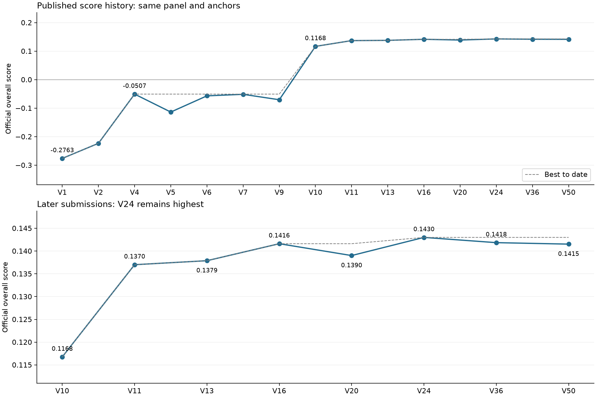
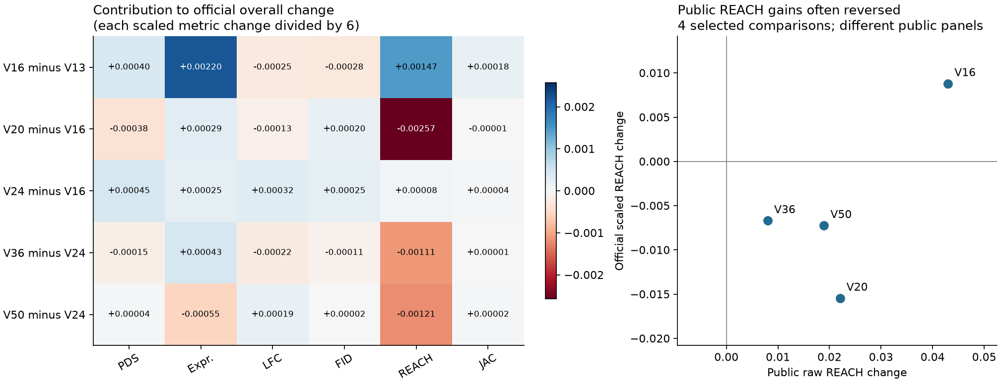

# V54: which methods tracked published performance?

Retrospective analysis of 15 published entries, all on the same validation panel and anchor set. Score receipts are the source of truth; ranks vary with other teams and are not used as the outcome. No new model, predictions, upload or fresh API check is performed.

Best published: V24, overall **0.142997855**. Method associations are descriptive: multiple changes travel together, variants were selected after public testing, and no randomized component ablation was uploaded.

The V10-family indicator has Spearman rho **0.866** with overall across all 15 uploads. Residual10 has rho **0.845** within V10 onward (8 uploads). These are inherited-pipeline associations, not isolated component effects. For example, learned residuals have a positive all-history association even though both uploaded residual revisions (V20 and V36) lose to their own baselines.

## What actually improved

| comparison_version | version | method | overall_delta |
|---|---|---|---|
| 1 | 2 | Donor-calibrated CD4 hybrid | 0.052964 |
| 2 | 4 | Lineage-guided response coverage | 0.172652 |
| 4 | 5 | Atlas calibration and dual moments | -0.062963 |
| 4 | 6 | Fidelity-guarded lineage response | -0.006116 |
| 4 | 7 | V4 effects with fallback resampling | -0.000713 |
| 4 | 9 | V4 effects with activation-preserving emission | -0.019773 |
| 4 | 10 | Pooled interventions and compact population transport | 0.167428 |
| 10 | 11 | Consensus coverage with noise 0.65 | 0.020250 |
| 11 | 13 | Assay-aware unknown-knockdown calibration | 0.000879 |
| 13 | 16 | V13 response with residual10 emission | 0.003731 |
| 16 | 20 | Bounded Stack mean expert | -0.002602 |
| 16 | 24 | Context-matched CD4 response expert | 0.001384 |
| 24 | 36 | Quarter-strength retrieval contrast | -0.001152 |
| 24 | 50 | Generic randomized response-amplitude prior | -0.001475 |

The largest benchmark gains are V4 versus V2 (+0.172652) and V10 versus V4 (+0.167428). In the V4-to-V10 change, fidelity contributes +0.110253 and PDS +0.052860 to overall: together 97.4% of the net gain. This is an arithmetic decomposition, not proof of which code component caused it. V10 versus V4 is a bundled benchmark comparison, not an isolated component test. V11 also changes both consensus coverage and noise. V16 is a clearer emission comparison because its production response remains V13; V24 changes the mean expert while retaining the V16 emitter. V20, V36 and V50 use their actual scientific baseline, rather than the immediately preceding upload.

V7 released V4 effects with resampling. V13 selected unknown-knockdown handling, not the tested response-program learner. V36 released retrieval_contrast25; its full population-view model was rejected. V50 selected the fixed randomized amplitude prior, not demonstrated target-specific KOLF transfer. V52/V53 joint mean/rank training has no official score and is excluded. Directory names and experiment counts are not evidence that a method improved the leaderboard.

## Statistical associations, with their limits

Binary method features explicitly encode inherited components. Their Spearman associations with overall are below. They overlap and are confounded with chronology. A feature present only once has no replication; a constant feature within an era has no defined correlation. Do not read these values as effect sizes or probabilities of success.

| era | feature | with_method | without_method | spearman |
|---|---|---|---|---|
| All published | V10 pooled-response/compact-emission family | 8 | 7 | 0.866025 |
| All published | V11 consensus-coverage family | 7 | 8 | 0.866025 |
| All published | V16 residual10 emission | 5 | 10 | 0.818317 |
| All published | V24 context-matched CD4 expert | 3 | 12 | 0.655789 |
| All published | Target-specific learned residual (Stack or retrieval) | 2 | 13 | 0.408529 |
| All published | V50 generic randomized amplitude prior | 1 | 14 | 0.247436 |
| All published | V5 atlas/dual-moment revision | 1 | 14 | -0.309295 |
| V10 onward | V10 pooled-response/compact-emission family | 8 | 0 | unavailable |
| V10 onward | V11 consensus-coverage family | 7 | 1 | 0.577350 |
| V10 onward | V16 residual10 emission | 5 | 3 | 0.845154 |
| V10 onward | V24 context-matched CD4 expert | 3 | 5 | 0.732467 |
| V10 onward | Target-specific learned residual (Stack or retrieval) | 2 | 6 | 0.251976 |
| V10 onward | V50 generic randomized amplitude prior | 1 | 7 | 0.082479 |
| V10 onward | V5 atlas/dual-moment revision | 0 | 8 | unavailable |

The all-history correlations mainly separate the early negative-score pipeline from the later population-emission family. Within the later family, there is much less evidence to distinguish individual components. No high-dimensional regression, causal estimate or independence-based p-value is justified by 15 selected, related uploads.

Official metric-to-overall Spearman correlations in the V11+ era (7 uploads) are:

| metric | spearman | leave_one_out_spearman_min | leave_one_out_spearman_max |
|---|---|---|---|
| pds | 0.785714 | 0.657143 | 1.000000 |
| mse | 0.714286 | 0.542857 | 0.942857 |
| nmae | 0.107143 | -0.257143 | 0.257143 |
| fid | -0.321429 | -0.657143 | -0.085714 |
| reach | 0.535714 | 0.257143 | 0.885714 |
| jac | 0.714286 | 0.542857 | 0.885714 |

**Part-whole coupling:** overall is exactly the mean of the six scaled components. Correlation of one component with overall is therefore partly arithmetic, not an independently validated predictor. Expression and fold-change columns here are scaled accuracies: higher is better. Raw public MSE/NMAE are errors: lower is better.

## Did our local tests predict official gains?

Extracted candidate-minus-comparator deltas from saved result JSONs, oriented so positive is favorable. The four primary diagnostic comparisons are V16, V20, V36 and V50; V24 is reported separately because its public baseline was refitted without Stim48hr and is not the exact published V16. Even the four primary comparisons differ in study panels, scoring aggregation, missing metrics, and whether they are confirmation or reused development. These are within-test matched changes, not a common independent benchmark.

| metric | n | spearman | leave_one_out_spearman_min | leave_one_out_spearman_max | sign_agreements | nonzero_pairs |
|---|---|---|---|---|---|---|
| pds | 4 | 0.258199 | 0.000000 | 0.866025 | 1 | 1 |
| mse | 4 | 0.400000 | -0.500000 | 1.000000 | 4 | 4 |
| nmae | 4 | 0.000000 | -0.500000 | 0.500000 | 1 | 4 |
| fid | 4 | 0.800000 | 0.500000 | 1.000000 | 4 | 4 |
| reach | 4 | 0.200000 | -1.000000 | 0.500000 | 1 | 4 |
| jac | 4 | 0.000000 | -0.500000 | 0.500000 | 2 | 4 |

Leave-one-out ranges are sensitivity diagnostics, not confidence intervals. With four selected comparisons, a coefficient is too unstable to choose a model. Raw public deltas and private anchored scaled deltas have different units; they are never averaged together. Full paired rows, including V24 sensitivity, are in local_validation_pairs.csv.

The most revealing mismatch is REACH:

| version | comparison_version | local_oriented_delta | official_scaled_delta |
|---|---|---|---|
| 16 | 13 | 0.042989 | 0.008807 |
| 20 | 16 | 0.022051 | -0.015446 |
| 36 | 24 | 0.008023 | -0.006680 |
| 50 | 24 | 0.018944 | -0.007234 |

V50 public REACH gain is +0.018944; removing CD4_Rest_D1/MTHFSD (three reference DE genes) gives -0.001870. This previously audited sensitivity explains why a positive aggregate did not establish a robust gain. It is not a reason to remove that case from official-style summaries.

In these four selected comparisons, expression and fidelity changes each agree in direction in 4/4 cases; REACH and NMAE agree in only 1/4. This is a descriptive sign check across heterogeneous tests, not an accuracy estimate for future releases. The sample is too small and selected to rank validation metrics reliably.

V20 also improved public confirmation REACH but lost official REACH. V36 improved public development REACH but lost it privately. V16 is the successful case: both public and official REACH increased. Local public gains have not been a reliable release signal.

## Implication for the next model

Preserve V24 as the measured reference. The strongest observed progress came from response pooling, consensus coverage and count-population construction, with a smaller gain from a context-compatible CD4 expert. Learned residuals and generic amplification have not yet beaten that reference. This does not establish that neural networks cannot work: only two target-specific learned residual variants were actually uploaded, and the new joint model was not.

Evaluate future candidates on one frozen, common study/target panel with identical controls and emission seeds. Report per-study mean-response error, rank-response error, realized count metrics, null DE and case influence separately; retain missing values. Require gains to survive whole-study exclusion, generation seeds and leave-target-out sensitivity. Keep a simple linear and shuffled-target control. Select before opening new biological reserve data. Those tests address the observed validation mismatch; this retrospective cannot forecast a leaderboard gain.

## Reproduce

Use the existing Python 3.12 scientific environment (NumPy, pandas, SciPy, matplotlib). From Windows Command Prompt:

~~~bat
cd /d L:\promec\Animesh\Download\Virtual
"C:\Users\animeshs\AppData\Local\Temp\vcc_v20_stack\env\Scripts\python.exe" analyze_v54_method_performance.py
"C:\Users\animeshs\AppData\Local\Temp\vcc_v20_stack\env\Scripts\python.exe" analyze_v54_method_performance.py --check
~~~

Outputs: [complete history](analysis/v54_method_performance/published_history.csv), [method coding](analysis/v54_method_performance/method_associations.csv), [paired component contributions](analysis/v54_method_performance/component_contributions.csv), [local validation pairs](analysis/v54_method_performance/local_validation_pairs.csv), [validation correlations](analysis/v54_method_performance/local_validation_correlations.csv), and [source hashes/audit](analysis/v54_method_performance/audit.json). --check recomputes numerical outputs and verifies all archived files/source hashes without rewriting them. The source receipts and previous scientific results remain unchanged.

