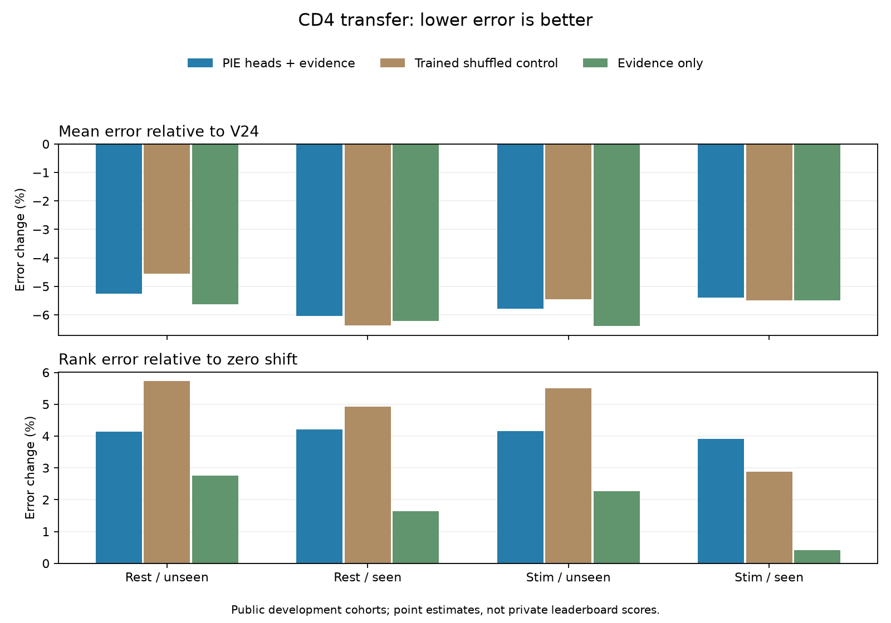

# V58 cross-dataset PIE: measured results

Completed experiment: genuine saved response evidence, three retained model outputs, source-only calibration and integer-count tests. These are public development results, not a new leaderboard score. V24 remains the best published project submission (0.142997855).

## What ran

The hash-verified checkpoint and 17.12 GiB of training summaries were downloaded. All 64,260 saved training rows supplied the global evidence normalization. The projected evidence contains 186 records for 154 seen panel targets; 146 targets have no matching response record. Independent arithmetic passed 36 comparisons; 96 reused source/code assets (1,495,668,215 bytes) matched their previous checksums. Strict weights, finite outputs and repeated-forward checks passed.

H1/Orion diagnostics exclude matching query-response records from evidence, but their studies were used to pretrain the checkpoint. They are not unseen-study tests. CD4 treatment labels do not fit or select decoder parameters. The held-study feature guard additionally passed after poisoning every CD4 response-bank row. The earlier V57 calibration path could use CD4 labels indirectly in source baseline features and is superseded. All 366 eligible response cases and 176 count comparisons were evaluated. Public biology has been used in prior project development; seeds are not independent biological replicates. D3 remains unopened.

## CD4 response accuracy before count generation

Positive mean/rank gains below are improvements. The raw and calibrated delta columns are error ratios: below 1 beats a zero-shift predictor. Means use equal context-target case weights within each stratum.

| source | seen | Mean MSE gain % | Mean gain vs shuffled % | Mean gain vs evidence-only % | Rank MSE gain vs zero % | Raw PIE delta / zero MSE | Calibrated delta / zero MSE |
|---|---|---|---|---|---|---|---|
| CD4_Rest_D2 | False | 5.250 | 0.731 | -0.408 | -4.138 | 2.392 | 1.016 |
| CD4_Rest_D2 | True | 6.043 | -0.343 | -0.176 | -4.213 | 1.880 | 1.023 |
| CD4_Stim48_D2 | False | 5.789 | 0.352 | -0.652 | -4.151 | 2.473 | 1.016 |
| CD4_Stim48_D2 | True | 5.393 | -0.108 | -0.096 | -3.904 | 1.758 | 1.018 |

The mean predictor is a bounded correction to the V24 public hold-study baseline. CD4 comparator arrays are bitwise unchanged; source diagnostic baselines additionally exclude CD4 under the corrected guard. Rank is tie-aware U probability minus one half; zero rank shift is a necessary simple comparator. Source-only whole-target validation selected the ridge regularization. The trained shuffled-head model and evidence-only ablation are reported in response_cases.csv and response_summary.csv, not omitted when stronger.

Eligible-only raw DE-probability and conditional-LFC checks were completed before count generation; see raw_head_summary.csv. The auxiliary AP field in count_cases.csv includes all supported genes and is not used for confidence validation, because untested genes must not be treated as negatives.

## Raw DE and conditional fold-change heads

| source | seen | DE_prevalence | raw_pDE_AP_eligible_only | raw_PIE_LFC_DE_direction | calibrated_intended_DE_direction |
|---|---|---|---|---|---|
| CD4_Rest_D2 | False | 0.0479 | 0.1161 | 0.6134 | 0.5016 |
| CD4_Rest_D2 | True | 0.0584 | 0.1256 | 0.4551 | 0.4874 |
| CD4_Stim48_D2 | False | 0.0898 | 0.1537 | 0.4400 | 0.4475 |
| CD4_Stim48_D2 | True | 0.1437 | 0.2426 | 0.5500 | 0.4880 |

AP is evaluated only on tested/eligible genes; DE prevalence is its chance reference. Direction agreement is on actual DE genes. These are raw-head diagnostic proportions, not the official scaled fidelity score.

## Integer-count results

Fidelity/reach/Jaccard are raw local higher-is-better metrics. NMAE and profile MSE are errors, lower is better. Missing NMAE is retained. Actual treatment populations contain up to 400 distinct available cells, while generated populations contain 400. Each comparison uses independent NTC reference cells and the same sampling seed across arms.

| source | arm | fidelity | reach | jaccard | nmae | profile_MSE |
|---|---|---|---|---|---|---|
| CD4_Rest_D2 | pie_joint | 0.416845 | 0.004279 | 0.045324 | 0.978137 | 0.006775 |
| CD4_Rest_D2 | pie_mean | 0.521376 | 0.012624 | 0.077933 | 0.977777 | 0.006775 |
| CD4_Rest_D2 | shuffled_joint | 0.414111 | 0.009904 | 0.049197 | 0.981585 | 0.006784 |
| CD4_Rest_D2 | v24 | 0.523166 | 0.011207 | 0.082230 | 0.977887 | 0.006882 |
| CD4_Stim48_D2 | pie_joint | 0.269520 | 0.002728 | 0.063683 | 0.986378 | 0.009782 |
| CD4_Stim48_D2 | pie_mean | 0.497042 | 0.000785 | 0.134159 | 0.987749 | 0.009781 |
| CD4_Stim48_D2 | shuffled_joint | 0.287997 | 0.001145 | 0.074049 | 0.984999 | 0.009718 |
| CD4_Stim48_D2 | v24 | 0.503257 | 0.002739 | 0.136456 | 0.978204 | 0.009791 |
| H1 | pie_joint | 0.173613 | 0.001258 | 0.037155 | 0.976252 | 0.003398 |
| H1 | pie_mean | 0.570580 | 0.000846 | 0.131627 | 0.975486 | 0.003398 |
| H1 | shuffled_joint | 0.269293 | 0.003438 | 0.047619 | 0.977051 | 0.003441 |
| H1 | v24 | 0.600771 | 0.007059 | 0.121337 | 0.948624 | 0.003369 |
| HCT116 | pie_joint | 0.580222 | 0.200000 | 0.006881 | missing | 0.003959 |
| HCT116 | pie_mean | 0.549179 | 0.133333 | 0.000617 | missing | 0.003959 |
| HCT116 | shuffled_joint | 0.552256 | 0.200000 | 0.005624 | missing | 0.003943 |
| HCT116 | v24 | 0.545100 | 0.311111 | 0.000521 | missing | 0.003894 |
| HEK293T | pie_joint | 0.513565 | 0.000000 | 0.005319 | 0.892302 | 0.003165 |
| HEK293T | pie_mean | 0.569656 | 0.090090 | 0.001910 | 0.890432 | 0.003165 |
| HEK293T | shuffled_joint | 0.548401 | 0.000000 | 0.001597 | 0.879482 | 0.003155 |
| HEK293T | v24 | 0.551287 | 0.226351 | 0.001867 | 0.902015 | 0.003189 |

Seen/unseen paired changes, common-control panel diagnostics, predicted/reference DE counts, calibration-vs-transfer distinctions and leave-target-out sensitivity are retained as CSV files. The panel calculation uses one common context control and keeps expression numerators and denominators separate; no unstable ratio is averaged into a private score forecast.

## Zero-intervention control checks

| source | v24_DE_calls | pie_joint_DE_calls |
|---|---|---|
| CD4_Rest_D2 | 1644 | 0 |
| CD4_Stim48_D2 | 2819 | 0 |
| H1 | 1908 | 0 |
| HCT116 | 2511 | 0 |
| HEK293T | 3405 | 0 |

These checks compare synthetic zero-response populations with independent real controls. Zero called DE genes here does not establish accurate perturbation responses. The joint decoder repairs a baseline artifact while losing substantial treatment direction yield.



## Interpretation and limitations

The joint decoder fails the conservative public support check. This experiment does not justify replacing V24 or labeling an unvalidated file a better submission.

Detailed check outcomes:

```json
{
  "CD4_Rest_D2": {
    "mean_MSE_beats_V24": true,
    "rank_MSE_beats_zero": false,
    "count_profile_MSE_beats_V24": true,
    "FID_not_worse": false,
    "Jaccard_not_worse": false,
    "FID_beats_shuffled": true,
    "profile_MSE_beats_shuffled": true
  },
  "CD4_Stim48_D2": {
    "mean_MSE_beats_V24": true,
    "rank_MSE_beats_zero": false,
    "count_profile_MSE_beats_V24": true,
    "FID_not_worse": false,
    "Jaccard_not_worse": false,
    "FID_beats_shuffled": false,
    "profile_MSE_beats_shuffled": false
  }
}
```

PIE p_de is a tempered, class-weighted probability output, not BH FDR. Its conditional LFC head is not supervised on every non-DE coordinate. Its mean-log-expression shift is not interchangeable with a pooled-count profile through exponentiation. The joint decoder uses an explicitly approximate Gaussian mean/rank relation, then enforces integer libraries and global moments; actual count scoring tests this approximation.

One pre-existing subset limitation remains explicit: TMEM104 resolves through its SLC38A12 alias in ESM2, but that renamed entry is missing from the reused NCBI token subset. NCBI coverage is 299/300, ESM2 300/300 and perturbation-text coverage 155/300. Missing inputs are masked. No configurations were mixed or quietly changed after freezing.

Further work should improve cell-context conditioning and supervised DE/direction decisions. Their contribution would need a separate frozen test. These results do not establish that the published PIE architecture fails generally; they evaluate this anonymous-context configuration and this decoder.

The independent auditor runs through an immutable-JSON read cache; the frozen auditor/calculation and protocol bytes are unchanged. Two separate GPU context workers only alter scheduling, not precision, weights, samples or seeds.

## Reproduce and locate artifacts

[Frozen protocol](V58_PIE_CROSS_STRATEGY.md) lists commands. Start with run_v58_response.py for resumable response-stage inference/calibration once inputs/evidence are prepared; the count stage remains separate. Scientific methods are sealed by plan SHA256 `417725d7de448eca9ea27f307e81463956a3b5b39eca0ecdf469b58f457ca762`. Root scripts and compact receipts/tables are committed; large arrays are regenerable caches or exported project artifacts. No competition API upload occurs.

Key files: experiments/v58_pie_holdstudy_guard/analysis/response_summary.csv, count_summary.csv, held_CD4_paired_summary.csv, held_CD4_leave_target_out.csv, panel_metrics.csv, assessment.json and final_audit.json.
