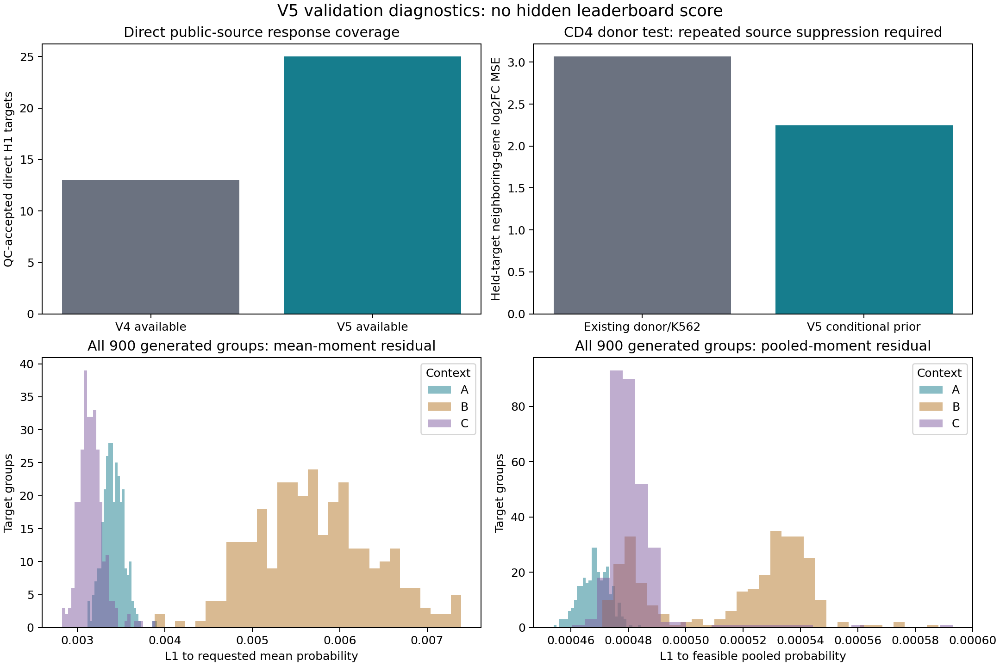

# V5: verified and published submission

<!-- V5 publication begin -->

Published as `BPI0n52HTsG0EYTFOf9H`, overall **-0.113637**, rank 1100 at the user-reported check. V4 remains best at **-0.050674**. V5 improves five scaled components but loses direction fidelity; see [V5_LEADERBOARD_RESULTS.md](V5_LEADERBOARD_RESULTS.md) for exact comparisons and raw metrics.

<!-- V5 publication end -->

Created for the 2026 validation panel `vcc2026-val-1`. Generation, official packaging and independent verification passed. The completed leaderboard result is recorded above.

| Check | Result |
| --- | --- |
| Submission file | `experiments/v5_atlas_calibrated/prediction.vcc` |
| Size | 3,275,069,440 bytes (3.05 GiB) |
| Shape | 360,000 cells by 18,533 genes |
| Groups | All 900 context/target combinations, 400 cells each |
| Gene order | Exact official axis |
| Counts | Every stored value is a positive integer; zeros remain sparse |
| Library sizes | All 360,000 match the selected original control-cell libraries exactly |
| Sampling | Each target has 400 unique real controls with all 46 guides balanced |
| Public H1 labels | 25 overlapping targets; 25 accepted for direct responses |
| Promoter corrections | 22 A-only target/neighbor effects with repeated source suppression |
| Numerical preflight | 24 groups passed |
| Focused tests | Five passed |
| Official packaging | Passed; VCC CLI 0.2.2 |
| Independent source verification | 40 original source rows checked; all 1,536 reused selected controls exactly matched in each extra split |
| Independent source moments | 6,780,000 values recalculated |
| Independent final effects | 33,359,400 mean/pooled effects reassembled |
| Deterministic full-count replay | 12 complete groups checked |

Package SHA-256:

```text
09a06f2256163549a2c993f0e289c4ce6d848fa91b5adb21f3cd542360378343
```

## Original upload command (historical)

Reuse the existing login:

```cmd
cd /d L:\promec\Animesh\Download\Virtual
.\.competition_env\Scripts\python.exe -m vcc submit .\experiments\v5_atlas_calibrated\prediction.vcc -m "Atlas-calibrated lineage and dual moments v5" --wait
```

This is the original upload command, retained for reproduction. The entry has completed scoring; use `vcc status BPI0n52HTsG0EYTFOf9H` to inspect it. Repeating the upload command creates another entry. No token belongs in a command or committed file.

## What changed

1. **Public H1 coverage:** Add released 2025 validation/test perturbation observations to the original training subset. The repeated control identifiers are checked against original counts and kept only once. Global batch partitions provide disjoint control IDs for calibration. Direct estimates require at least 40 selected target cells, at least 30% mean-expression knockdown, source control mean above 5 CPM and a negative own-target effect larger than 1.96 estimated SE. Every response gene also needs measured support and source control expression above 5 CPM.
2. **Separate expression moments:** Fit H1 mean-CPM log2FC and library-weighted pooled `log1p(50000*p)` changes independently. Pooled uncertainty retains count/depth covariance. Source batches and held targets select amplitudes. CD4 centering remains zero and its V4 response estimator is retained.
3. **Preserved cell variation:** Start each 400-cell group from individual guide/depth-balanced original controls. Fit requested mean and pooled profiles to these individual templates, allowing only the documented feasible-moment projection, then round to raw integer counts while preserving each exact original library size. No four-cell averaging is used.
4. **Conditional promoter correction:** Apply the distance-dependent prior only to A, only when a neighbor has significant negative responses in at least two qualified CD4 conditions, and preserve existing stronger negative effects. The held-target/disjoint-donor test uses 17 targets/34 observations. Relative neighboring-gene error is 0.733 of the existing donor/K562 estimator. These are selected source observations, not hidden A labels.

The 12 additional source targets and their QC outcome are:

| target_gene | selected_cells | own_log2fc | direct_response_accepted |
| --- | --- | --- | --- |
| ACLY | 753 | -3.000 | yes |
| ADNP | 291 | -3.000 | yes |
| ANKZF1 | 763 | -3.000 | yes |
| BRPF1 | 366 | -3.000 | yes |
| HDAC8 | 767 | -3.000 | yes |
| MED15 | 768 | -0.726 | yes |
| MED25 | 768 | -3.000 | yes |
| NFE2L1 | 746 | -0.973 | yes |
| PLAGL2 | 768 | -3.000 | yes |
| SLIRP | 768 | -3.000 | yes |
| ZFP62 | 204 | -3.000 | yes |
| ZNF32 | 632 | -3.000 | yes |

Full input sampling, uncertainties, selected coefficients, transfer rules and reproduction are documented in [V5_MODEL_STRATEGY.md](V5_MODEL_STRATEGY.md). Root scripts and all compact validation records are version-controlled. Large counts/effect caches and H5AD/VCC files remain local inputs/outputs.


