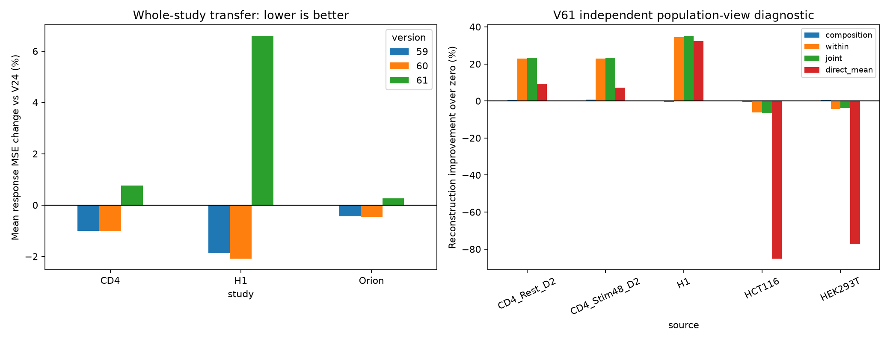

# V61 pooled state-response results

The fixed primary failed the recorded public support gates. This release is experimental and is not recommended as a validated replacement for V24.

## Response and population reconstruction

All 366 eligible target-context cases were evaluated at five arms, using complete recipient-study exclusion. State genes and depth/detection covariates exclude all 300 panel targets. Raw matched views and immutable source checksums are retained. D3 remains unopened.

| study | source | arm | MSE | MAE |
|---|---|---|---|---|
| CD4 | CD4_Rest_D2 | composition50 | 0.115202 | 0.201061 |
| CD4 | CD4_Rest_D2 | joint50 | 0.116225 | 0.204081 |
| CD4 | CD4_Rest_D2 | pooled50 | 0.116124 | 0.203881 |
| CD4 | CD4_Rest_D2 | shuffled_joint50 | 0.116366 | 0.204096 |
| CD4 | CD4_Rest_D2 | v24 | 0.115220 | 0.201046 |
| CD4 | CD4_Stim48_D2 | composition50 | 0.128002 | 0.215620 |
| CD4 | CD4_Stim48_D2 | joint50 | 0.128692 | 0.217896 |
| CD4 | CD4_Stim48_D2 | pooled50 | 0.128512 | 0.217662 |
| CD4 | CD4_Stim48_D2 | shuffled_joint50 | 0.128791 | 0.218010 |
| CD4 | CD4_Stim48_D2 | v24 | 0.127860 | 0.215425 |
| H1 | H1 | composition50 | 0.037582 | 0.108032 |
| H1 | H1 | joint50 | 0.039862 | 0.115787 |
| H1 | H1 | pooled50 | 0.039809 | 0.115603 |
| H1 | H1 | shuffled_joint50 | 0.039391 | 0.114085 |
| H1 | H1 | v24 | 0.037397 | 0.107463 |
| Orion | HCT116 | composition50 | 0.185898 | 0.277149 |
| Orion | HCT116 | joint50 | 0.186002 | 0.277785 |
| Orion | HCT116 | pooled50 | 0.185945 | 0.277730 |
| Orion | HCT116 | shuffled_joint50 | 0.186063 | 0.277832 |
| Orion | HCT116 | v24 | 0.185845 | 0.277103 |
| Orion | HEK293T | composition50 | 0.157577 | 0.275054 |
| Orion | HEK293T | joint50 | 0.158221 | 0.276095 |
| Orion | HEK293T | pooled50 | 0.158130 | 0.276001 |
| Orion | HEK293T | shuffled_joint50 | 0.158193 | 0.276023 |
| Orion | HEK293T | v24 | 0.157499 | 0.274972 |

Response gate: **False**. Equal-study primary/V24 MSE ratio: **1.025339**. A lower number beats V24. Primary joint50 must additionally beat matched shuffled and pooled controls; these requirements are not relaxed after outcomes.

The corrected oracle estimates a mechanism on one disjoint matched population and reconstructs the other before computing error. It uses treatment labels solely as a diagnostic. Direct mean and zero response are controls, not uploadable oracles. Lower MSE is better.

| source | composition | direct_mean | joint | state_permuted | within | zero |
|---|---|---|---|---|---|---|
| CD4_Rest_D2 | 0.145470 | 0.132655 | 0.112170 | 0.149120 | 0.112895 | 0.146308 |
| CD4_Stim48_D2 | 0.161748 | 0.151408 | 0.125054 | 0.165425 | 0.125864 | 0.163070 |
| H1 | 0.033992 | 0.022882 | 0.021964 | 0.035035 | 0.022192 | 0.033831 |
| HCT116 | 0.379815 | 0.701195 | 0.403730 | 0.379666 | 0.402326 | 0.378561 |
| HEK293T | 0.305378 | 0.544698 | 0.318569 | 0.309320 | 0.320364 | 0.307055 |

Within-dataset reconstruction can improve while cross-study prediction worsens. That difference limits the response information transferable to anonymous competition contexts. It does not prove that these models identify cell survival, proliferation or observed individual counterfactuals.

## All integer-count comparisons

All 264 comparisons completed. Each target-seed population is common across arms; 400 generated cells and up to 400 distinct measured treatment cells are compared against independent real controls. HCT116/HEK293T are one Orion study and both CD4 states are one study. Seeds repeat biology. The five mean arms use identical templates and the unchanged residual10 emitter. The state_cells50 diagnostic changes both means and cell distributions; missing mechanism coordinates in that diagnostic can dilute the V24 component, so it is not a clean variance-only test or an eligible finalist. No diagnostic was promoted after outcomes.

| source | arm | fidelity | reach | jaccard | nmae | profile_MSE | predicted_calls | reference_calls |
|---|---|---|---|---|---|---|---|---|
| CD4_Rest_D2 | composition50 | 0.529372 | 0.004766 | 0.089183 | 0.980611 | 0.007096 | 2002.562500 | 547.000000 |
| CD4_Rest_D2 | joint50 | 0.526255 | 0.004821 | 0.086017 | 0.980926 | 0.007318 | 2225.500000 | 547.000000 |
| CD4_Rest_D2 | pooled50 | 0.525242 | 0.005821 | 0.086134 | 0.979898 | 0.007302 | 2223.500000 | 547.000000 |
| CD4_Rest_D2 | shuffled_joint50 | 0.524917 | 0.004660 | 0.086503 | 0.982744 | 0.007310 | 2174.000000 | 547.000000 |
| CD4_Rest_D2 | state_cells50 | 0.032142 | 0.010697 | 0.005387 | 0.977554 | 0.007040 | 16.375000 | 547.000000 |
| CD4_Rest_D2 | v24 | 0.530035 | 0.004810 | 0.089787 | 0.978708 | 0.007095 | 2034.437500 | 547.000000 |
| CD4_Stim48_D2 | composition50 | 0.519903 | 0.002593 | 0.143009 | 0.969632 | 0.009592 | 2687.187500 | 1125.687500 |
| CD4_Stim48_D2 | joint50 | 0.521661 | 0.001495 | 0.141904 | 0.970133 | 0.009808 | 2819.625000 | 1125.687500 |
| CD4_Stim48_D2 | pooled50 | 0.520718 | 0.001794 | 0.141846 | 0.969216 | 0.009813 | 2817.062500 | 1125.687500 |
| CD4_Stim48_D2 | shuffled_joint50 | 0.519077 | 0.001798 | 0.140593 | 0.969140 | 0.009817 | 2820.000000 | 1125.687500 |
| CD4_Stim48_D2 | state_cells50 | 0.007348 | 0.018545 | 0.001612 | 0.968096 | 0.009530 | 10.062500 | 1125.687500 |
| CD4_Stim48_D2 | v24 | 0.516870 | 0.002706 | 0.142545 | 0.968917 | 0.009614 | 2719.500000 | 1125.687500 |
| H1 | composition50 | 0.593572 | 0.004870 | 0.115192 | 0.932651 | 0.003507 | 2592.750000 | 1455.250000 |
| H1 | joint50 | 0.585659 | 0.004324 | 0.124145 | 0.929895 | 0.003733 | 3039.750000 | 1455.250000 |
| H1 | pooled50 | 0.585219 | 0.004324 | 0.124606 | 0.929488 | 0.003734 | 3036.500000 | 1455.250000 |
| H1 | shuffled_joint50 | 0.585938 | 0.004623 | 0.121546 | 0.932591 | 0.003714 | 2966.250000 | 1455.250000 |
| H1 | state_cells50 | 0.178277 | 0.036241 | 0.047243 | 0.922912 | 0.003529 | 415.250000 | 1455.250000 |
| H1 | v24 | 0.595178 | 0.006300 | 0.112006 | 0.931217 | 0.003479 | 2607.750000 | 1455.250000 |
| HCT116 | composition50 | 0.565439 | 0.555556 | 0.000510 | missing | 0.003948 | 2437.500000 | 2.500000 |
| HCT116 | joint50 | 0.561312 | 0.555556 | 0.000507 | missing | 0.004124 | 2448.250000 | 2.500000 |
| HCT116 | pooled50 | 0.563900 | 0.555556 | 0.000509 | missing | 0.004106 | 2443.500000 | 2.500000 |
| HCT116 | shuffled_joint50 | 0.564851 | 0.555556 | 0.000496 | missing | 0.004199 | 2537.500000 | 2.500000 |
| HCT116 | state_cells50 | 0.677256 | 0.555556 | 0.116667 | missing | 0.004104 | 27.000000 | 2.500000 |
| HCT116 | v24 | 0.570032 | 0.555556 | 0.000511 | missing | 0.003933 | 2424.000000 | 2.500000 |
| HEK293T | composition50 | 0.553001 | 0.333333 | 0.000706 | missing | 0.003052 | 3905.000000 | 4.500000 |
| HEK293T | joint50 | 0.553001 | 0.333333 | 0.000706 | missing | 0.003052 | 3905.000000 | 4.500000 |
| HEK293T | pooled50 | 0.553001 | 0.333333 | 0.000706 | missing | 0.003052 | 3905.000000 | 4.500000 |
| HEK293T | shuffled_joint50 | 0.553001 | 0.333333 | 0.000706 | missing | 0.003052 | 3905.000000 | 4.500000 |
| HEK293T | state_cells50 | 0.259259 | 0.388889 | 0.283333 | missing | 0.003238 | 2.250000 | 4.500000 |
| HEK293T | v24 | 0.553001 | 0.333333 | 0.000706 | missing | 0.003052 | 3905.000000 | 4.500000 |

Fidelity/reach/Jaccard are raw higher-is-better metrics. NMAE and profile MSE are errors; missing NMAE stays missing. Profile MSE excludes the directly targeted gene; nonpanel MSE and corrected error numerators are saved separately. These are not official anchor-scaled scores. No private overall/rank forecast is made.

Recorded count/release checks:

```json
{
  "H1": {
    "expression_better": false,
    "DE_gains": 1,
    "FID_guard": false,
    "JAC_guard": true,
    "beats_shuffle_FID": false,
    "beats_shuffle_expression": false
  },
  "Orion": {
    "expression_better": false,
    "DE_gains": 0,
    "FID_guard": true,
    "JAC_guard": true,
    "beats_shuffle_FID": false,
    "beats_shuffle_expression": true
  },
  "CD4": {
    "expression_better": false,
    "DE_gains": 1,
    "FID_guard": true,
    "JAC_guard": true,
    "beats_shuffle_FID": true,
    "beats_shuffle_expression": false
  }
}
```

## Limited common-control discrimination panels

| source | arm | unique_targets | raw_panel_PDS | common_expression_numerator | common_expression_denominator |
|---|---|---|---|---|---|
| CD4_Rest_D2 | joint50 | 8.000000 | 0.535714 | 0.040521 | 0.025376 |
| CD4_Rest_D2 | v24 | 8.000000 | 0.508929 | 0.039963 | 0.025376 |
| CD4_Stim48_D2 | joint50 | 8.000000 | 0.517857 | 0.060631 | 0.046367 |
| CD4_Stim48_D2 | v24 | 8.000000 | 0.482143 | 0.060478 | 0.046367 |
| H1 | joint50 | 4.000000 | 0.583333 | 0.012465 | 0.009032 |
| H1 | v24 | 4.000000 | 0.666667 | 0.011451 | 0.009032 |
| HCT116 | joint50 | 4.000000 | 0.583333 | 0.005365 | -0.000077 |
| HCT116 | v24 | 4.000000 | 0.500000 | 0.005137 | -0.000077 |
| HEK293T | joint50 | 4.000000 | 0.666667 | 0.005382 | 0.001522 |
| HEK293T | v24 | 4.000000 | 0.666667 | 0.005382 | 0.001522 |

These panels contain only four or eight unique targets per source/seed. All 300 panel genes are excluded from PDS coordinates; one common NTC profile is verified bitwise. Constant predictions and the balanced cyclic label-shift control both score exactly .5. These are limited diagnostics, not official 300-target PDS or a private overall forecast. The HCT116 expression denominator is unresolved/negative; signed numerator and denominator are retained separately and unstable ratios are not averaged into a release score.

## Zero-intervention comparison

| source | residual10_DE | real_control_DE |
|---|---|---|
| CD4_Rest_D2 | 2285 | 0 |
| CD4_Stim48_D2 | 3691 | 0 |
| H1 | 2366 | 1 |
| HCT116 | 2293 | 0 |
| HEK293T | 3655 | 0 |

The state-cell zero-intervention contract returns real unedited NTC rows. Null calibration does not establish treatment prediction. Own-target knockdown is applied once by the existing count emitter and excluded from direction scoring.



## Production scope

The release keeps the unchanged residual10 count emitter. Of 900 target/context groups, 330 reuse validated V24 counts exactly; the remaining 570 were regenerated from the fixed V61 effects. The unsuccessful state_cells50 generator is excluded. All 360,000 cells use original guide-stratified control templates with exact integer libraries.

## Integrity and release scope

The production kernel is independently implemented and compared bitwise against all public primary predictions. Every production effect is additionally reconstructed through the original transfer implementation. Counts retain exact original library sizes and unique guide-stratified templates. Full package verification compares every stored value/index/pointer and all axes, verifies provenance and replays 12 complete groups.

The user's requested fixed experimental candidate is V61 joint50, frozen before its count outcomes. `--experimental` is explicit in its release command if gates fail. It preserves V24, reports failure and makes no claim of superior private performance. No leaderboard upload or Git push is performed.

[Protocol and commands](V61_POOLED_STATE_STRATEGY.md) · [Upload artifact](V61_SUBMISSION.md) · [Three-version review](V59_V61_STATE_REVIEW.md).

Scientific plan SHA256: `fb3f3d24b37f82622f0dc13e97aa24a3d40c37e2582f47598ce82f71f48a173e`. Production plan SHA256: `97970232a618e850d1b68ec75d21f6608ea7f2c1db1ed914f6358c41170ccd0f`.
