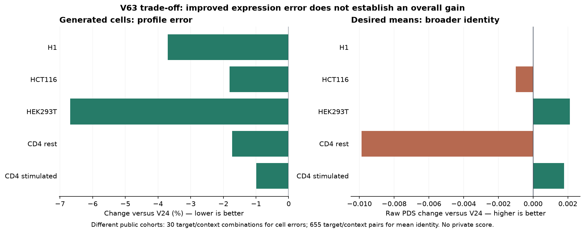

# V63 identity-guarded assay response: measured results

**Status: experimental test artifact, not a validated replacement for V24.** V24 remains the best published project score (0.142997855). No V62 or V63 leaderboard score is known.

## What changed

V62 compared source-common LFC removal, assay-space response pooling and their combination. Its selected combined representation reduced raw mean profile error across all three held studies, but lost discrimination and narrowly failed significance overlap in final counts. V63 adds a frozen guard that retains at least 80% of V24 target-template margins, using query controls and predictions only. It changes response means while retaining the V24 generator, library sizes, control sampling and seeds.

This was an outcome-informed follow-up to V62, not an untouched hypothesis test. The source estimator and 80% guard were fixed before V63 count scores. No parameter or candidate was reselected using additional outcomes. See [V62 results](V62_RESULTS.md) and [V63 method and reproduction](V63_IDENTITY_GUARD_STRATEGY.md).

## Predeclared count development

| Arm | PDS | Fidelity | Reach | Jaccard | NMAE error | Expression error ratio |
| --- | ---: | ---: | ---: | ---: | ---: | ---: |
| v24 | 0.791667 | 0.581703 | 0.194389 | 0.070027 | 0.912601 | 37.471936 |
| guarded_assay | 0.750000 | 0.580240 | 0.226104 | 0.069452 | 0.903127 | 36.621792 |
| guarded_assay_shuffled | 0.763889 | 0.580866 | 0.238594 | 0.069586 | 0.907414 | 37.316430 |

Gate result: **False**. Failed checks: pds, jac, beats_shuffle_pds.

The public gate failures remain failures. The fixed candidate was explicitly fitted in experimental mode for the user-requested upload test; no improvement over V24 is asserted.

## Additional public count diagnostics

| Arm | PDS | Fidelity | Reach | Jaccard | NMAE error | Expression error ratio |
| --- | ---: | ---: | ---: | ---: | ---: | ---: |
| v24 | 0.779762 | 0.587250 | 0.249236 | 0.053259 | 0.915103 | 37.650838 |
| guarded_assay | 0.751984 | 0.587426 | 0.227930 | 0.052781 | 0.899096 | 36.713180 |
| guarded_assay_shuffled | 0.751984 | 0.588897 | 0.240182 | 0.053407 | 0.907190 | 37.395636 |

These are 144 additional comparisons: 24 remaining case configurations, two generation seeds and three arms. They were run after failed development as diagnostics, not confirmation. Their own numerical checks pass: **False**. They cannot retroactively validate the original development decision.

Across both stages there are 204 count-comparison records from 68 case/seed configurations, covering 44 predefined case configurations, 30 unique target/context combinations and 34 distinct actual-cell row sets that may overlap. Twenty identical V24 development records were checksum-verified and reused from V62; they are not newly generated independent samples. Repeated generation seeds use the same measured biology.

PDS/FID/REACH/JAC are raw higher-is-better diagnostics. NMAE and expression ratios are errors, lower is better. Missing NMAE remains missing in individual contexts. These values are not the CLI scaled scores. Small development panels contain four targets/context; original additional panels contain four or eight case rows, including repeated labels in HEK293T, so those PDS values require the separate correction below. HCT116 has a very small measured perturbation-to-control distance, making its raw expression ratio large; averaging that ratio across contexts is not a private-score forecast.

## Unique-target scoring correction

| Arm | PDS | Fidelity | Reach | Jaccard | NMAE error | Expression error ratio |
| --- | ---: | ---: | ---: | ---: | ---: | ---: |
| v24 | 0.788889 | 0.587346 | 0.241349 | 0.053477 | 0.915103 | 37.513720 |
| guarded_assay | 0.761111 | 0.587181 | 0.225128 | 0.052990 | 0.899096 | 36.658738 |
| guarded_assay_shuffled | 0.761111 | 0.588891 | 0.231231 | 0.053619 | 0.907190 | 37.344530 |

The preceding original panel outputs and failed gates are preserved. The corrected table selects the first case_index for each target within each context/seed panel; the HEK293T additional panel then has six unique targets rather than eight rows. This matches the metric requirement that each competitor represent a distinct perturbation. It does not erase development failures or create independent new biological validation. Targets also receive equal weight in the profile-error analysis after averaging repeated case/seed errors.

## Paired absolute profile errors and replication audit

A separate diagnostic compares generated pooled-profile squared error directly with V24, avoiding division by near-null biological response distances. Equal-study ratio: **0.968980** (below one is better). It excludes only the directly targeted gene, as expression scoring does, but is a plug-in error rather than official jackknife/anchor-scaled accuracy.

| Context | Measured target groups | Case/seed configurations | Target-weighted error / V24 | Improved configurations |
| --- | ---: | ---: | ---: | ---: |
| CD4_Rest_D1 | 8 | 12 | 0.982727 | 11 |
| CD4_Stim48_D2 | 8 | 12 | 0.990058 | 12 |
| H1 | 4 | 12 | 0.963010 | 12 |
| HCT116 | 4 | 12 | 0.981920 | 9 |
| HEK293T | 6 | 20 | 0.933153 | 17 |

Leave-one-context-target-out ratio range: 0.967058 to 0.978373. This is influence sensitivity, not a confidence interval or a new biological validation set.

## Broader identity diagnostic

| Predictor | Target-context pairs | Equal-study raw PDS change vs V24 |
| --- | ---: | ---: |
| v62 | 655 | -0.004890 |
| v63 | 655 | -0.001162 |

This uses every target with at least 30 real cells in existing extractions: 25 H1, 282 HCT116, 291 HEK293T, 23 resting CD4 and 34 stimulated CD4. All 300 panel genes are excluded from the geometry. The predicted side contains intended pooled means before cell rounding. This establishes a broader mean-identity trade-off, not complete competition performance. The guard preserves model geometry and reduces the broader identity loss, but does not guarantee agreement with measured truth.

## What this supports

Changing response representation improves expression-error diagnostics more consistently than the rejected state-composition transfer. The target-identity trade-off remains unresolved. The separately frozen V64 scalar-only follow-up also failed its count gates; see V64_RESULTS.md. Case replication and corrected unique-label scoring are audited in V62_V64_VALIDATION_AUDIT.md. This artifact is a controlled experiment to measure that trade-off on the hidden scorer. It should not be described as a significant ranking improvement before the hosted result exists. V24 remains the fallback.

All source studies, public mean labels and many raw count cases have been examined repeatedly in earlier work. No new independent study or D3 donor was opened. The unchanged generator still creates excessive control-null DE compared with real controls; the new guard does not solve that issue. All six official anchor scales remain unknown. The mapped source profiles cover roughly 68%-100% of a per-cell CPM library and are used without reclosure; the initial source-plan word closed was inaccurate. Query profiles are aligned-axis normalized. These are incomplete-axis per-cell proxies rather than exact shared-axis pooled profiles; source_normalization_audit.json records the actual coverage and this limitation. No predictor was changed after that audit.

## Upload artifact and verification

Path: `experiments/v63_identity_guard/prediction.vcc` (4,073,656,320 bytes). SHA256 `a075397d8c23fa2e63e1e99220a04bf6fcd500eaa1e94f8a0fc8eb445271048b`. Official prep passed; 360,000 cells, 18,533 genes, 900 target/context groups and 400 cells/group verified. Every packaged sparse value/index/pointer and all axes match the generated counts. Every original control cell ID, guide and library is checked; 12 complete groups are regenerated exactly. All 900 response vectors replay, and the production-margin inequalities receive an independent per-target check. These are integrity checks, not proof of hidden accuracy.

The original pre-upload receipts and failed-gate records remain unchanged. Use [V63_SUBMISSION.md](V63_SUBMISSION.md) for the CMD command. Root scripts and compact provenance are committed locally. No automatic upload or Git push.

## Visual trade-off

The two panels use different public cohorts and are not official scaled scores.

## Magnitude-only diagnostic

| Desired-mean predictor | Profile MSE | PDS on unique target sets |
| --- | ---: | ---: |
| v24 | 0.003568691 | 0.765079 |
| guarded_assay | 0.003488277 | 0.756151 |
| amplitude_only | 0.003532334 | 0.775595 |

Canonical unique-target mean panels cover 30 target/context combinations. The scalar control preserves gene signs and zeros, but matches LFC magnitude rather than exact nonlinear profile magnitude. Its apparent mean benefit motivated the separately frozen V64 count test, which failed and was rejected. No V64 upload file was generated. This is evidence against promoting a predictor from desired means alone.
