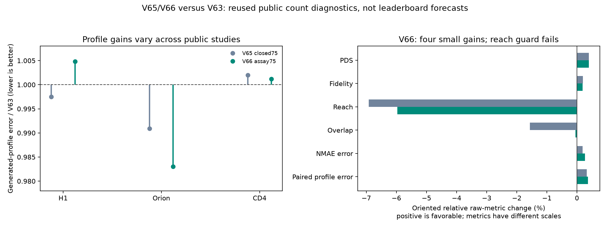

# V65 measured response and count results

**Status: tested alternative; no production upload file generated.** V63 remains the best published project submission, overall 0.150422795. No V65/V66 leaderboard result is known.

## Fixed response screen

| Response candidate | Profile error / V63 | LFC MSE / V63 | LFC MAE / V63 | PDS change | Eligible? |
| --- | ---: | ---: | ---: | ---: | :---: |
| reclosed50 | 1.006001214 | 1.006360306 | 1.003086089 | +0.000000000 | False |
| closed50 | 1.004176387 | 1.003205449 | 1.002231416 | +0.000000000 | False |
| closed75 | 0.997291243 | 1.001204837 | 1.001545919 | +0.000000000 | True |

These are desired-mean diagnostics over the canonical first case for each of 30 unique target/context pairs. Contexts are averaged within study, then three studies equally. Profile ratios compare summed target errors within context to V63, excluding each intervention's own gene. PDS excludes all 300 panel targets. LFC errors have the inherited expression/support masks. Lower errors are better. These are repeatedly reused public datasets; no new independent biological confirmation is claimed.

Locked count candidate: `closed75`. No alternate arm was promoted after count scores. V65 tests available-axis reclosure/perturbation closure; V66 is the strength-matched original-assay control. The normalized half-strength variants were rejected. A stronger correction in the original representation must be compared before crediting normalization for a gain. See [V65 protocol](V65_STRATEGY.md) and [V66 protocol](V66_STRATEGY.md).

## Complete paired integer-count tests

| Count arm | PDS | Fidelity | Reach | Jaccard | NMAE error | Profile squared error |
| --- | ---: | ---: | ---: | ---: | ---: | ---: |
| v24 | 0.775992063 | 0.582899470 | 0.218768191 | 0.061749508 | 0.910023085 | 66.223261340 |
| v63 | 0.756150794 | 0.584463011 | 0.241977612 | 0.061057561 | 0.903559862 | 64.726893779 |
| closed75 | 0.759126984 | 0.585628047 | 0.225232046 | 0.060100113 | 0.901884958 | 64.679389684 |
| closed75_shuffled | 0.773015873 | 0.582182501 | 0.236933909 | 0.061393490 | 0.909060837 | 65.321423669 |

| Public study | Profile error / V63 | PDS change | Fidelity change | Reach change |
| --- | ---: | ---: | ---: | ---: |
| H1 | 0.997469372 | +0.000000000 | +0.000103857 | -0.002513113 |
| Orion | 0.990915238 | +0.000000000 | -0.001105757 | -0.050886625 |
| CD4 | 1.001967152 | +0.008928571 | +0.004497010 | +0.003163042 |

These are external public study groups; they do not identify anonymous contexts A, B or C.

There are 240 comparison records: 30 unique target/context pairs, two technical generation seeds, four arms (V24, V63, primary and shuffled). Reused baseline files are byte-checked computations, not extra biology. Canonical target selection avoids repeated-label PDS competitors. Both generations use the same measured truth, so they are not independent replicates.

Public guard result: **False**. Failed checks: **reach, jaccard, beats_shuffle_pds**. Lower NMAE and profile errors are favorable; PDS/FID/REACH/JAC increase when favorable. HCT116's unresolved NMAE remains missing; the summary averages available studies for that metric. No official hidden anchors are estimated. The table's profile column averages absolute squared errors; the following paired ratio instead averages within-study candidate/baseline ratios, so it is not the ratio of those two table averages.

Paired equal-study generated-profile error / V63: **0.996783921** (-0.322%). Per-seed ratios: `{'0': 0.9967687369955461, '620000': 0.9967991054171678}`. Leave-one-context-target-out range: **0.995466084 to 1.001413480**. Where the leave-one-out range crosses one, removing a single target/context reverses the aggregate gain. These are influence/technical-seed diagnostics, not confidence intervals or independent biological replication.

The serialized auditor independently replays fidelity, Jaccard, NMAE, call counts, PDS and profile error across all 240 records and 40 panels, and verifies reuse receipts and arrays. The legacy cache omits raw p values used for reach tie ordering; no full serialized reach replay is claimed. The selected release receives ten fresh prespecified first-target count/DE replays across all contexts/seeds, including an independent raw-p reach ordering check. Production integrity is checked separately.

## Measured count trade-off

Each relative raw-metric change has its own scale. The percent bars must not be averaged or interpreted as official anchored-score contributions.

## Broader identity and expression check

The same existing raw extractions support 655 target/context pairs with at least 30 treated cells. On desired means before count generation, equal-study PDS change versus V63 is **+0.002793371** and profile error ratio is **1.001747760**. Profile scoring excludes own/unmeasured genes; PDS excludes the whole target panel. This broader result is diagnostic, not another selection set; no strength was changed to improve it.

The broader expression ratios are slightly worse than V63 for both variants, while the small fixed response/count cohorts show some gains. This disagreement and the failed count guards limit the evidence. No substantial rank improvement is demonstrated. Any released file is a bounded experimental test of a fixed candidate, not a replacement proven superior on the challenge. The unchanged generator still has the previously documented control-null DE calibration problem.

## Reproduction and provenance

Root scripts and exact input/implementation hashes are recorded in plan.json and production_plan.json; the whole-study source exclusions and poisoning checks pass. V66 also replays V63 bitwise at its original correction strength in every context. D3 remains unopened. Source studies, outputs and controls have been examined repeatedly in earlier versions; per-study source exclusions prevent recipient response leakage but do not create fresh model-selection data.

[V65 protocol](V65_STRATEGY.md) · [V66 protocol](V66_STRATEGY.md) · [All published submissions](V65_SUBMISSION_HISTORY.md) · [Selected submission and limitations](V65_V66_SUBMISSION.md). Compact receipts are saved under experiments/v65_closed_response/analysis. The selected package receives official prep plus full payload/axis/provenance checks and 12 full-group production replays. These are integrity checks, not hidden accuracy tests. No automatic upload or Git push.
