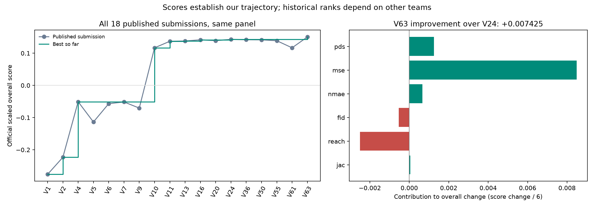

# Submission history and the next experiment

The project has **18 recorded published submissions**. Every receipt uses validation panel `vcc2026-val-1` and the same anchor set. The table compares each submission with the best earlier project score. Historical ranks are affected by other teams and dates; score improvement is the reliable comparison available here. All six CLI components are scaled accuracies, with higher values better.

| Submission | Main change | Overall | Change vs prior best | New best? |
| --- | --- | ---: | ---: | :---: |
| V1 | Public CRISPR transfer | -0.276290 | initial | yes |
| V2 | Donor-calibrated CD4 hybrid | -0.223325 | +0.052964 | yes |
| V4 | Lineage-guided response coverage | -0.050674 | +0.172652 | yes |
| V5 | Atlas-calibrated dual moments | -0.113637 | -0.062963 |  |
| V6 | Fidelity-guarded lineage response | -0.056790 | -0.006116 |  |
| V7 | V4 fallback resampling | -0.051387 | -0.000713 |  |
| V9 | Activation-preserving profile calibration | -0.070447 | -0.019773 |  |
| V10 | Pooled intervention population transport | 0.116754 | +0.167428 | yes |
| V11 | Consensus coverage and dispersion | 0.137004 | +0.020250 | yes |
| V13 | Assay-aware knockdown transport | 0.137883 | +0.000879 | yes |
| V16 | Response residual dispersion | 0.141614 | +0.003731 | yes |
| V20 | Stack-calibrated response ensemble | 0.139012 | -0.002602 |  |
| V24 | Context-matched donor response | 0.142998 | +0.001384 | yes |
| V36 | Retrieval-contrast correction | 0.141845 | -0.001152 |  |
| V50 | Empirical response prior | 0.141523 | -0.001475 |  |
| V55 | Fixed V24/V36 half-blend | 0.138767 | -0.004231 |  |
| V61 | Pooled state-response transfer | 0.116763 | -0.026234 |  |
| V63 | Identity-guarded assay response | 0.150423 | +0.007425 | yes |

## What has actually helped

- V2 and V4 improve the initial weak transfer through donor/context calibration and response coverage, but overall remains negative.
- V10 changes pooled intervention response and population transport together. Its +0.167428 gain over the previous best V4 comes mostly from fidelity (+0.110253 contribution to overall) and PDS (+0.052860). These are arithmetic contributions, not an isolated causal test of the components.
- V11 adds consensus coverage/dispersion: +0.020250 over V10, improving five components while losing expression accuracy.
- V13, V16 and V24 add smaller gains. V24 improves all six components over V16; its context-matched CD4 response is a useful conservative reference.
- V63 gains +0.007425 over V24, driven by expression (+0.008484 contribution), with further PDS, NMAE and overlap gains. Fidelity and reach decline. Its changed response representation is worth investigating while keeping the established generator as a controlled comparator.

## What has not earned a better published score

V5/V6/V7/V9 do not beat V4. Stacking V20, retrieval/population-view correction V36, empirical response prior V50 and fixed V24/V36 blending V55 do not beat V24. State-response transfer V61 regresses to 0.116763. This does not prove that every ensemble or neural model fails; these particular changes did not transfer successfully to the hosted panel. Combining the best scalar metric from different submissions cannot construct a valid population prediction.

Many version numbers are local experiments with no published score. Their evidence is kept separate:

| Experiment family | Local finding |
| --- | --- |
| V12/V14/V15/V17-V23 | Response calibrations, specialist/ensemble and population variants; see their individual result reports. Published descendants V13/V16/V20/V24 provide the hosted evidence. |
| V25-V29 | Intervention geometry, neural decoder and control-preserving transport; no candidate passed its release checks. Better control-null behavior alone did not ensure treatment fidelity. |
| V30-V34 | STRING/construct features, guide-aware correction, paired transfer, tabular foundation model and flow model; failed mean screens or shuffled-control comparisons. |
| V35-V37 | Retrieval/residual training, population views and component ensembles; V36 was published but lost to V24; V37 blends failed local guards. |
| V38-V44 | Activity/direction heads, KOLF data, contrastive identity, LINCS fingerprints and increased residual dispersion; failed relevant gates or target-shuffled controls. |
| V45-V50 | Residual reduction, population mixtures, corroboration, exact-margin projection/rounding and response priors. Numerical improvements did not establish better biology; published V50 lost to V24. |
| V52-V55 | Joint mean/rank neural prediction, feature correction and decoder/blend diagnosis. Joint heads did not provide reliable transfer; published V55 lost to V24. |
| V56-V58 | PIE evaluation with genuine saved training-response evidence and separate heads. Mean gains did not beat adequate controls or produce a validated count-decoder gain. |
| V59-V61 | State abundance/within-state transfer and depth adjustment. Public transfer checks failed; published V61 regressed. |
| V62-V64 | Assay/common-response transformation, identity guard and scalar magnitude control. V63 improved privately despite failed public gates; V64 failed count checks and was not uploaded. |

The 300-gene control-expression reconstruction networks model observational coexpression, which does not establish causal CRISPR response transfer. The repeatedly used public cohorts also provide weak validation: 44 case configurations reduce to 30 unique target/context pairs and 34 distinct measured cell sets. Seeds and overlapping cell sets do not add independent biological studies. Local PDS often ranks candidates differently from the hosted panel; zero-shot baseline geometry guards protect our prior predictions, not ground truth.

## V65 decision

Test available-axis source normalization and normalized source perturbation profiles before assay-space transfer. Keep the V24 count generator and geometry guard, compare with **V63** as the current best reference, and include V24 and a shuffled-target diagnostic. Select only with the frozen desired-mean rule before opening new counts, then report the complete locked count comparison. This targets a concrete units/composition assumption revealed by the successful V63 estimator rather than adding another unvalidated predictor to a blend.

[Protocol and commands](V65_STRATEGY.md). The new candidate's measured results and final packaging decision are documented separately; no private V65 score is inferred.

The history loader asserts score arithmetic and records every source receipt hash in `published_history.json`; `published_history.csv` contains the full component data and historical rank snapshots. Reproduce with `review_v65_history.py` followed by `document_v65_history.py`. Earlier reports remain historical snapshots and are not overwritten.
