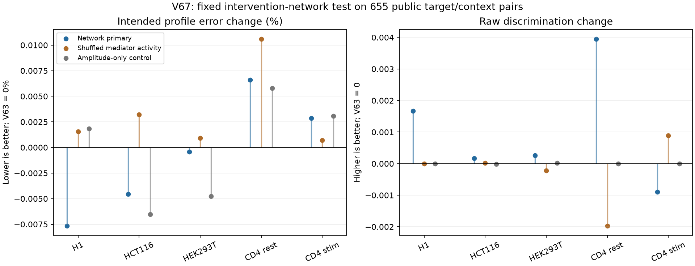

# V67 results: intervention-network rewiring

The fixed network primary **did not pass its release criteria**. Across all **655 target/context pairs**, equal-study intended profile error changes **-0.0018% versus V63** and **-0.0919% versus V66**. Raw discrimination changes **+0.0011366 versus V63**. No V67 submission cells or upload file were generated; V66 remains the highest published score, with V63 the near-tied reference.

## What was actually different

The model derives a bounded interaction operator from measured responses of the 300 target genes to each other's knockdowns. It re-solves the feedback system after changing outgoing mediator availability using recipient controls, then transports the change in source response onto V63. It is neither a STRING embedding predictor nor a control-covariance transport. The operator and saturation rule are predictive assumptions, not identified causal biology. [Protocol, formulas, limitations and references](V67_STRATEGY.md).

## Broad results

| Study | Profile error change vs V63 | PDS change vs V63 |
| --- | ---: | ---: |
| H1 | -0.008% | +0.001667 |
| Orion | -0.002% | +0.000212 |
| CD4 | +0.005% | +0.001531 |

The whole-target diagnostic development profile ratio is **0.999946912**, confirmation **1.000013821**, and canonical-small target-subset ratio **1.000001722**, all versus V63. The canonical-small subset uses the same full treatment populations as this broad test; it does not recreate the old 200/400-cell samples. Target partitions reuse previously studied public biology and are not an independent blind test.

Matched control profile ratios versus V63: **shuffled mediator availability 1.000030924**, **amplitude-only projection 1.000002105**. These ratios are errors, with lower better. None is a private anchored accuracy. The primary and controls were fixed before outcomes and only the primary could qualify.

Failed fixed checks: profile_vs_v63, confirmation_profile_vs_v63, profile_vs_v66. All 12 check outcomes and all subgroup metrics are in `experiments/v67_intervention_network/analysis/mean_results.json`. Count generation was conditional on passing this stage and was not run. No claim is made about V67's hosted score or its DE fidelity, reach or overlap.

## What this experiment establishes

This particular baseline-conditioned feedback construction does not meet the improvement needed to justify another upload. It does not rule out all regulatory-network models: only 300 intervention nodes are represented; source effects are noisy, many source measurements are absent, the 90% interventions are not small perturbations, and availability of a transcript is not equivalent to regulatory activity. The stability cap and valid-output requirement also make accepted corrections small. Per-context source coverage and correction magnitudes are saved in `network_diagnostics.json`.

Do not increase feedback strength or choose a control arm using these outcomes. Any revised model requires its own protocol and validation. Improving our validation still matters: the full and canonical-small target subsets are now compared under the same bulk-profile calculation and actual treatment populations. The project still lacks convincing study-independent evidence for a large leaderboard gain; this experiment does not supply it.

## Verification and reproducibility

Seven numerical tests pass, including recovery of a known synthetic feedback network, indirect chain propagation, exact unchanged-context identity and missing-data abstention. Recipient-evidence poisoning passes for all three studies (H1, Orion and CD4), covering 25, 573 and 604 source-summary rows respectively. All 300 panel output genes remain exactly V63, with own-target knockdown applied separately only if cells were generated.

The result auditor checks bitwise equality of saved V63/V66 baseline arrays, query/bulk profiles and measured masks; all 3,275 arm/target/context records share their treatment populations; the 655-pair cohort size and all macro error ratios independently reconcile. It checks saved arithmetic and constraints, not a full independent reimplementation of every raw extraction and graph prediction. No private treatments or D3 reserve are used. Original releases and their seals remain unchanged.

Reproduce with the commands in [V67_STRATEGY.md](V67_STRATEGY.md), then run `audit_v67_results.py` and `document_v67_results.py`. Scientific source and compact receipts are committed; large arrays are regenerable and ignored. The pre-outcome protocol was committed as `d75504c`. A separate result manifest binds the protocol, audit, outputs and their inputs; README is mutable and excluded. Nothing is uploaded or pushed automatically.
