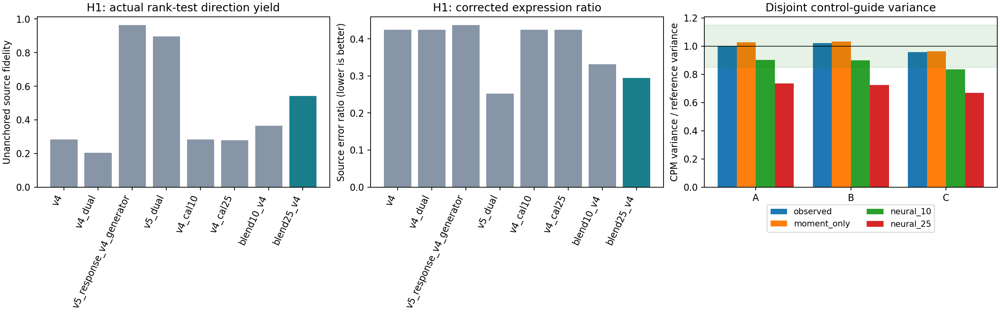
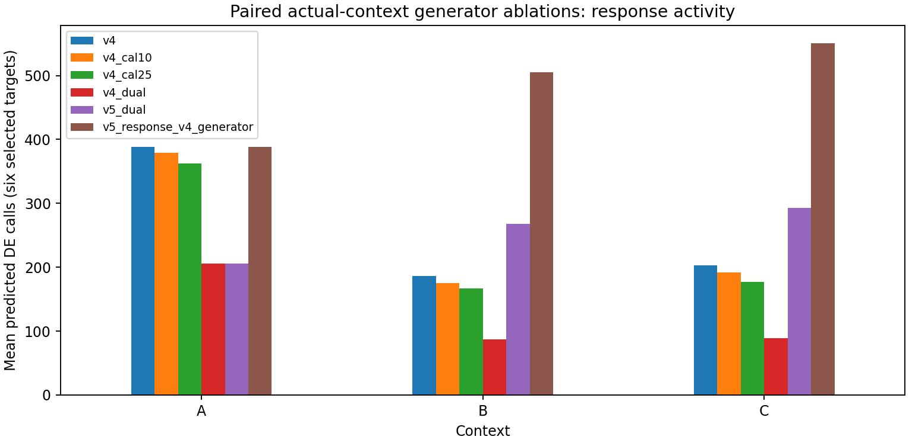

# V6: fidelity-guarded submission ready for upload

Created, officially packaged and independently verified at `experiments/v6_fidelity_calibrated/prediction.vcc`. It has **not been uploaded or scored**. V4 remains the best published project submission; no local benchmark establishes a better hidden score.

| Check | Result |
|---|---|
| Shape | 360,000 cells by 18,533 genes |
| Groups | 900 target/context combinations, 400 cells each |
| Stored counts | 2,086,258,688 positive integer values |
| Maximum cell library | 53,041 counts |
| Package size | 3,309,619,200 bytes (3.08 GiB) |
| Frozen candidate | `blend25_v4` |
| Settings | `{"blend": 0.25, "calibration": 0.0, "dual": false}` |
| Neural template weight | 0 |
| Source perturbations | 25 targets, two disjoint batch directions, two generation seeds, eight configurations |
| Primary setting-selection targets | 9; at least 200 distinct evaluation cells in both partitions |
| Counts and axes | Every stored count and all 360,000 libraries checked; exact official gene/label axes |
| Control provenance | Every original row, cell ID, guide and library checked; 400 distinct controls and 8-9 cells per guide in each group |
| Exact count replay | 12 complete groups; 88,958,400 gene counts |
| Focused tests | Seven passed |
| Official packaging | VCC prep passed; every compressed payload count, CSR index/pointer, axis and label matches generated H5AD |

SHA-256:

```text
4950ffe451fea2eb5a34475c4358435d985db38a55cbc3e2616483d5a404731e
```

## What was selected

A retains all V4 mean-response effects. B/C can only blend existing effects that agree in sign with V5, with a maximum blend of 25%; V4 zeros and conflicting directions remain unchanged. The frozen candidate actually uses the settings above. No A promoter correction or neural knockdown counterfactual was added.

The benchmark separates V4-like source effects, full dual-moment generation, partial stochastic count calibration, V5-like source gain/pooled calibration and small response blends. Source blends change the held-out H1 contrast gain from 0.7 toward 1.5. The production B/C blend additionally combines the frozen lineage estimators and applies the sign/zero mask; its complete 900-response policy is not reproduced by that source-only comparison. Full V5 response replacement is a diagnostic and is ineligible for production. The authoritative production record is `reference_model.json`; `source_selection.json` retains the earlier unrestricted source diagnostic.

Partial calibration, when selected, first generates V4 binomial-thinned/depth-scaled Poisson-added counts. It mixes the emitted mean and pooled probabilities with response-implied desired probabilities at the selected weight, then fits/rounds those profiles while preserving every stochastic cell's resulting library size. Full dual generation, when selected, starts from original individual controls. Mean and pooled targets always come from the same response estimator. Zero calibration retains the V4 generator.

All groups use separately seeded draws of 400 unique real A/B/C controls balanced over the 46 guides and depth. The seed is 20261007. Own-target knockdown remains the explicit 90% assumption, separate from downstream effects; scoring excludes that gene but its library-normalization consequences still matter.

## Measured source validation

Source cells are the pinned expanded public H1 cache, with all original IDs and counts verified. Its 1,536 controls form two batch partitions, each split into 384 template controls and 384 disjoint reference controls; source evaluation groups therefore have at most 384 cells. Estimation and evaluation batches are opposite global partitions. Evaluation-template controls and DE-reference controls are disjoint IDs within the evaluation partition. Every reference group uses distinct actual perturbed cells, capped at 400 and at the template-pool size; smaller groups are not expanded by duplication. Hyperparameters are selected using other targets in each of five outer folds.

The primary targets are: ACLY, ANKZF1, HDAC8, MED15, MED25, NFE2L1, PLAGL2, SLIRP, ZNF32. All smaller groups remain in `source_generator_scores.csv` and `source_candidate_summary.csv` as separately scoped diagnostics.

| Candidate | Fidelity | Reach | Jaccard | LFC NMAE | Expression ratio | PDS |
|---|---:|---:|---:|---:|---:|---:|
| v4 | 0.2833 | 1.0000 | 0.2129 | 0.4884 | 0.4246 | 1.0000 |
| v4_dual | 0.2030 | 1.0000 | 0.1631 | 0.4889 | 0.4240 | 1.0000 |
| v5_response_v4_generator | 0.9637 | 1.0000 | 0.2610 | 0.3536 | 0.4371 | 1.0000 |
| v5_dual | 0.8953 | 1.0000 | 0.3228 | 0.3528 | 0.2526 | 1.0000 |
| v4_cal10 | 0.2825 | 1.0000 | 0.2128 | 0.4883 | 0.4245 | 1.0000 |
| v4_cal25 | 0.2797 | 1.0000 | 0.2109 | 0.4881 | 0.4242 | 1.0000 |
| blend10_v4 | 0.3645 | 1.0000 | 0.2532 | 0.4452 | 0.3314 | 1.0000 |
| blend25_v4 | 0.5420 | 1.0000 | 0.3039 | 0.3851 | 0.2944 | 1.0000 |

These are raw, unanchored source measurements. DE uses actual two-sided asymptotic Wilcoxon tests on per-cell CPM, a control-only >5 CPM gene filter and within-group BH; the own target is removed from reported metrics. Fidelity uses the call/reference budget, reach uses the confidence ordering and 90% prefix purity, and NMAE/Jaccard use the reference significant sets. PDS excludes all official panel-target genes and ranks only the available source-target panel. Expression uses the delete-one jackknife/capped-noise ratio on the source panel. There are no competition baseline/replicate anchors here. Source PDS with fewer than two targets is undefined.

Paired primary-target differences and 10,000 target-cluster bootstrap intervals are recorded in `paired_source_uncertainty.csv`; target-level outcomes are in `source_target_diagnostics.csv`. Both emission seeds and both batch directions stay within the resampled target. These are exploratory intervals on nine previously inspected public H1 targets, rather than uncertainty estimates for the competition score.

Nested production selection metrics: `{"expression_ratio": 0.6261925965453381, "fidelity": 0.5420156637773855, "jaccard": 0.3038791232352864, "nmae": 0.3851345866694516, "pds": 1.0, "reach": 1.0, "uncorrected_profile_mse": 0.000998310143536843}`.

Nested unchanged-source comparator: `{"expression_ratio": 0.7343332346490561, "fidelity": 0.28326047432447143, "jaccard": 0.21287509586550893, "nmae": 0.48839790575518394, "pds": 1.0, "reach": 1.0, "uncorrected_profile_mse": 0.0010527169479200749}`.

Full dual fitting reduced response-call budgets markedly in the paired context audit. Production generators must therefore retain at least 90% of the V4 call budget in every context on the six selected targets. This is a conservative activity guard, not proof that these calls are biologically correct.

Adoption requires competitive held-out fidelity and overlap (maximum 0.005 raw decline) and no corrected-expression-error increase. The within-training comparison uses fidelity + overlap + 0.5*(1-expression ratio), a fixed source proxy rather than official anchor scaling. Outer results are weighted by the number of primary targets. The table's full nine-target expression ratio differs from the weighted fold ratio because the jackknife correction depends on each panel's prediction spread. If nested adoption is unsupported, the frozen model falls back to V4 response/generation. All settings were locked before generating this package.

The H1 sources and earlier source results have been inspected in previous work. This is a comparative ablation on those data, not a new independent dataset. Source calibration cannot establish anonymous A/B/C efficacy. There are no cell-level CD4 donor references in the summary release to validate this complete generator in A.

## Neural template decision

The selected train-guide-only neural models were tested on disjoint validation-guide templates and test-guide reference controls, twice per context. Training-guide moments calibrate the candidates. The test guides were inspected previously, so these are comparative control diagnostics. 25% neural weights fail the distribution gate in all three contexts; 10% fails it in C. Small neural weights can improve pooled-control error while reducing variance, illustrating why reconstruction MSE alone does not justify them for DE. A/B 10% pass the control gate but have no measured perturbation-level benefit. Production therefore retains empirical residual variability with neural weight zero.

## Actual-context generator ablation

The four response/generator combinations and two partial corrections were also generated for six selected targets per context with identical original-control draws. Actual Wilcoxon/BH calls and dispersion are retained in `context_generator_ablation.csv`. This tests emitted response activity and numerical behavior against supplied controls; it has no hidden response truth and cannot attribute V5's fidelity loss to a component.





## Reproduce from Windows Command Prompt

Requires the unchanged competition controls, V4/V5 arrays/source caches, public H1 selected counts, neural evaluation weights and pinned reviewed upstream clone. No new source download or hidden response labels are used.

```cmd
cd /d L:\promec\Animesh\Download\Virtual
.\.competition_env\Scripts\python.exe calibrate_v6_submission.py
.\.competition_env\Scripts\python.exe evaluate_v6_neural_templates.py
.\.competition_env\Scripts\python.exe audit_v6_generators.py
.\.competition_env\Scripts\python.exe audit_v6_generators.py --partial-only
.\.competition_env\Scripts\python.exe -m unittest test_v6_submission -v
.\.competition_env\Scripts\python.exe fit_v6_submission.py
.\.competition_env\Scripts\python.exe validate_v6_submission.py --model-only
.\.competition_env\Scripts\python.exe build_v6_submission.py --preflight --workers 4
.\.competition_env\Scripts\python.exe build_v6_submission.py --workers 4
.\.competition_env\Scripts\python.exe validate_v6_submission.py
.\.competition_env\Scripts\python.exe document_v6_submission.py
```

Generated outputs refuse overwrite. Use a fresh experiment version for subsequent changes. Code, compact source/selection records, all source/control identities, verification records and figures are versioned; numerical NPZ caches and large H5AD/VCC files remain local.

## Submit

```cmd
cd /d L:\promec\Animesh\Download\Virtual
.\.competition_env\Scripts\python.exe -m vcc submit .\experiments\v6_fidelity_calibrated\prediction.vcc -m "Fidelity-guarded lineage response v6" --wait
```

This uploads a new entry. Preserve its ID and six metrics to compare against V4 and V5 on the same panel/anchor set. Original planning and frozen V4/V5 effect comparisons remain in [V6_MODEL_STRATEGY.md](V6_MODEL_STRATEGY.md).
