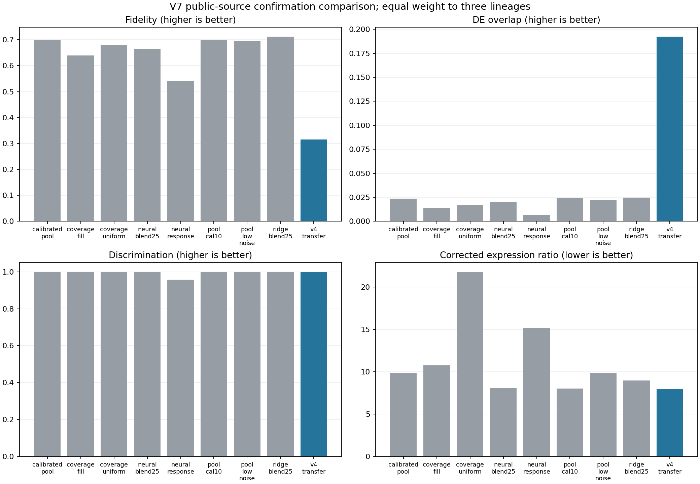

# V7 submission: V4 transfer fallback after expanded-source comparison

The upload-ready file is `experiments/v7_multisource_adaptive/prediction.vcc` (3,308,800,000 bytes). It has **360,000 cells x 18,533 genes**, with all 300 targets x 400 cells in A, B and C. Official packaging and independent full-payload validation passed. The package has not been uploaded and has no hidden leaderboard score.

SHA-256: `9bafac870c3eec270015f568e67aad45fd06afdea35bd3b495fec64d7de6a5af`.

## Frozen decision

Generated-cell candidate: **v4_transfer**. Count generator: **v4**. Production pooling configuration: `uniform_a065 (screened, unused by the selected fallback)`. Calibration winner: `v4_transfer`; confirmation improvement accepted: `False`.

This is a new count realization of the V4-style transfer fallback. The expanded sources, pooling, neural heads and ridge blend were evaluated, but no alternative passed the calibration guards. Those new response estimates are not incorporated into this package. An independent array comparison found the response effects exactly equal to published V4 (maximum absolute log2 difference 0); the generated counts use a new seed. There is no demonstrated improvement over the published V4 submission.

A uses the prior directly measured CD4 response, with K562 fallback; B/C use prior H1/CD4/K562 transfer and the H1 shared prior. These are biological transfer assumptions, not identified challenge lineages.

This uses public CRISPRi interventions, conservative measured-label masks and each query context's own controls. Count sampling seed is 20261008. The 90% own-target knockdown and low-expression gates remain assumptions. The model does not infer the challenge's hidden perturbation truth from control correlations.

## Source coverage and integrity

| source | selected_cells | targets | eligible_targets | batches | measured_genes | excluded_missing_cells |
| --- | --- | --- | --- | --- | --- | --- |
| HCT116 | 52295 | 300 | 282 | 109 | 18106 | 67 |
| HEK293T | 70082 | 300 | 291 | 223 | 18106 | 0 |

Both converted-source expression fragments were audited for absent cells and shifted offsets. Duplicate-name suffixes were mapped through the original canonical integer gene metadata and summed, rather than losing counts. Every selected raw cell ID and full library was checked before projection. Two independent original-Parquet checks verified all challenge-axis counts for 32 Batch1 cells per source. K562's full raw matrix was inspected and confirmed to share its existing 7,681-gene challenge overlap; downloading it would not broaden the output axis.

## Public generated-cell evidence

| source | targets | calibration_targets | confirmation_targets | observed_cells_min | observed_cells_max | prediction_cells |
| --- | --- | --- | --- | --- | --- | --- |
| H1 | 11 | 6 | 5 | 291 | 400 | 400 |
| HCT116 | 18 | 9 | 9 | 209 | 400 | 400 |
| HEK293T | 18 | 9 | 9 | 205 | 400 | 400 |

There are two paired seeds. Each evaluated lineage is excluded from response fitting; tuning is nested in other lineages. Actual treated cells number 200-400, while all candidates generate 400 predictions and use 400 distinct matched-batch reference controls. Templates/reference controls never overlap. Calibration and confirmation targets are distinct. Previously inspected public data remain development data.

The following averages use only confirmation targets and give equal weight to the three source lineages. Undefined per-target DE metrics are omitted from their corresponding means; they are not assigned perfect or zero accuracy. Values are raw metrics, **not leaderboard-normalized scores**. A local improvement does not guarantee a hidden score gain.

| candidate | pds | fidelity | reach | jaccard | nmae | expression_ratio | template_variance_ratio |
| --- | --- | --- | --- | --- | --- | --- | --- |
| calibrated_pool | 1.000000 | 0.699295 | 0.639190 | 0.023440 | 0.691683 | 9.854876 | 0.979989 |
| coverage_fill | 1.000000 | 0.639715 | 0.488557 | 0.014071 | 0.867742 | 10.743707 | 0.987564 |
| coverage_uniform | 1.000000 | 0.679225 | 0.642308 | 0.017387 | 0.718084 | 21.792948 | 0.969057 |
| neural_blend25 | 1.000000 | 0.665449 | 0.600192 | 0.020189 | 0.732514 | 8.084067 | 0.986195 |
| neural_response | 0.958333 | 0.541112 | 0.242910 | 0.006332 | 0.891862 | 15.154882 | 0.995146 |
| pool_cal10 | 1.000000 | 0.698717 | 0.638414 | 0.023991 | 0.692273 | 8.023667 | 0.979199 |
| pool_low_noise | 1.000000 | 0.695396 | 0.658866 | 0.021820 | 0.692750 | 9.881593 | 0.978119 |
| ridge_blend25 | 1.000000 | 0.712258 | 0.661931 | 0.024477 | 0.700286 | 8.963501 | 0.982509 |
| v4_transfer | 1.000000 | 0.315983 | 0.522230 | 0.192491 | 0.863116 | 7.919291 | 0.991478 |



Selection and guards:

| candidate | calibration_utility | calibration_guard | confirmation_utility | confirmation_guard |
| --- | --- | --- | --- | --- |
| v4_transfer | 0.281829 | True | 0.259366 | True |
| coverage_fill | 0.245891 | False | 0.212434 | False |
| coverage_uniform | 0.253398 | False | 0.270139 | False |
| calibrated_pool | 0.290961 | False | 0.278374 | False |
| pool_low_noise | 0.291949 | False | 0.280555 | False |
| pool_cal10 | 0.295062 | False | 0.278142 | True |
| neural_response | 0.198578 | False | 0.175532 | False |
| neural_blend25 | 0.284820 | False | 0.262166 | True |
| ridge_blend25 | 0.294345 | False | 0.283063 | False |

The utility is a declared mean of raw discrimination, fidelity, reach, overlap, clipped 1-NMAE and clipped 1-expression ratio. Fidelity must remain within 0.01 of baseline, expression ratio within 1.05 times baseline and template variance at least 0.9 times baseline. No candidate is accepted by expression MSE alone. The fallback was selected because alternatives worsened calibration expression error beyond its guard, despite higher raw fidelity in several cases; DE overlap also fell sharply. The next response-model experiment should diagnose that expression shift and unsupported DE calls before adding model complexity. Fast summary-stage normal/SE proxies are followed by actual generated-cell Wilcoxon/BH tests.

## Validation and reproducibility

Nine focused scientific tests passed, including measured-zero versus missing-source handling, matched-batch neutrality, expected-count preservation and conservative ridge label masks. Neutral H1 controls produced zero false DE calls for each tested count generator. Full submission auditing checked all 900 groups, all 360,000 cell libraries and every packaged nonzero value/index/pointer; twelve groups were exactly replayed from their recorded controls and seeds. The independent audit is `experiments/v7_multisource_adaptive/analysis/independent_validation.json`.

The complete steps, pinned sources, assumptions and model scope are in [V7_MODEL_STRATEGY.md](V7_MODEL_STRATEGY.md). Root scripts include preparation, source-offset repair, three neural architectures, four ridge penalties, source-held response/count comparisons, conservative coverage filling, production fitting, sparse generation and independent validation. The small neural response heads implement an intervention-conditioned transition idea; this is not a faithful Arc STATE foundation-model reproduction.

## Upload using Windows CMD

```bat
cd /d L:\promec\Animesh\Download\Virtual
.\.competition_env\Scripts\python.exe -m vcc whoami
.\.competition_env\Scripts\python.exe -m vcc submit .\experiments\v7_multisource_adaptive\prediction.vcc -m "V4 fallback resampling v7" --wait
```

If waiting is interrupted after upload, resume status polling for the returned entry ID rather than submitting again:

```bat
.\.competition_env\Scripts\python.exe -m vcc status ENTRY_ID --wait
```

The scripts and reproducibility records are committed locally. Large data caches, model arrays and submission packages are ignored by Git and remain in the project folder.
